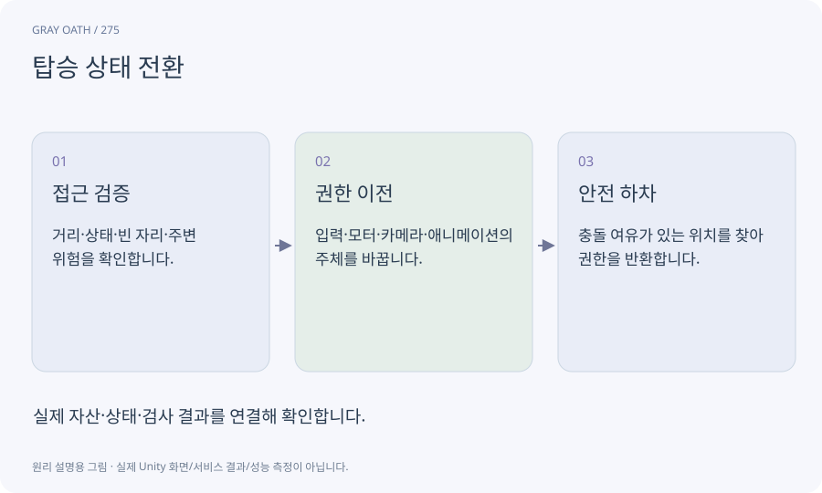

# 탑승 상태 전환

플레이어와 탈것 사이에서 입력·카메라·위치 소유권을 넘기는 상태 전환입니다. 단순히 캐릭터를 말의 자식으로 만드는 것보다 많은 책임이 있습니다.

## 익숙한 비유

운전석에 앉으면 보행이 아니라 차를 조종하고, 내릴 때 안전한 자리에 서는 것과 같습니다.



## 작동 원리

### 1. 접근 검증

거리·상태·빈 자리·주변 위험을 확인합니다.

### 2. 권한 이전

입력·모터·카메라·애니메이션의 주체를 바꿉니다.

### 3. 안전 하차

충돌 여유가 있는 위치를 찾아 권한을 반환합니다.

## 게임 속 예

말 왼쪽이 벽이면 오른쪽을 검사하고 양쪽이 막히면 하차를 거부합니다. 사망·로드·취소도 같은 정리 경로를 탑니다.

## 혼동하지 않기

탑승 중 보행 모터가 여전히 위치를 바꾸면 떨림과 충돌이 생깁니다.

## 확인 질문

말이 갑자기 사라졌을 때 플레이어는?

유효한 안전 위치로 복귀하고 입력·카메라 소유권을 확실히 되돌립니다.

## 내 프로젝트에서 확인하기

```text
현재 GrayOathRPG3D에서 탑승 상태 전환을 사용하는 실제 대상과 동작을 읽기 전용으로 확인해 줘. 쉬운 말과 작은 사례로 설명하고 탑승 중 보행 모터가 여전히 위치를 바꾸면 떨림과 충돌이 생깁니다. 이 문제를 어떻게 막는지 보여 줘. 코드·데이터·설정은 아직 수정하지 마.
```

## 관련 해설

[state-machine](state-machine.md) · [motor](motor.md) · [clearance](clearance.md)

## 공식 참고

- [Unity · NavMeshLink](https://docs.unity3d.com/Packages/com.unity.ai.navigation@2.0/manual/NavMeshLink.html)
