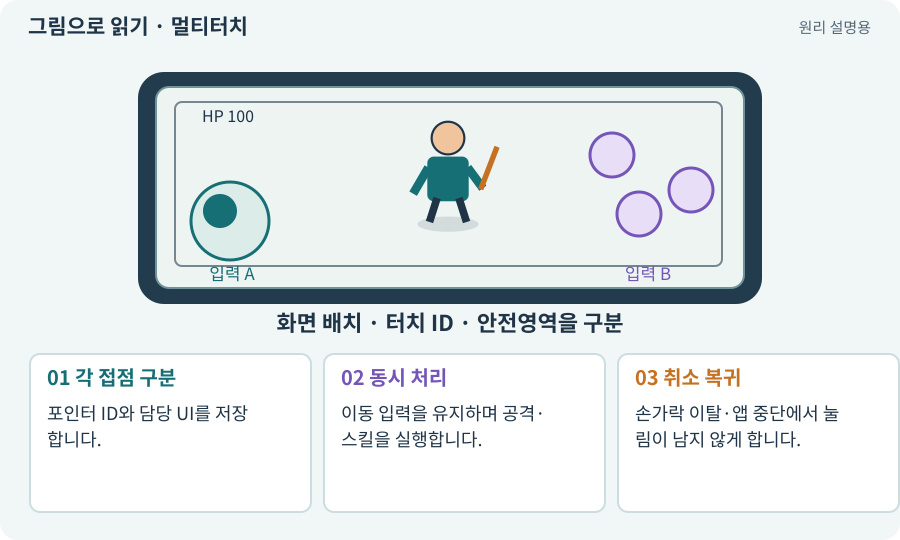

# 멀티터치·가상 조이스틱

**분야:** 입력·UI·소리·성능

멀티터치는 여러 접점을 동시에 구분하는 입력입니다. 가상 조이스틱은 화면 드래그를 방향과 강도로, 가상 버튼은 화면 누름을 행동으로 바꿉니다.

**찾아오는 이름:** 멀티터치·가상 조이스틱, 멀티터치, 두 손가락, 가상 조이스틱, On-screen Control, OnScreenStick, OnScreenButton

## 익숙한 것에 비유하면

왼손으로 운전대를 잡고 오른손으로 버튼을 누르는 것처럼 독립적인 두 입력을 유지하는 것입니다.



개념도입니다. 실제 Unity 화면이나 검사 결과가 아닙니다. 그림의 순서·색은 역할을 구분하며 실제 설정값은 프로젝트에서 확인합니다.

## 이렇게 작동합니다

### 1. 각 접점 구분

포인터 ID와 담당 UI를 저장합니다.

### 2. 동시 처리

이동 입력을 유지하며 공격·스킬을 실행합니다.

### 3. 취소 복귀

손가락 이탈·앱 중단에서 눌림이 남지 않게 합니다.

## 두 손가락은 서로 다른 생명주기를 가집니다

왼손의 누름·이동·해제와 오른손의 누름·이동·해제를 각각 pointerId로 추적합니다. 오른손을 뗐다는 이유로 왼손의 Move 값을 0으로 만들지 않습니다.

화면 밖으로 드래그하거나 앱이 백그라운드로 갈 때 누름이 고착되지 않게 취소·포커스 상실·해제를 정리합니다. 버튼이 다른 UI로 바뀌는 순간 이전 터치의 클릭이 새 버튼에 전달되지 않는지도 검사합니다.

아래 버튼 모형은 독립 입력 상태의 원리를 보여 줄 뿐 실제 Android 멀티터치 테스트가 아닙니다. 실제 게임에서는 손가락 두 개를 사용해 움직임과 발사 결과를 함께 확인합니다.

| 포인터 | 담당 | 다른 포인터 해제 시 |
| --- | --- | --- |
| A | 왼쪽 조이스틱 | 계속 유지 |
| B | 공격 버튼 | 자기 공격 상태만 종료 |
| 앱 포커스 상실 | 모든 활성 입력 | 정리 후 새 누름 대기 |

## 직접 값을 바꾸며 보기

[웹 해설의 조작 모형 열기](../index.html#tech-multitouch). 조작은 설명용 모형만 바꿉니다. 실제 프로젝트·AI·진행 체크·게임 테스트는 실행하거나 변경하지 않습니다.

## 우리 RPG에서는 이렇게 만나요

기기에서 이동을 유지하면서 공격 버튼을 누르고 떼어 봅니다. 입력이 표시됐는지뿐 아니라 실제 이동과 피해·투사체가 동시에 발생했는지 확인합니다.

## 이것과 혼동하지 마세요

화면에 두 개의 손가락 표시를 띄운 것과 실제 두 행동이 실행된 것은 다릅니다.

## 이해했는지 한 번 생각해 보기

이동 중 공격하면 멈추는 것이 항상 의도인가요?

<details><summary>답과 이유</summary>

공격의 이동 제한 규칙과 입력 처리 오류를 구분해야 합니다.

</details>

## 내 프로젝트에서 확인하고 싶다면

아래 요청은 읽기 전용으로 실제 대상을 확인하는 선택 요청입니다. 코드나 설정을 직접 편집할 필요는 없습니다.

```text
현재 프로젝트에서 멀티터치·가상 조이스틱 관련 요소가 어떻게 사용되는지 읽기 전용으로 확인해 줘. 실제 대상과 설정을 찾아 쉬운 말과 작은 예로 설명해 줘. 특히 다음 혼동을 구분해 줘: 화면에 두 개의 손가락 표시를 띄운 것과 실제 두 행동이 실행된 것은 다릅니다. 아직 코드·설정·파일은 바꾸지 말고, 확인할 수 없는 내용은 따로 알려 줘.
```

## 이어지는 개념

[포인터 ID·누름·해제·캡처](pointer-id.md) · [데드존·입력 강도](deadzone.md) · [Input System·Action·Binding](input-system.md) · [입력 버퍼·취소·우선순위](input-buffer.md)

## 이 개념을 사용하는 실습

[10 · 모바일 조이스틱과 버튼 배치하기](../index.html#lesson-010) · [11 · PC와 휴대폰에서 처음 실행하기](../index.html#lesson-011) · [36 · 휴대폰에서 두 손가락으로 전투하기](../index.html#lesson-036) · [96 · 3D 카메라 가림과 터치 조작 다듬기](../index.html#lesson-096) · [104 · 2D와 3D를 두 플랫폼에서 완주하기](../index.html#lesson-104) · [132 · 필터를 실제 던전과 모바일에 연결하기](../index.html#lesson-132)

## 참고와 설명의 범위

기본 도구 동작은 아래 공식 자료를 참고했습니다. 비유·그림·RPG의 예시 수치와 정책은 이해를 위한 자체 예제입니다. 실제 API·지원 기능은 설치 버전과 계정에서 확인합니다.

- [Unity Input System · UI 지원](https://docs.unity3d.com/Packages/com.unity.inputsystem@1.17/manual/UISupport.html)

그림·계산 예제·조작 모형은 자체 제작한 설명입니다. 실제 Unity 화면, 서비스 생성 결과, 성능 실측 또는 게임 테스트 결과가 아닙니다. 자료 확인: 2026년 9월 26일.
