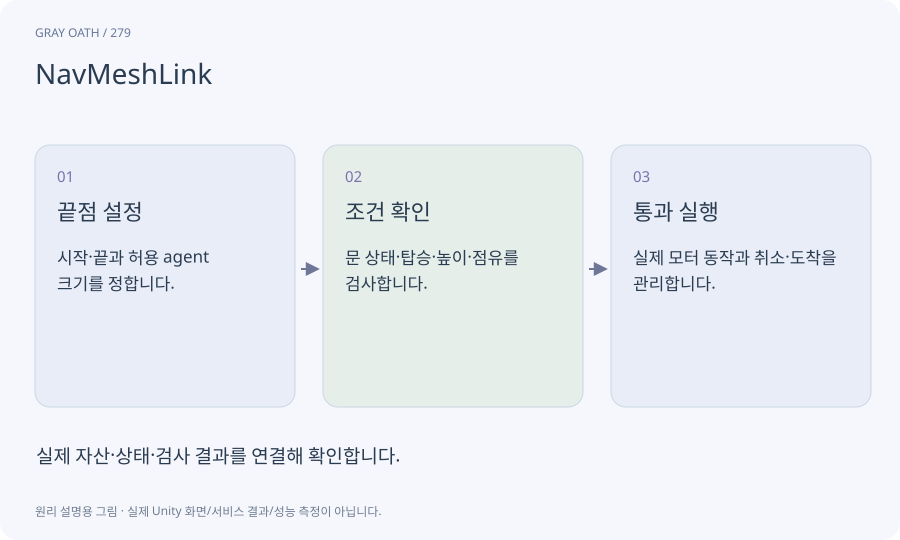

# NavMeshLink

분리된 이동 가능한 영역 사이에 명시적인 연결을 제공하는 요소입니다. 캐릭터가 그 연결을 어떤 동작과 조건으로 건너는지는 별도로 구현합니다.

## 익숙한 비유

도로 두 구간 사이의 계단이나 문을 지도에 연결선으로 표시하는 것입니다.



## 작동 원리

### 1. 끝점 설정

시작·끝과 허용 agent 크기를 정합니다.

### 2. 조건 확인

문 상태·탑승·높이·점유를 검사합니다.

### 3. 통과 실행

실제 모터 동작과 취소·도착을 관리합니다.

## 게임 속 예

부서진 다리를 지나기 위한 연결을 만들었어도 걷는 적이 허공을 순간이동하면 안 됩니다. 실제 통과 행동이 필요합니다.

## 혼동하지 않기

링크 하나가 자동으로 점프·수영·사다리 애니메이션까지 만들어 주지 않습니다.

## 확인 질문

큰 괴물이 작은 문으로 가려 하면?

agent 종류와 통과 폭, 경로 조건을 분리해 잘못된 연결 사용을 막습니다.

## 내 프로젝트에서 확인하기

```text
현재 GrayOathRPG3D에서 NavMeshLink을 사용하는 실제 대상과 동작을 읽기 전용으로 확인해 줘. 쉬운 말과 작은 사례로 설명하고 링크 하나가 자동으로 점프·수영·사다리 애니메이션까지 만들어 주지 않습니다. 이 문제를 어떻게 막는지 보여 줘. 코드·데이터·설정은 아직 수정하지 마.
```

## 관련 해설

[navmesh](navmesh.md) · [clearance](clearance.md) · [motor](motor.md)

## 공식 참고

- [Unity · NavMeshLink](https://docs.unity3d.com/Packages/com.unity.ai.navigation@2.0/manual/NavMeshLink.html)
