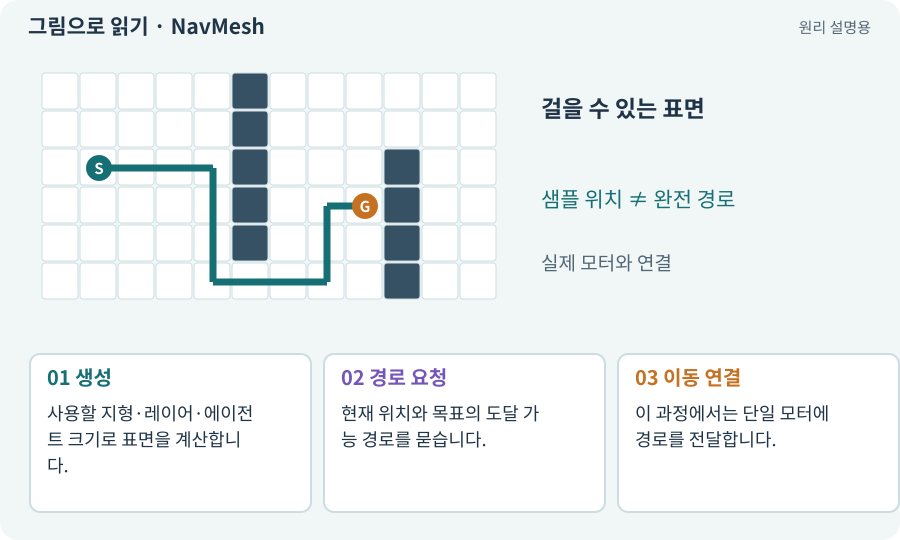

# NavMesh·Surface·Agent

**분야:** 지도·적 AI·전투 규칙

NavMesh는 3D 공간에서 걸어갈 수 있는 표면을 길찾기용으로 표현한 자료입니다. Surface는 그 자료를 만들 범위를, Agent는 이동 주체의 크기와 경로 행동 등을 다룹니다.

**찾아오는 이름:** NavMesh·Surface·Agent, NavMesh, NavMeshSurface, NavMeshAgent, 네비메시, AI Navigation, SamplePosition, CalculatePath

## 익숙한 것에 비유하면

바닥 전체 사진 대신 “사람이 걸을 수 있는 구역”만 색칠한 지도입니다. 벽·계단·경사와 몸체 크기가 결과에 영향을 줍니다.



개념도입니다. 실제 Unity 화면이나 검사 결과가 아닙니다. 그림의 순서·색은 역할을 구분하며 실제 설정값은 프로젝트에서 확인합니다.

## 이렇게 작동합니다

### 1. 생성

사용할 지형·레이어·에이전트 크기로 표면을 계산합니다.

### 2. 경로 요청

현재 위치와 목표의 도달 가능 경로를 묻습니다.

### 3. 이동 연결

이 과정에서는 단일 모터에 경로를 전달합니다.

## 목표를 찾는 것과 완전한 길은 다릅니다

SamplePosition은 주어진 위치 근처의 NavMesh 지점을 찾는 데 쓰입니다. 두 지점이 서로 연결되어 있다는 증명은 아닙니다. 섬처럼 떨어진 NavMesh 위에서도 샘플을 얻을 수 있습니다.

CalculatePath로 얻은 상태가 완전 경로인지, 일부 경로인지, 무효인지 확인합니다. 경로 계산 예산 초과나 빌드 중 상태를 “길 없음”과 구분해야 합니다.

이 3D 과정에서는 NavMesh를 경로 계산에 사용하고 실제 위치는 CharacterController 모터가 책임지는 구성을 택합니다. NavMeshAgent가 위치를 자동 갱신하는 기능과 동시에 사용하면 두 주체가 싸울 수 있으므로 설정을 확인합니다.

| 단계 | 확인 | 그 자체로 보장하지 않는 것 |
| --- | --- | --- |
| 위치 샘플 | NavMesh 위의 가까운 점 | 상호 연결 |
| 경로 계산 | 완전·부분·무효 | 실제 몸체 이동 |
| 실제 플레이 | 문·모서리·움직이는 대상 | 모든 시드의 성공 |

## 우리 RPG에서는 이렇게 만나요

랜덤 3D 지형을 바꾼 뒤 이전 NavMesh를 그대로 쓰면 없는 바닥을 길로 안내할 수 있습니다. 새 표면 준비 완료 후 적과 플레이어를 움직입니다.

## 이것과 혼동하지 마세요

NavMesh.SamplePosition으로 근처 점을 찾은 것만으로 그 점까지 연결된 경로가 보장되지는 않습니다.

## 이해했는지 한 번 생각해 보기

목표점은 NavMesh 위인데 갈 수 없는 이유는?

<details><summary>답과 이유</summary>

분리된 섬일 수 있습니다. 완전 경로 여부를 따로 확인합니다.

</details>

## 내 프로젝트에서 확인하고 싶다면

아래 요청은 읽기 전용으로 실제 대상을 확인하는 선택 요청입니다. 코드나 설정을 직접 편집할 필요는 없습니다.

```text
현재 프로젝트에서 NavMesh·Surface·Agent 관련 요소가 어떻게 사용되는지 읽기 전용으로 확인해 줘. 실제 대상과 설정을 찾아 쉬운 말과 작은 예로 설명해 줘. 특히 다음 혼동을 구분해 줘: NavMesh.SamplePosition으로 근처 점을 찾은 것만으로 그 점까지 연결된 경로가 보장되지는 않습니다. 아직 코드·설정·파일은 바꾸지 말고, 확인할 수 없는 내용은 따로 알려 줘.
```

## 이어지는 개념

[몸체 여유·모서리 통과](clearance.md) · [경로와 경유점](navigation.md) · [연결성·BFS·도달 가능성](connectivity.md) · [CharacterController](controller.md)

## 이 개념을 사용하는 실습

[01 · 빈 2D 프로젝트 만들기](../index.html#lesson-001) · [07 · 캐릭터와 벽이 있는 공간 만들기](../index.html#lesson-007) · [08 · WASD로 벽에 부딪히며 이동하기](../index.html#lesson-008) · [28 · 여덟 구역의 첫 던전 만들기](../index.html#lesson-028) · [55 · 어떤 그림도 맞춰 넣는 아트 규격 정하기](../index.html#lesson-055) · [85 · 3D 캐릭터를 한 모터로 움직이기](../index.html#lesson-085) · [86 · 3D에서도 클릭한 곳까지 돌아가기](../index.html#lesson-086) · [90 · 적의 판단을 3D 공간에 연결하기](../index.html#lesson-090) · [94 · 같은 랜덤 던전을 3D로 생성하기](../index.html#lesson-094) · [96 · 3D 카메라 가림과 터치 조작 다듬기](../index.html#lesson-096) · [101 · 3D Android 성능 다시 측정하기](../index.html#lesson-101)

## 참고와 설명의 범위

기본 도구 동작은 아래 공식 자료를 참고했습니다. 비유·그림·RPG의 예시 수치와 정책은 이해를 위한 자체 예제입니다. 실제 API·지원 기능은 설치 버전과 계정에서 확인합니다.

- [Unity · Tilemap Collider 2D](https://docs.unity3d.com/6000.3/Documentation/Manual/tilemaps/work-with-tilemaps/tilemap-collider-2d.html)

그림·계산 예제·조작 모형은 자체 제작한 설명입니다. 실제 Unity 화면, 서비스 생성 결과, 성능 실측 또는 게임 테스트 결과가 아닙니다. 자료 확인: 2026년 9월 26일.
