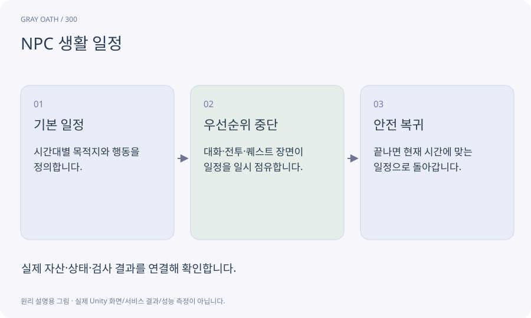

# NPC 생활 일정

NPC가 시간과 상황에 따라 어느 장소에서 무엇을 하는지 정하는 계획입니다. 실제 오브젝트가 로드되지 않아도 논리 일정은 계산할 수 있습니다.

## 익숙한 비유

출근·식사·퇴근 일정표에 긴급 약속이 끼어드는 것과 같습니다.



## 작동 원리

### 1. 기본 일정

시간대별 목적지와 행동을 정의합니다.

### 2. 우선순위 중단

대화·전투·퀘스트 장면이 일정을 일시 점유합니다.

### 3. 안전 복귀

끝나면 현재 시간에 맞는 일정으로 돌아갑니다.

## 게임 속 예

현오는 낮에 대장간, 밤에 집에 있습니다. 메인 진행에 꼭 필요하면 찾을 경로와 안내 또는 대체 접근을 마련합니다.

## 혼동하지 않기

시간이 바뀌었다고 대화 중인 NPC를 멀리 순간이동시키면 안 됩니다.

## 확인 질문

멀리 있는 주민도 매 프레임 NavMesh를 움직여야 하나요?

아닙니다. 먼 지역은 논리 상태로 계산하고 가까워질 때 안전하게 표현을 복원할 수 있습니다.

## 내 프로젝트에서 확인하기

```text
현재 GrayOathRPG3D에서 NPC 생활 일정을 사용하는 실제 대상과 동작을 읽기 전용으로 확인해 줘. 쉬운 말과 작은 사례로 설명하고 시간이 바뀌었다고 대화 중인 NPC를 멀리 순간이동시키면 안 됩니다. 이 문제를 어떻게 막는지 보여 줘. 코드·데이터·설정은 아직 수정하지 마.
```

## 관련 해설

[world-clock](world-clock.md) · [world-state](world-state.md) · [streaming-cell](streaming-cell.md)

## 공식 참고

- [Unity · NavMeshLink](https://docs.unity3d.com/Packages/com.unity.ai.navigation@2.0/manual/NavMeshLink.html)
