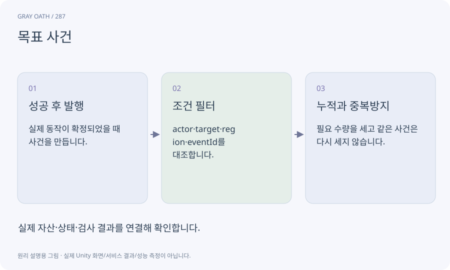

# 목표 사건

단서를 조사했다, 특정 적을 처치했다, 아이템을 획득했다처럼 퀘스트 목표가 이해하는 의미 단위의 사건입니다. 단순 버튼 클릭과 결과 확정은 다릅니다.

## 익숙한 비유

택배 발송 버튼이 아니라 실제 발송 접수증을 읽는 것입니다.



## 작동 원리

### 1. 성공 후 발행

실제 동작이 확정되었을 때 사건을 만듭니다.

### 2. 조건 필터

actor·target·region·eventId를 대조합니다.

### 3. 누적과 중복방지

필요 수량을 세고 같은 사건은 다시 세지 않습니다.

## 게임 속 예

늪 괴물의 두 콜라이더에서 피격 이벤트가 와도 죽음은 한 번 확정합니다. 계약 목표는 그 죽음 사건 하나만 셉니다.

## 혼동하지 않기

퀘스트 수락 전 사건을 모두 무시하면 단서를 미리 찾은 플레이어가 막힐 수 있습니다.

## 확인 질문

먼저 모은 아이템은 어떻게 처리하나요?

목표 정책에 따라 현재 소유 상태나 기록된 사실을 평가하고 수락 이후 사건과 구분합니다.

## 내 프로젝트에서 확인하기

```text
현재 GrayOathRPG3D에서 목표 사건을 사용하는 실제 대상과 동작을 읽기 전용으로 확인해 줘. 쉬운 말과 작은 사례로 설명하고 퀘스트 수락 전 사건을 모두 무시하면 단서를 미리 찾은 플레이어가 막힐 수 있습니다. 이 문제를 어떻게 막는지 보여 줘. 코드·데이터·설정은 아직 수정하지 마.
```

## 관련 해설

[event](event.md) · [event-id](event-id.md) · [quest-machine](quest-machine.md)

## 공식 참고

- [Unity · AssetDatabase](https://docs.unity3d.com/6000.3/Documentation/ScriptReference/AssetDatabase.html)
