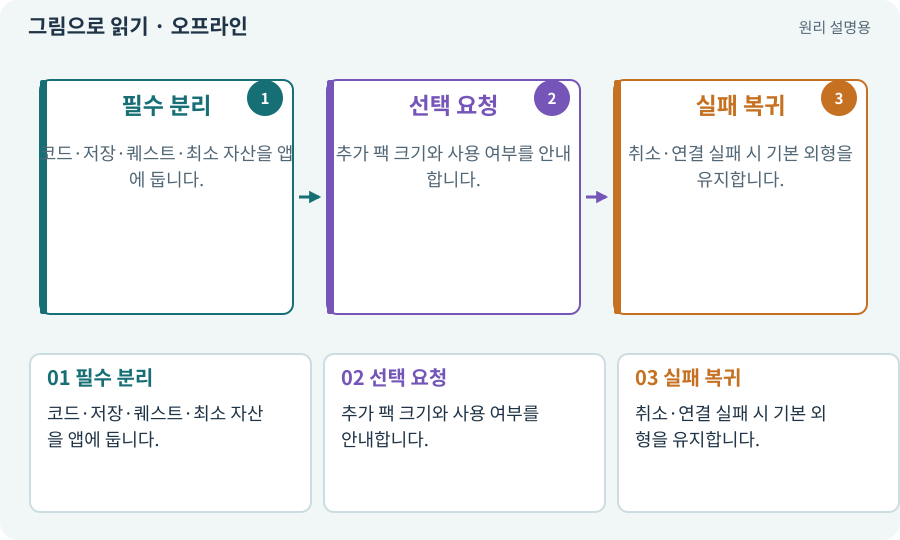

# 오프라인·기본 자산·선택 팩

**분야:** 비동기·다운로드·빌드·버전 관리

오프라인은 네트워크 연결 없이 실행하는 상태입니다. 이 게임은 기본 규칙과 최소 외형을 앱에 포함하고 추가 외형만 선택 다운로드해 처음 실행부터 완주할 수 있게 설계합니다.

**찾아오는 이름:** 오프라인·기본 자산·선택 팩, 오프라인, offline, 선택팩, 선택 팩, 고해상도팩

## 익숙한 것에 비유하면

식당의 기본 메뉴는 항상 준비하고 특별 장식만 추가 배송으로 받는 것과 같습니다.



개념도입니다. 실제 Unity 화면이나 검사 결과가 아닙니다. 그림의 순서·색은 역할을 구분하며 실제 설정값은 프로젝트에서 확인합니다.

## 이렇게 작동합니다

### 1. 필수 분리

코드·저장·퀘스트·최소 자산을 앱에 둡니다.

### 2. 선택 요청

추가 팩 크기와 사용 여부를 안내합니다.

### 3. 실패 복귀

취소·연결 실패 시 기본 외형을 유지합니다.

## 우리 RPG에서는 이렇게 만나요

인터넷이 없는 첫 실행에서 마을·던전·보스·저장이 이어져야 합니다. 예전에 받은 캐시가 남은 상태만으로 최초 오프라인을 검증하지 않습니다.

## 이것과 혼동하지 마세요

오프라인 게임이라는 말이 제작 도구의 모델 호출·클라우드 업로드까지 인터넷 없이 된다는 뜻은 아닙니다.

## 이해했는지 한 번 생각해 보기

외형팩을 거절했는데 스킬 사용이 막혀도 되나요?

<details><summary>답과 이유</summary>

이 설계에서는 안 됩니다. 선택팩은 기본 규칙을 잠그지 않습니다.

</details>

## 내 프로젝트에서 확인하고 싶다면

아래 요청은 읽기 전용으로 실제 대상을 확인하는 선택 요청입니다. 코드나 설정을 직접 편집할 필요는 없습니다.

```text
현재 프로젝트에서 오프라인·기본 자산·선택 팩 관련 요소가 어떻게 사용되는지 읽기 전용으로 확인해 줘. 실제 대상과 설정을 찾아 쉬운 말과 작은 예로 설명해 줘. 특히 다음 혼동을 구분해 줘: 오프라인 게임이라는 말이 제작 도구의 모델 호출·클라우드 업로드까지 인터넷 없이 된다는 뜻은 아닙니다. 아직 코드·설정·파일은 바꾸지 말고, 확인할 수 없는 내용은 따로 알려 줘.
```

## 이어지는 개념

[폴백·안전한 대체 경로](fallback.md) · [캐시·적중·무효화](cache.md) · [Addressables·주소로 에셋 불러오기](addressables.md) · [게임 빌드·개발 빌드·배포](build.md)

## 이 개념을 사용하는 실습

[01 · 빈 2D 프로젝트 만들기](../index.html#lesson-001) · [04 · 되돌릴 수 있는 작업 습관 만들기](../index.html#lesson-004) · [25 · 게임을 껐다 켜도 장비 유지하기](../index.html#lesson-025) · [73 · 주소로 에셋 불러오기](../index.html#lesson-073) · [75 · 다운로드 용량과 진행률 보여 주기](../index.html#lesson-075) · [76 · 연결이 끊겨도 게임 계속하기](../index.html#lesson-076) · [77 · 앱을 바꾸지 않고 외형 업데이트하기](../index.html#lesson-077) · [78 · 선택: Google Play 에셋 전달 사용하기](../index.html#lesson-078) · [79 · 추가 기능을 하나의 게임으로 합치기](../index.html#lesson-079) · [80 · 나만의 2D RPG 완성하기](../index.html#lesson-080) · [98 · 3D 팩을 2D 팩과 따로 내려받기](../index.html#lesson-098) · [104 · 2D와 3D를 두 플랫폼에서 완주하기](../index.html#lesson-104) · [153 · 대장간 고해상도팩 선택 다운로드하기](../index.html#lesson-153) · [159 · 최종 확장판 배포 후보 만들기](../index.html#lesson-159) · [160 · 대장간 보스까지 완주하고 새 기능 맡기기](../index.html#lesson-160)

## 참고와 설명의 범위

이 항목의 비유·그림·RPG 수치·운영 규칙은 개념을 이해하기 위한 자체 설계 예제입니다. 특정 도구가 이 규칙을 자동으로 구현한다는 뜻은 아닙니다.


그림·계산 예제·조작 모형은 자체 제작한 설명입니다. 실제 Unity 화면, 서비스 생성 결과, 성능 실측 또는 게임 테스트 결과가 아닙니다. 자료 확인: 2026년 9월 26일.
