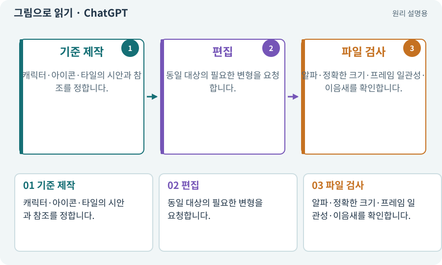

# ChatGPT·OpenAI 이미지 API

**분야:** 자산 제작·렌더링 보충

ChatGPT의 이미지 기능과 OpenAI 이미지 API는 이미지를 생성·편집하는 사용 경로입니다. 웹 사용과 개발 API는 인증·자동화·과금 경로가 다를 수 있습니다. 이 게임의 실행 안에 이미지 모델을 넣는 과정은 아닙니다.

**찾아오는 이름:** ChatGPT·OpenAI 이미지 API, OpenAI, ChatGPT, GPT Image, 이미지 API

## 익숙한 것에 비유하면

그림을 대화로 주문하는 창구와 프로그램으로 주문하는 창구를 구분하는 것입니다.



개념도입니다. 실제 Unity 화면이나 검사 결과가 아닙니다. 그림의 순서·색은 역할을 구분하며 실제 설정값은 프로젝트에서 확인합니다.

## 이렇게 작동합니다

### 1. 기준 제작

캐릭터·아이콘·타일의 시안과 참조를 정합니다.

### 2. 편집

동일 대상의 필요한 변형을 요청합니다.

### 3. 파일 검사

알파·정확한 크기·프레임 일관성·이음새를 확인합니다.

## 우리 RPG에서는 이렇게 만나요

범용 이미지 모델이 만든 격자 그림에는 셀 크기 오차나 프레임별 변화가 있을 수 있습니다. AI가 실제 파일을 받아 검사·수정·패킹하고 Unity에 연결하게 합니다.

## 이것과 혼동하지 마세요

ChatGPT 구독료가 이미지 API 비용까지 포함한다고 가정하지 않습니다. 현재 계정 경로를 확인합니다.

## 이해했는지 한 번 생각해 보기

그림 안에 체크무늬 배경이 보이면 투명 PNG인가요?

<details><summary>답과 이유</summary>

아닐 수 있습니다. 실제 알파 채널을 읽어야 합니다.

</details>

## 내 프로젝트에서 확인하고 싶다면

아래 요청은 읽기 전용으로 실제 대상을 확인하는 선택 요청입니다. 코드나 설정을 직접 편집할 필요는 없습니다.

```text
현재 프로젝트에서 ChatGPT·OpenAI 이미지 API 관련 요소가 어떻게 사용되는지 읽기 전용으로 확인해 줘. 실제 대상과 설정을 찾아 쉬운 말과 작은 예로 설명해 줘. 특히 다음 혼동을 구분해 줘: ChatGPT 구독료가 이미지 API 비용까지 포함한다고 가정하지 않습니다. 현재 계정 경로를 확인합니다. 아직 코드·설정·파일은 바꾸지 말고, 확인할 수 없는 내용은 따로 알려 줘.
```

## 이어지는 개념

[생성형 아트·참조 이미지·후처리](image-service.md) · [비용 한도·예약·실사용량](budget.md) · [알파·RGBA·투명 배경](alpha.md) · [스프라이트 시트](sprite-sheet.md)

## 이 개념을 사용하는 실습

[62 · OpenAI 이미지로 게임 자산 만들기](../index.html#lesson-062) · [67 · 내 게임의 아트 제작 경로 선택하기](../index.html#lesson-067)

## 참고와 설명의 범위

기본 도구 동작은 아래 공식 자료를 참고했습니다. 비유·그림·RPG의 예시 수치와 정책은 이해를 위한 자체 예제입니다. 실제 API·지원 기능은 설치 버전과 계정에서 확인합니다.

- [OpenAI · 이미지 생성·편집](https://developers.openai.com/api/docs/guides/image-generation)

그림·계산 예제·조작 모형은 자체 제작한 설명입니다. 실제 Unity 화면, 서비스 생성 결과, 성능 실측 또는 게임 테스트 결과가 아닙니다. 자료 확인: 2026년 9월 26일.
