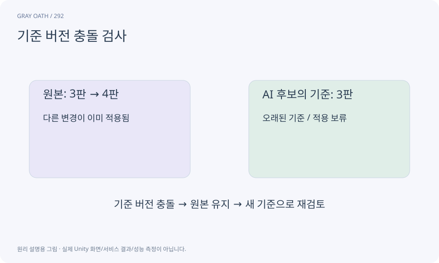

# 기준 버전 충돌 검사

편집을 시작할 때의 기준 버전과 적용 직전의 현재 버전을 비교해 다른 변경을 덮어쓰지 않게 하는 방식입니다. “낙관적”은 검사 없이 믿는다는 뜻이 아닙니다.

## 익숙한 비유

수정 전 계약서가3판이었는데 제출할 때4판이 됐다면 그대로 덮지 않고 다시 비교하는 것입니다.



## 작동 원리

### 1. 기준 기록

초안의 baseRevision을 저장합니다.

### 2. 현재 대조

적용 직전에 같은 자산의 revision을 다시 읽습니다.

### 3. 충돌 처리

다르면 재기반·재검토를 요청하고 원본은 유지합니다.

## 기준 버전3의 초안을 받은 뒤

기준판 확인은 요청 시점뿐 아니라 실제 적용 직전에도 수행합니다. 네트워크 응답이 끝나고 사람이 읽는 동안에도 원본은 바뀔 수 있습니다.

| 상황 | 적용 여부 | 이유 |

|---|---|---|

| 현재도3판·검증/승인 완료 | 새4판으로 적용 | 같은 기준을 수정 |

| 현재4판으로 바뀜 | 거부 | 다른 작업 덮어쓰기 방지 |

| 3판이지만 요청 취소 | 거부 | 버전만 맞는다고 승인된 것은 아님 |

| 이미 적용한 requestId | 추가 적용 안 함 | 한 요청의 중복 커밋 방지 |

## 게임 속 예

AI가7판 퀘스트를 읽는 동안 사람이8판으로 승인했다면 AI 초안은 바로 적용되지 않습니다. 현재8판과 차이를 다시 보여 줍니다.

## 혼동하지 않기

생성 요청 시 검사했더라도 적용 시 재검사를 생략하면 충돌을 막을 수 없습니다.

## 확인 질문

취소 후 성공 결과가 도착해도 revision만 같으면 적용하나요?

아닙니다. 요청의 취소·승인 상태도 함께 검사합니다.

## 내 프로젝트에서 확인하기

```text
현재 GrayOathRPG3D에서 기준 버전 충돌 검사을 사용하는 실제 대상과 동작을 읽기 전용으로 확인해 줘. 쉬운 말과 작은 사례로 설명하고 생성 요청 시 검사했더라도 적용 시 재검사를 생략하면 충돌을 막을 수 없습니다. 이 문제를 어떻게 막는지 보여 줘. 코드·데이터·설정은 아직 수정하지 마.
```

## 관련 해설

[content-revision](content-revision.md) · [editor-job](editor-job.md) · [transaction](transaction.md)

## 공식 참고

- [Unity · AssetDatabase](https://docs.unity3d.com/6000.3/Documentation/ScriptReference/AssetDatabase.html)
