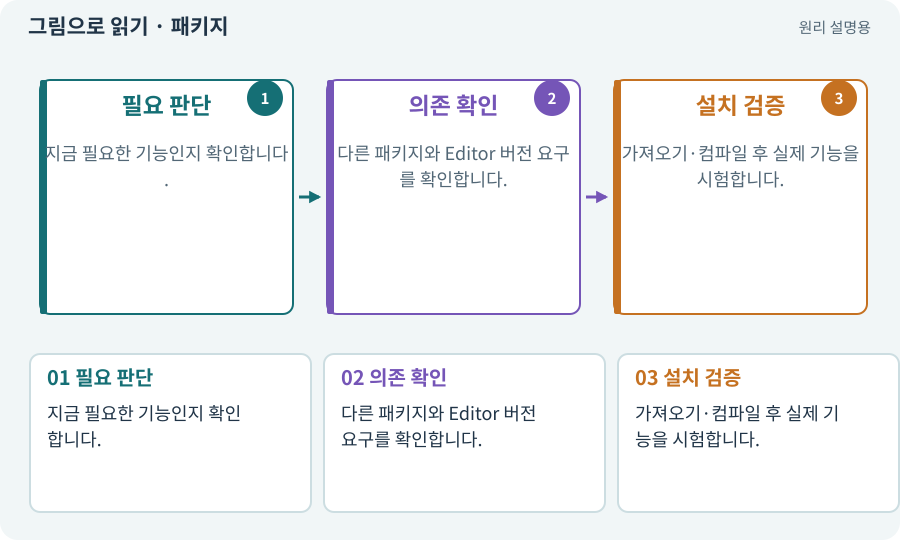

# 패키지·패키지 관리자

**분야:** 시작·도구·작업 공간

패키지는 입력·타일맵·테스트처럼 특정 기능을 묶어 프로젝트에 추가하는 단위입니다. Unity Package Manager가 설치와 의존 버전을 관리합니다.

**찾아오는 이름:** 패키지·패키지 관리자, 패키지, Package Manager, UPM, package lock, packages-lock.json

## 익숙한 것에 비유하면

기본 공구함에 전동드릴 세트를 추가하는 것과 같습니다. 세트가 필요로 하는 배터리도 함께 맞아야 합니다.



개념도입니다. 실제 Unity 화면이나 검사 결과가 아닙니다. 그림의 순서·색은 역할을 구분하며 실제 설정값은 프로젝트에서 확인합니다.

## 이렇게 작동합니다

### 1. 필요 판단

지금 필요한 기능인지 확인합니다.

### 2. 의존 확인

다른 패키지와 Editor 버전 요구를 확인합니다.

### 3. 설치 검증

가져오기·컴파일 후 실제 기능을 시험합니다.

## 우리 RPG에서는 이렇게 만나요

Input System을 설치해도 입력 액션과 EventSystem 연결이 자동으로 완성된 것은 아닙니다. 패키지 설치와 프로젝트 기능 연결은 별개입니다.

## 이것과 혼동하지 마세요

이름이 비슷한 제삼자 패키지를 공식 패키지로 오해하지 않습니다. 버전과 출처를 기록합니다.

## 이해했는지 한 번 생각해 보기

패키지를 설치했는데 공격 버튼이 안 눌리는 이유는?

<details><summary>답과 이유</summary>

액션·장치·UI 입력 모듈 등의 연결이 아직 없을 수 있습니다.

</details>

## 내 프로젝트에서 확인하고 싶다면

아래 요청은 읽기 전용으로 실제 대상을 확인하는 선택 요청입니다. 코드나 설정을 직접 편집할 필요는 없습니다.

```text
현재 프로젝트에서 패키지·패키지 관리자 관련 요소가 어떻게 사용되는지 읽기 전용으로 확인해 줘. 실제 대상과 설정을 찾아 쉬운 말과 작은 예로 설명해 줘. 특히 다음 혼동을 구분해 줘: 이름이 비슷한 제삼자 패키지를 공식 패키지로 오해하지 않습니다. 버전과 출처를 기록합니다. 아직 코드·설정·파일은 바꾸지 말고, 확인할 수 없는 내용은 따로 알려 줘.
```

## 이어지는 개념

[매니페스트·패키지 목록·빌드 기록](manifest.md) · [Input System·Action·Binding](input-system.md) · [의존성·DAG·위상 정렬](dependency.md) · [컴파일·어셈블리·도메인 리로드](compile.md)

## 이 개념을 사용하는 실습

[01 · 빈 2D 프로젝트 만들기](../index.html#lesson-001) · [02 · 내 게임을 알아듣는 개발 스킬 만들기](../index.html#lesson-002) · [03 · AI와 실행 중인 Unity 연결하기](../index.html#lesson-003) · [06 · 시작 메뉴와 테스트 공간 연결하기](../index.html#lesson-006) · [56 · Unity AI로 캐릭터 움직임 만들기](../index.html#lesson-056) · [65 · 스프라이트를 정리해 실제 캐릭터에 넣기](../index.html#lesson-065) · [67 · 내 게임의 아트 제작 경로 선택하기](../index.html#lesson-067) · [73 · 주소로 에셋 불러오기](../index.html#lesson-073) · [77 · 앱을 바꾸지 않고 외형 업데이트하기](../index.html#lesson-077) · [78 · 선택: Google Play 에셋 전달 사용하기](../index.html#lesson-078) · [81 · 2D 게임을 남기고 3D 작업 시작하기](../index.html#lesson-081) · [91 · 보스 예고를 3D 바닥에 맞추기](../index.html#lesson-091) · [99 · 2D와 3D 사이에 진행 가져오기](../index.html#lesson-099) · [105 · 내 개발 도구를 빈 폴더에서 시작하기](../index.html#lesson-105) · [129 · 기존 2D 게임에서 확장팩 시작하기](../index.html#lesson-129)

## 참고와 설명의 범위

기본 도구 동작은 아래 공식 자료를 참고했습니다. 비유·그림·RPG의 예시 수치와 정책은 이해를 위한 자체 예제입니다. 실제 API·지원 기능은 설치 버전과 계정에서 확인합니다.

- [Unity · 2D 게임 제작 흐름](https://docs.unity3d.com/6000.3/Documentation/Manual/2d-game-creation-wokflow.html)

그림·계산 예제·조작 모형은 자체 제작한 설명입니다. 실제 Unity 화면, 서비스 생성 결과, 성능 실측 또는 게임 테스트 결과가 아닙니다. 자료 확인: 2026년 9월 26일.
