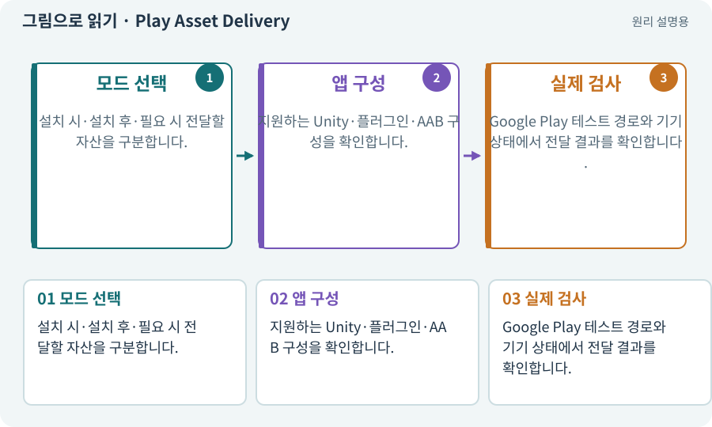

# Play Asset Delivery·전달 시점

**분야:** 비동기·다운로드·빌드·버전 관리

Play Asset Delivery는 Google Play 배포에서 큰 게임 자산을 앱과 함께 또는 나중에 전달하는 방식입니다. 별도 CDN 다운로드와는 배포·설치 경로가 다릅니다.

**찾아오는 이름:** Play Asset Delivery·전달 시점, PAD, Play Asset Delivery, install-time, fast-follow, on-demand

## 익숙한 것에 비유하면

기본 제품과 함께 넣는 물품, 설치 직후 배달하는 추가 상자, 필요할 때 주문하는 상자를 나누는 방식입니다.



개념도입니다. 실제 Unity 화면이나 검사 결과가 아닙니다. 그림의 순서·색은 역할을 구분하며 실제 설정값은 프로젝트에서 확인합니다.

## 이렇게 작동합니다

### 1. 모드 선택

설치 시·설치 후·필요 시 전달할 자산을 구분합니다.

### 2. 앱 구성

지원하는 Unity·플러그인·AAB 구성을 확인합니다.

### 3. 실제 검사

Google Play 테스트 경로와 기기 상태에서 전달 결과를 확인합니다.

## 우리 RPG에서는 이렇게 만나요

기본 게임을 오프라인 완주하려면 필수 코드와 최소 자산을 접근 가능한 기본 배포에 포함합니다. 선택 외형팩만 나중 전달할 수 있습니다.

## 이것과 혼동하지 마세요

로컬 APK 설치 검사만으로 Play의 자산 전달을 전부 검증했다고 하지 않습니다.

## 이해했는지 한 번 생각해 보기

AAB를 직접 눌러 설치하면 PAD 검사도 끝나나요?

<details><summary>답과 이유</summary>

아닙니다. 적절한 Play 테스트·배포 경로에서 실제 전달을 확인해야 합니다.

</details>

## 내 프로젝트에서 확인하고 싶다면

아래 요청은 읽기 전용으로 실제 대상을 확인하는 선택 요청입니다. 코드나 설정을 직접 편집할 필요는 없습니다.

```text
현재 프로젝트에서 Play Asset Delivery·전달 시점 관련 요소가 어떻게 사용되는지 읽기 전용으로 확인해 줘. 실제 대상과 설정을 찾아 쉬운 말과 작은 예로 설명해 줘. 특히 다음 혼동을 구분해 줘: 로컬 APK 설치 검사만으로 Play의 자산 전달을 전부 검증했다고 하지 않습니다. 아직 코드·설정·파일은 바꾸지 말고, 확인할 수 없는 내용은 따로 알려 줘.
```

## 이어지는 개념

[AAB·스토어 배포 묶음](aab.md) · [Addressables·주소로 에셋 불러오기](addressables.md) · [오프라인·기본 자산·선택 팩](offline.md) · [호환성·코드와 콘텐츠 계약](compatibility.md)

## 이 개념을 사용하는 실습

[78 · 선택: Google Play 에셋 전달 사용하기](../index.html#lesson-078) · [79 · 추가 기능을 하나의 게임으로 합치기](../index.html#lesson-079) · [80 · 나만의 2D RPG 완성하기](../index.html#lesson-080)

## 참고와 설명의 범위

기본 도구 동작은 아래 공식 자료를 참고했습니다. 비유·그림·RPG의 예시 수치와 정책은 이해를 위한 자체 예제입니다. 실제 API·지원 기능은 설치 버전과 계정에서 확인합니다.

- [Google · Unity용 Play Asset Delivery](https://developer.android.com/guide/playcore/asset-delivery/integrate-unity)

그림·계산 예제·조작 모형은 자체 제작한 설명입니다. 실제 Unity 화면, 서비스 생성 결과, 성능 실측 또는 게임 테스트 결과가 아닙니다. 자료 확인: 2026년 9월 26일.
