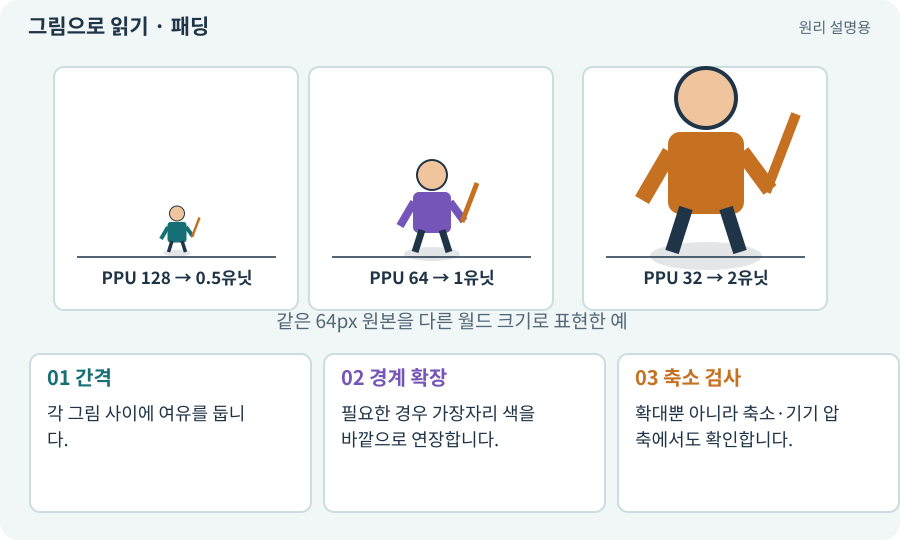

# 패딩·여백·필터링 번짐

**분야:** 그림·애니메이션·화면 만들기

패딩은 시트나 아틀라스의 그림 사이에 두는 간격입니다. 필터링이나 밉맵이 주변 픽셀을 섞을 때 옆 그림 색이 새어 나오지 않도록 도와줍니다.

**찾아오는 이름:** 패딩·여백·필터링 번짐, 패딩, padding, extrusion, bleeding, 번짐, 여백

## 익숙한 것에 비유하면

다른 색 물감 사이에 칸막이를 두는 것과 같습니다. 경계가 붙어 있으면 붓이 옆 색을 집어올 수 있습니다.



개념도입니다. 실제 Unity 화면이나 검사 결과가 아닙니다. 그림의 순서·색은 역할을 구분하며 실제 설정값은 프로젝트에서 확인합니다.

## 이렇게 작동합니다

### 1. 간격

각 그림 사이에 여유를 둡니다.

### 2. 경계 확장

필요한 경우 가장자리 색을 바깥으로 연장합니다.

### 3. 축소 검사

확대뿐 아니라 축소·기기 압축에서도 확인합니다.

## 우리 RPG에서는 이렇게 만나요

빨간 마법 아이콘 옆 초록 타일의 색이 검 테두리에 섞이면 아틀라스 패딩·필터·밉맵을 봅니다. 패딩만 늘려 모든 포맷 문제를 해결했다고 단정하지 않습니다.

## 이것과 혼동하지 마세요

필터링을 바꾸는 것은 원본 프레임 오류나 잘못된 알파를 고치는 방법이 아닙니다.

## 이해했는지 한 번 생각해 보기

큰 화면에서는 깨끗한데 축소하면 줄이 생기는 이유는?

<details><summary>답과 이유</summary>

주변 픽셀 혼합과 밉맵·압축·셀 경계를 함께 확인해야 합니다.

</details>

## 내 프로젝트에서 확인하고 싶다면

아래 요청은 읽기 전용으로 실제 대상을 확인하는 선택 요청입니다. 코드나 설정을 직접 편집할 필요는 없습니다.

```text
현재 프로젝트에서 패딩·여백·필터링 번짐 관련 요소가 어떻게 사용되는지 읽기 전용으로 확인해 줘. 실제 대상과 설정을 찾아 쉬운 말과 작은 예로 설명해 줘. 특히 다음 혼동을 구분해 줘: 필터링을 바꾸는 것은 원본 프레임 오류나 잘못된 알파를 고치는 방법이 아닙니다. 아직 코드·설정·파일은 바꾸지 말고, 확인할 수 없는 내용은 따로 알려 줘.
```

## 이어지는 개념

[Sprite Atlas와 패킹](atlas.md) · [밉맵·텍스처 압축](mipmap.md) · [Point·Bilinear 필터와 픽셀 아트](filter.md) · [알파·RGBA·투명 배경](alpha.md)

## 이 개념을 사용하는 실습

[65 · 스프라이트를 정리해 실제 캐릭터에 넣기](../index.html#lesson-065) · [69 · 베기와 폭발을 시트 애니메이션으로 만들기](../index.html#lesson-069) · [70 · 피격 강조와 보스 예고 셰이더 만들기](../index.html#lesson-070)

## 참고와 설명의 범위

기본 도구 동작은 아래 공식 자료를 참고했습니다. 비유·그림·RPG의 예시 수치와 정책은 이해를 위한 자체 예제입니다. 실제 API·지원 기능은 설치 버전과 계정에서 확인합니다.

- [Unity · Sprite](https://docs.unity3d.com/6000.3/Documentation/Manual/sprite/sprite-landing.html)

그림·계산 예제·조작 모형은 자체 제작한 설명입니다. 실제 Unity 화면, 서비스 생성 결과, 성능 실측 또는 게임 테스트 결과가 아닙니다. 자료 확인: 2026년 9월 26일.
