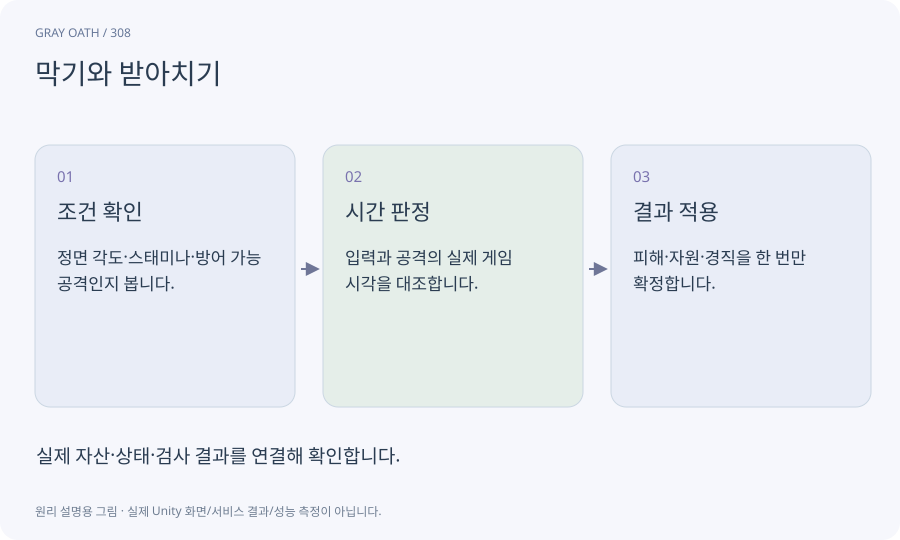

# 막기와 받아치기

방어 입력의 방향·타이밍·공격 종류에 따라 피해나 경직을 처리하는 규칙입니다. 가드 유지와 짧은 받아치기 성공 구간을 구분합니다.

## 익숙한 비유

방패를 계속 드는 것과 공격 순간에 정확히 튕겨내는 동작의 차이입니다.



## 작동 원리

### 1. 조건 확인

정면 각도·스태미나·방어 가능 공격인지 봅니다.

### 2. 시간 판정

입력과 공격의 실제 게임 시각을 대조합니다.

### 3. 결과 적용

피해·자원·경직을 한 번만 확정합니다.

## 게임 속 예

정면 공격은 짧은 패리 구간에 튕길 수 있지만 후방 공격이나 명시된 불가 공격은 다른 결과를 냅니다. 색뿐 아니라 형태/소리로도 안내합니다.

## 혼동하지 않기

버튼을 누른 프레임 수로만 창을 계산하면 프레임률에 따라 난이도가 달라집니다.

## 확인 질문

30fps와60fps에서 패리 시간이 같아야 하나요?

게임 시각 기준의 허용 구간을 정하고 실제 입력 지연을 각각 검사해야 합니다.

## 내 프로젝트에서 확인하기

```text
현재 GrayOathRPG3D에서 막기와 받아치기을 사용하는 실제 대상과 동작을 읽기 전용으로 확인해 줘. 쉬운 말과 작은 사례로 설명하고 버튼을 누른 프레임 수로만 창을 계산하면 프레임률에 따라 난이도가 달라집니다. 이 문제를 어떻게 막는지 보여 줘. 코드·데이터·설정은 아직 수정하지 마.
```

## 관련 해설

[delta-time](delta-time.md) · [damage](damage.md) · [telegraph](telegraph.md)

## 공식 참고

- [Unity · 실제 대상 기기 프로파일링](https://docs.unity3d.com/6000.3/Documentation/Manual/profiling-target-device.html)
