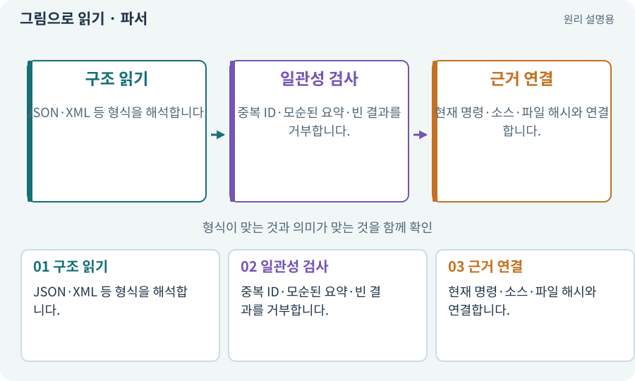

# 파서·XML·결과 판정

**분야:** AI·스킬·훅·하네스 운영

파서는 텍스트나 파일의 구조를 읽어 데이터로 바꾸는 프로그램입니다. 테스트 판정기는 파싱한 결과의 실제 실행 수·식별자·실패·대상을 추가 검사해야 합니다.

**찾아오는 이름:** 파서·XML·결과 판정, 파서, Parser, 파싱, XML, NUnit XML, 결과 파서

## 익숙한 것에 비유하면

시험지 채점표를 읽는 기계입니다. 같은 학생 답안 두 장을 다른 두 학생의 합격으로 세면 안 됩니다.



개념도입니다. 실제 Unity 화면이나 검사 결과가 아닙니다. 그림의 순서·색은 역할을 구분하며 실제 설정값은 프로젝트에서 확인합니다.

## 이렇게 작동합니다

### 1. 구조 읽기

JSON·XML 등 형식을 해석합니다.

### 2. 일관성 검사

중복 ID·모순된 요약·빈 결과를 거부합니다.

### 3. 근거 연결

현재 명령·소스·파일 해시와 연결합니다.

## 우리 RPG에서는 이렇게 만나요

NUnit 결과에 같은 테스트 ID가 두 번 있으면 검사 수를 부풀릴 수 있습니다. 매개변수가 다른 실제 테스트와 완전 중복을 구분해 처리합니다.

## 이것과 혼동하지 마세요

정규식으로 PASS만 찾으면 실패 요약이 함께 있어도 잘못 통과시킬 수 있습니다.

## 이해했는지 한 번 생각해 보기

성공 5개와 실패 요약이 함께 있으면?

<details><summary>답과 이유</summary>

실행 단위와 최종 결과가 모순되므로 무조건 성공으로 처리하지 않습니다.

</details>

## 내 프로젝트에서 확인하고 싶다면

아래 요청은 읽기 전용으로 실제 대상을 확인하는 선택 요청입니다. 코드나 설정을 직접 편집할 필요는 없습니다.

```text
현재 프로젝트에서 파서·XML·결과 판정 관련 요소가 어떻게 사용되는지 읽기 전용으로 확인해 줘. 실제 대상과 설정을 찾아 쉬운 말과 작은 예로 설명해 줘. 특히 다음 혼동을 구분해 줘: 정규식으로 PASS만 찾으면 실패 요약이 함께 있어도 잘못 통과시킬 수 있습니다. 아직 코드·설정·파일은 바꾸지 말고, 확인할 수 없는 내용은 따로 알려 줘.
```

## 이어지는 개념

[JSON·객체·배열·필드](json.md) · [구조화 응답·변경안 계약](structured-output.md) · [검증 게이트·필수 검사](gate.md) · [증거·검사 상태·미실행](evidence.md)

## 이 개념을 사용하는 실습

[25 · 게임을 껐다 켜도 장비 유지하기](../index.html#lesson-025) · [38 · 테스트 결과와 실제 플레이 구분하기](../index.html#lesson-038) · [99 · 2D와 3D 사이에 진행 가져오기](../index.html#lesson-099) · [114 · 테스트를 실행하고 결과 읽기](../index.html#lesson-114) · [124 · 현재 컴퓨터의 Unity 명령 등록하기](../index.html#lesson-124) · [152 · 이전 저장을 새 확장판으로 가져오기](../index.html#lesson-152) · [157 · 하네스가 실패해도 기록 지키기](../index.html#lesson-157)

## 참고와 설명의 범위

기본 도구 동작은 아래 공식 자료를 참고했습니다. 비유·그림·RPG의 예시 수치와 정책은 이해를 위한 자체 예제입니다. 실제 API·지원 기능은 설치 버전과 계정에서 확인합니다.

- [Python · JSON](https://docs.python.org/3/library/json.html)
- [Unity · 테스트 실행과 결과](https://docs.unity3d.com/Packages/com.unity.test-framework@1.4/manual/reference-command-line.html)

그림·계산 예제·조작 모형은 자체 제작한 설명입니다. 실제 Unity 화면, 서비스 생성 결과, 성능 실측 또는 게임 테스트 결과가 아닙니다. 자료 확인: 2026년 9월 26일.
