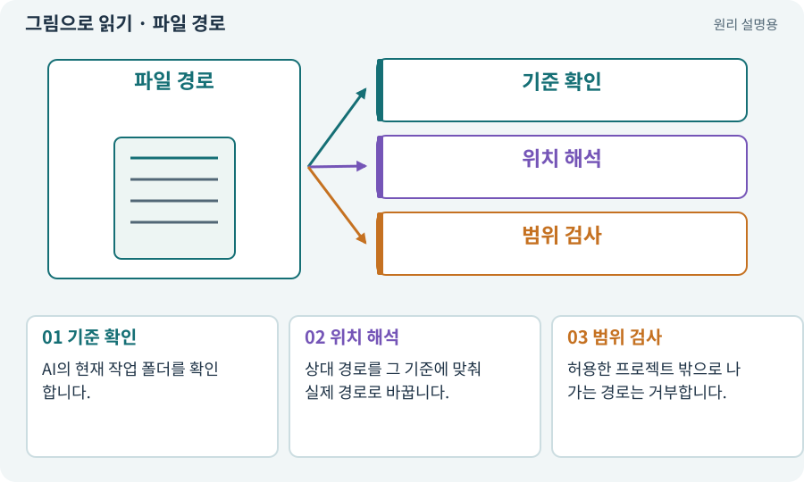

# 파일 경로·절대 경로·상대 경로

**분야:** 시작·도구·작업 공간

경로는 파일의 위치를 가리키는 주소입니다. 절대 경로는 기준 위치까지 포함하고, 상대 경로는 현재 폴더를 기준으로 해석합니다.

**찾아오는 이름:** 파일 경로·절대 경로·상대 경로, 절대 경로, 상대 경로, 파일 경로, 작업 경로, 작업 폴더, write_prefixes, read_files

## 익숙한 것에 비유하면

“서울의 어떤 건물 3층”과 “옆방”의 차이입니다. 옆방은 내가 어디에 서 있는지에 따라 달라집니다.



개념도입니다. 실제 Unity 화면이나 검사 결과가 아닙니다. 그림의 순서·색은 역할을 구분하며 실제 설정값은 프로젝트에서 확인합니다.

## 이렇게 작동합니다

### 1. 기준 확인

AI의 현재 작업 폴더를 확인합니다.

### 2. 위치 해석

상대 경로를 그 기준에 맞춰 실제 경로로 바꿉니다.

### 3. 범위 검사

허용한 프로젝트 밖으로 나가는 경로는 거부합니다.

## 우리 RPG에서는 이렇게 만나요

Assets/Player.cs는 MyGameHarness 폴더에서 보면 Unity 프로젝트 안 파일이 아닙니다. ../로 상위 폴더를 가리킬 수 있으므로 문자열 앞부분만 보지 않고 정규화된 실제 경로를 확인합니다.

## 이것과 혼동하지 마세요

파일명 검사는 보안 샌드박스가 아닙니다. 심볼릭 링크·외부 코드 실행 등의 별도 위험도 있습니다.

## 이해했는지 한 번 생각해 보기

같은 상대 경로로 실행했는데 다른 파일이 바뀌는 이유는?

<details><summary>답과 이유</summary>

현재 작업 폴더가 달라졌을 수 있습니다. 절대 경로와 대상 해시를 다시 확인합니다.

</details>

## 내 프로젝트에서 확인하고 싶다면

아래 요청은 읽기 전용으로 실제 대상을 확인하는 선택 요청입니다. 코드나 설정을 직접 편집할 필요는 없습니다.

```text
현재 프로젝트에서 파일 경로·절대 경로·상대 경로 관련 요소가 어떻게 사용되는지 읽기 전용으로 확인해 줘. 실제 대상과 설정을 찾아 쉬운 말과 작은 예로 설명해 줘. 특히 다음 혼동을 구분해 줘: 파일명 검사는 보안 샌드박스가 아닙니다. 심볼릭 링크·외부 코드 실행 등의 별도 위험도 있습니다. 아직 코드·설정·파일은 바꾸지 말고, 확인할 수 없는 내용은 따로 알려 줘.
```

## 이어지는 개념

[프로젝트와 프로젝트 루트](project.md) · [권한·승인·최소 권한](permission.md) · [샌드박스·후보 폴더·격리](sandbox.md) · [해시·SHA-256·체크섬](hash.md)

## 이 개념을 사용하는 실습

[01 · 빈 2D 프로젝트 만들기](../index.html#lesson-001) · [02 · 내 게임을 알아듣는 개발 스킬 만들기](../index.html#lesson-002) · [03 · AI와 실행 중인 Unity 연결하기](../index.html#lesson-003) · [55 · 어떤 그림도 맞춰 넣는 아트 규격 정하기](../index.html#lesson-055) · [73 · 주소로 에셋 불러오기](../index.html#lesson-073) · [81 · 2D 게임을 남기고 3D 작업 시작하기](../index.html#lesson-081) · [105 · 내 개발 도구를 빈 폴더에서 시작하기](../index.html#lesson-105)

## 참고와 설명의 범위

기본 도구 동작은 아래 공식 자료를 참고했습니다. 비유·그림·RPG의 예시 수치와 정책은 이해를 위한 자체 예제입니다. 실제 API·지원 기능은 설치 버전과 계정에서 확인합니다.

- [Python · 파일 경로](https://docs.python.org/3/library/pathlib.html)

그림·계산 예제·조작 모형은 자체 제작한 설명입니다. 실제 Unity 화면, 서비스 생성 결과, 성능 실측 또는 게임 테스트 결과가 아닙니다. 자료 확인: 2026년 9월 26일.
