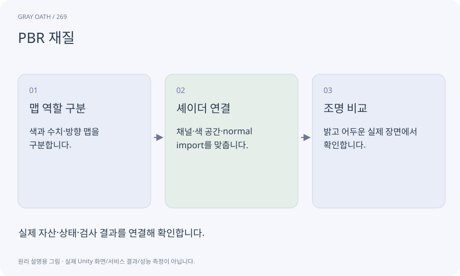

# PBR 재질

빛과 표면의 관계를 일관되게 표현하기 위한 재질 모델입니다. 색·금속성·거칠기·노멀 등의 맵이 각각 다른 정보를 전달합니다.

## 익숙한 비유

같은 물체도 플라스틱·금속·젖은 나무에 따라 빛을 반사하는 방식이 다른 것을 표현합니다.



## 작동 원리

### 1. 맵 역할 구분

색과 수치·방향 맵을 구분합니다.

### 2. 셰이더 연결

채널·색 공간·normal import를 맞춥니다.

### 3. 조명 비교

밝고 어두운 실제 장면에서 확인합니다.

## 게임 속 예

Meshy가 납품한 roughness를 URP의 smoothness 입력에 그대로 넣으면 표면 느낌이 반대로 보일 수 있습니다. 채널과 변환을 확인합니다.

## 혼동하지 않기

생성 이미지 속 하이라이트가 색 맵에 그려져 있으면 실제 조명과 겹쳐 부자연스러울 수 있습니다.

## 확인 질문

색 맵 하나를 넣으면 PBR 적용이 끝나나요?

기본 표시는 되지만 재질별 빛 반응은 필요한 맵·셰이더 설정을 대조해야 합니다.

## 내 프로젝트에서 확인하기

```text
현재 GrayOathRPG3D에서 PBR 재질을 사용하는 실제 대상과 동작을 읽기 전용으로 확인해 줘. 쉬운 말과 작은 사례로 설명하고 생성 이미지 속 하이라이트가 색 맵에 그려져 있으면 실제 조명과 겹쳐 부자연스러울 수 있습니다. 이 문제를 어떻게 막는지 보여 줘. 코드·데이터·설정은 아직 수정하지 마.
```

## 관련 해설

[material](material.md) · [roughness](roughness.md) · [uv](uv.md) · [lighting](lighting.md)

## 공식 참고

- [Meshy · Retexture](https://docs.meshy.ai/en/api/retexture)
- [Unity · URP performance](https://docs.unity3d.com/6000.3/Documentation/Manual/urp/understand-performance.html)
