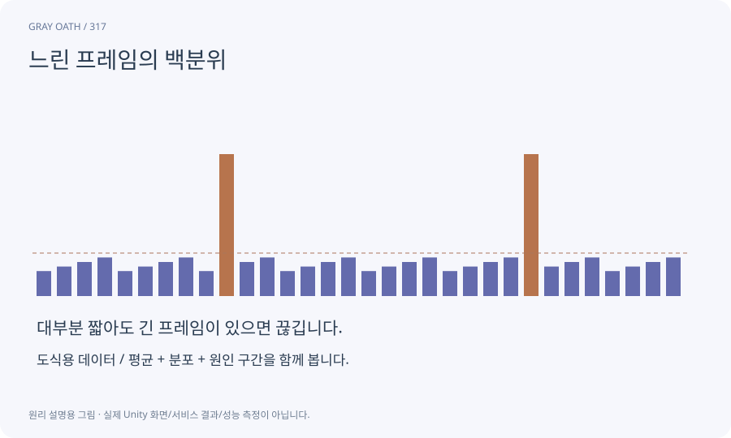

# 느린 프레임의 백분위

측정값을 작은 순서로 정렬했을 때 특정 비율이 그 값 이하인 지점을 나타냅니다. 평균이 숨기는 간헐적인 큰 지연을 파악하는 데 도움이 됩니다.

## 익숙한 비유

대기시간 평균뿐 아니라100명 중95명이 어느 정도 안에 처리됐는지 보는 것입니다.



## 작동 원리

### 1. 구간 고정

워밍업과 측정 구간·기기·품질을 정합니다.

### 2. 분포 계산

같은 표본에서 p50·p95·p99와 최대값을 계산합니다.

### 3. 전후 비교

표본 수와 지연 원인을 함께 대조합니다.

## 성능 수치를 읽는 순서

PC60fps는 약16.67ms, Android30fps는 약33.33ms가 목표 프레임 간격입니다. 이 값은 게임이 달성했다는 측정이 아니라 비교를 시작하는 설계선입니다.

워밍업·기기·밝기·전원·품질·build hash·seed를 같이 기록해야 변경 전후 비교가 의미가 있습니다.

| 지표 | 뜻 | 같이 볼 것 |

|---|---|---|

| 평균 프레임 시간 | 구간 총시간/프레임수 | 간헐적인 지연을 숨길 수 있음 |

| p95 / p99 | 정렬된 표본의95% /99% 지점 | 산정법·표본 수·측정 구간 |

| 최대 프레임 시간 | 해당 구간의 가장 긴 한 프레임 | 로딩/GC/OS 작업 등 원인 |

| CPU/GPU 시간 | 서로 다른 처리 구간 | 파이프라인으로 겹치므로 단순 합산 금지 |

## 게임 속 예

대부분16ms인데 가끔120ms면 평균 FPS만으로 체감 끊김을 설명하기 어렵습니다. 99표본의 p99와 수만 표본의 p99는 신뢰 범위가 다릅니다.

## 혼동하지 않기

p99는 최악값도 아니고, 다른 기기의 성능 보장도 아닙니다.

## 확인 질문

1000프레임 중 p95가30ms라면?

사용한 산정법에서 약95%가30ms 이하라는 뜻이며 나머지 지연과 최대값도 확인해야 합니다.

## 내 프로젝트에서 확인하기

```text
현재 GrayOathRPG3D에서 느린 프레임의 백분위을 사용하는 실제 대상과 동작을 읽기 전용으로 확인해 줘. 쉬운 말과 작은 사례로 설명하고 p99는 최악값도 아니고, 다른 기기의 성능 보장도 아닙니다. 이 문제를 어떻게 막는지 보여 줘. 코드·데이터·설정은 아직 수정하지 마.
```

## 관련 해설

[frame-time](frame-time.md) · [profiler](profiler.md) · [thermal-budget](thermal-budget.md)

## 공식 참고

- [Unity · 실제 대상 기기 프로파일링](https://docs.unity3d.com/6000.3/Documentation/Manual/profiling-target-device.html)
