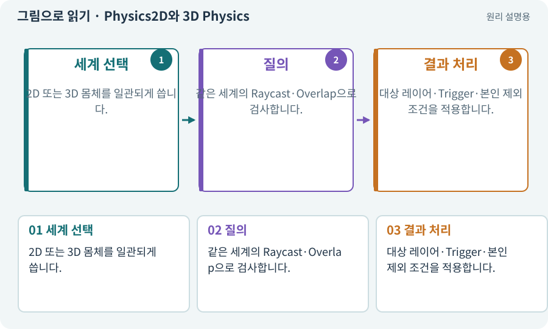

# Physics2D와 3D Physics

**분야:** 오브젝트·좌표·움직임

Physics2D는 2D 몸체와 충돌을 다루는 물리 시스템·조회 API입니다. Physics는 3D 쪽에 사용됩니다. 그림이 2D처럼 보여도 어떤 시스템을 쓰는지는 컴포넌트로 결정됩니다.

**찾아오는 이름:** Physics2D와 3D Physics, Physics2D, Physics, 2D 물리, 3D 물리

## 익숙한 것에 비유하면

종이 지도 위 교통과 입체 도로 모형의 교통을 별개로 시뮬레이션하는 것과 같습니다. 겉모습만으로 어느 모형인지 알 수 없습니다.



개념도입니다. 실제 Unity 화면이나 검사 결과가 아닙니다. 그림의 순서·색은 역할을 구분하며 실제 설정값은 프로젝트에서 확인합니다.

## 이렇게 작동합니다

### 1. 세계 선택

2D 또는 3D 몸체를 일관되게 씁니다.

### 2. 질의

같은 세계의 Raycast·Overlap으로 검사합니다.

### 3. 결과 처리

대상 레이어·Trigger·본인 제외 조건을 적용합니다.

## 우리 RPG에서는 이렇게 만나요

스프라이트 적에게 3D Physics.Raycast를 쏘면 Collider2D를 찾지 못할 수 있습니다. 공격 판정이 없는 것처럼 보여도 실제로는 다른 물리 세계를 검사한 것입니다.

## 이것과 혼동하지 마세요

렌더링 정렬 순서가 물리 충돌 순서를 결정하지 않습니다.

## 이해했는지 한 번 생각해 보기

그림은 겹치는데 공격이 전혀 안 맞는 원인 후보는?

<details><summary>답과 이유</summary>

물리 차원·레이어 필터·몸체·피격 대상 연결을 확인합니다.

</details>

## 내 프로젝트에서 확인하고 싶다면

아래 요청은 읽기 전용으로 실제 대상을 확인하는 선택 요청입니다. 코드나 설정을 직접 편집할 필요는 없습니다.

```text
현재 프로젝트에서 Physics2D와 3D Physics 관련 요소가 어떻게 사용되는지 읽기 전용으로 확인해 줘. 실제 대상과 설정을 찾아 쉬운 말과 작은 예로 설명해 줘. 특히 다음 혼동을 구분해 줘: 렌더링 정렬 순서가 물리 충돌 순서를 결정하지 않습니다. 아직 코드·설정·파일은 바꾸지 말고, 확인할 수 없는 내용은 따로 알려 줘.
```

## 이어지는 개념

[Collider와 몸체 경계](collider.md) · [Raycast·Linecast·Cast](raycast.md) · [Layer·LayerMask·Tag](layer.md) · [Sorting Layer·Order·발 정렬](sorting.md)

## 이 개념을 사용하는 실습

[08 · WASD로 벽에 부딪히며 이동하기](../index.html#lesson-008) · [13 · 적을 클릭해 접근하고 공격하기](../index.html#lesson-013) · [14 · 나를 발견하고 공격하는 적 만들기](../index.html#lesson-014) · [29 · 방마다 적과 상자 배치하기](../index.html#lesson-029) · [37 · 느려지는 원인을 측정해 고치기](../index.html#lesson-037) · [44 · 시드로 같은 던전 다시 만들기](../index.html#lesson-044) · [48 · 적이 나를 보고 놓치게 만들기](../index.html#lesson-048) · [49 · 여러 근접 적의 공격 나누기](../index.html#lesson-049) · [55 · 어떤 그림도 맞춰 넣는 아트 규격 정하기](../index.html#lesson-055) · [79 · 추가 기능을 하나의 게임으로 합치기](../index.html#lesson-079) · [81 · 2D 게임을 남기고 3D 작업 시작하기](../index.html#lesson-081) · [82 · 게임 규칙은 재사용하고 공간만 바꾸기](../index.html#lesson-082) · [86 · 3D에서도 클릭한 곳까지 돌아가기](../index.html#lesson-086) · [89 · 같은 전투 규칙을 3D에 연결하기](../index.html#lesson-089) · [135 · 벽을 통과하지 않는 회피 만들기](../index.html#lesson-135) · [156 · 기능 조합에서 숨은 오류 찾기](../index.html#lesson-156)

## 참고와 설명의 범위

기본 도구 동작은 아래 공식 자료를 참고했습니다. 비유·그림·RPG의 예시 수치와 정책은 이해를 위한 자체 예제입니다. 실제 API·지원 기능은 설치 버전과 계정에서 확인합니다.

- [Unity · Rigidbody2D](https://docs.unity3d.com/6000.3/Documentation/Manual/2d-physics/rigidbody/introduction-to-rigidbody-2d.html)
- [Unity · Physics2D.CircleCast](https://docs.unity3d.com/6000.3/Documentation/ScriptReference/Physics2D.CircleCast.html)

그림·계산 예제·조작 모형은 자체 제작한 설명입니다. 실제 Unity 화면, 서비스 생성 결과, 성능 실측 또는 게임 테스트 결과가 아닙니다. 자료 확인: 2026년 9월 26일.
