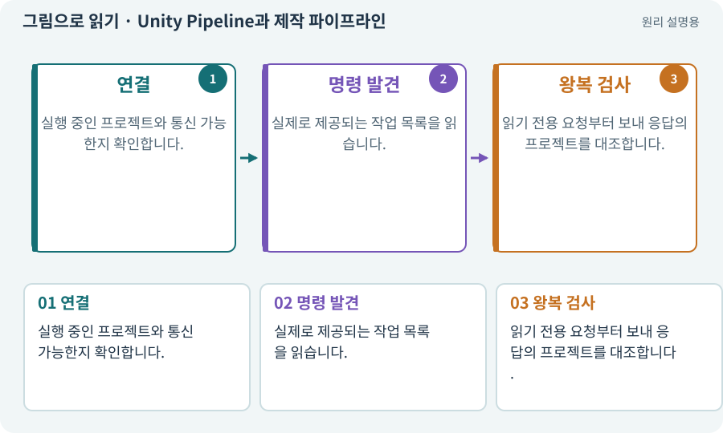

# Unity Pipeline과 제작 파이프라인

**분야:** 시작·도구·작업 공간

일반적으로 파이프라인은 여러 처리 단계를 이어 놓은 흐름입니다. 여기서 Unity Pipeline은 CLI와 실행 중인 Editor를 연결하는 패키지를 가리킵니다. 렌더 파이프라인과는 다른 뜻입니다.

**찾아오는 이름:** Unity Pipeline과 제작 파이프라인, Unity Pipeline, Pipeline, 파이프라인

## 익숙한 것에 비유하면

주문 창구와 주방 사이의 주문 전달 시스템입니다. 주방이 꺼져 있거나 다른 매장으로 연결되면 올바른 음식이 나오지 않습니다.



개념도입니다. 실제 Unity 화면이나 검사 결과가 아닙니다. 그림의 순서·색은 역할을 구분하며 실제 설정값은 프로젝트에서 확인합니다.

## 이렇게 작동합니다

### 1. 연결

실행 중인 프로젝트와 통신 가능한지 확인합니다.

### 2. 명령 발견

실제로 제공되는 작업 목록을 읽습니다.

### 3. 왕복 검사

읽기 전용 요청부터 보내 응답의 프로젝트를 대조합니다.

## 우리 RPG에서는 이렇게 만나요

2D 프로젝트에 연결했다고 생각했는데 열린 Editor가 3D 후보라면 수정 전에 멈춰야 합니다. 작은 확인 명령으로 경로·씬·버전을 돌려받게 합니다.

## 이것과 혼동하지 마세요

URP도 pipeline이라는 말을 쓰지만 화면 그리기 순서입니다. CLI 연결 패키지와 설치 목적이 다릅니다.

## 이해했는지 한 번 생각해 보기

Pipeline 연결 성공만으로 Play 검사도 완료인가요?

<details><summary>답과 이유</summary>

아닙니다. 연결, 명령 실행, 실제 플레이 검사는 각각 별도입니다.

</details>

## 내 프로젝트에서 확인하고 싶다면

아래 요청은 읽기 전용으로 실제 대상을 확인하는 선택 요청입니다. 코드나 설정을 직접 편집할 필요는 없습니다.

```text
현재 프로젝트에서 Unity Pipeline과 제작 파이프라인 관련 요소가 어떻게 사용되는지 읽기 전용으로 확인해 줘. 실제 대상과 설정을 찾아 쉬운 말과 작은 예로 설명해 줘. 특히 다음 혼동을 구분해 줘: URP도 pipeline이라는 말을 쓰지만 화면 그리기 순서입니다. CLI 연결 패키지와 설치 목적이 다릅니다. 아직 코드·설정·파일은 바꾸지 말고, 확인할 수 없는 내용은 따로 알려 줘.
```

## 이어지는 개념

[CLI와 GUI](cli.md) · [URP·2D Renderer·Universal Renderer](render-pipeline.md) · [API와 매개변수](api.md) · [프로세스·종료 코드·표준 출력](process.md)

## 이 개념을 사용하는 실습

[03 · AI와 실행 중인 Unity 연결하기](../index.html#lesson-003) · [38 · 테스트 결과와 실제 플레이 구분하기](../index.html#lesson-038) · [39 · 다른 PC와 Android 에서 실행할 파일 만들기](../index.html#lesson-039) · [94 · 같은 랜덤 던전을 3D로 생성하기](../index.html#lesson-094) · [124 · 현재 컴퓨터의 Unity 명령 등록하기](../index.html#lesson-124) · [130 · 첫 확장 작업을 하네스에 연결하기](../index.html#lesson-130)

## 참고와 설명의 범위

기본 도구 동작은 아래 공식 자료를 참고했습니다. 비유·그림·RPG의 예시 수치와 정책은 이해를 위한 자체 예제입니다. 실제 API·지원 기능은 설치 버전과 계정에서 확인합니다.

- [Unity · 2D 게임 제작 흐름](https://docs.unity3d.com/6000.3/Documentation/Manual/2d-game-creation-wokflow.html)

그림·계산 예제·조작 모형은 자체 제작한 설명입니다. 실제 Unity 화면, 서비스 생성 결과, 성능 실측 또는 게임 테스트 결과가 아닙니다. 자료 확인: 2026년 9월 26일.
