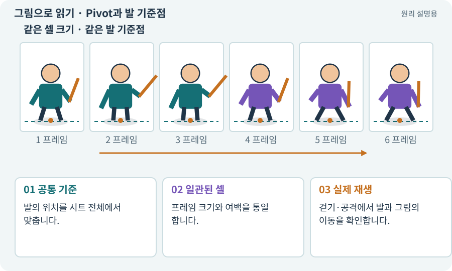

# Pivot과 발 기준점

**분야:** 그림·애니메이션·화면 만들기

Pivot은 그림을 배치·회전·정렬할 때 사용하는 기준점입니다. 탑다운 캐릭터는 발바닥 근처의 일정한 기준점을 쓰면 프레임마다 몸이 튀는 현상을 줄일 수 있습니다.

**찾아오는 이름:** Pivot과 발 기준점, Pivot, pivot, 피벗, 발 기준점, 기준점

## 익숙한 것에 비유하면

종이 인형을 같은 핀에 꽂아 두는 것입니다. 그림마다 핀 위치가 바뀌면 걷지 않아도 몸이 흔들립니다.



개념도입니다. 실제 Unity 화면이나 검사 결과가 아닙니다. 그림의 순서·색은 역할을 구분하며 실제 설정값은 프로젝트에서 확인합니다.

## 이렇게 작동합니다

### 1. 공통 기준

발의 위치를 시트 전체에서 맞춥니다.

### 2. 일관된 셀

프레임 크기와 여백을 통일합니다.

### 3. 실제 재생

걷기·공격에서 발과 그림의 이동을 확인합니다.

## 발을 같은 점에 놓으면 애니메이션이 흔들리지 않아요

Pivot은 그림을 오브젝트 위치에 맞출 기준점입니다. 같은 크기의 셀에 그림이 들어 있어도 프레임마다 발 위치가 다르면 캐릭터가 위아래로 튀는 것처럼 보입니다. 그림 중심은 공격 자세에서 바뀔 수 있으므로 발 접점을 일관되게 유지하는 방식이 유용합니다.

슬라이스된 사각형의 왼쪽 아래를 (0,0), 오른쪽 위를 (1,1)로 생각하면 (0.5,0)은 아래 가운데입니다. 그러나 투명 여백 안에 발이 있는 그림은 단순히 (0.5,0)을 적용하는 것만으로 해결되지 않을 수 있습니다. 원본 셀과 실제 발 픽셀을 함께 확인합니다.

UI의 RectTransform Pivot과 스프라이트 Pivot은 모두 기준점이라는 공통점이 있지만 설정 대상이 다릅니다. 바닥 정렬은 스프라이트의 발 위치, UI 회전·확대는 UI 사각형의 기준점으로 구분합니다.

| 처리 | 그림 변화 | 게임 규칙 |
| --- | --- | --- |
| 피벗 정렬 | 발이 동일 기준에 놓임 | 몸체 반경은 그대로 |
| 프레임별 트리밍 | 사각형 크기가 달라질 수 있음 | 오프셋 복원 필요 |
| ActorRoot 이동 | 모든 외형이 함께 이동 | 실제 위치가 바뀜 |

## 직접 값을 바꾸며 보기

[웹 해설의 조작 모형 열기](../index.html#tech-pivot). 조작은 설명용 모형만 바꿉니다. 실제 프로젝트·AI·진행 체크·게임 테스트는 실행하거나 변경하지 않습니다.

## 우리 RPG에서는 이렇게 만나요

검을 크게 휘두르는 프레임은 그림의 중심이 옮겨질 수 있습니다. 매 프레임 시각 중심을 Pivot으로 쓰면 발이 미끄러지므로 고정 발점을 보존합니다.

## 이것과 혼동하지 마세요

Pivot은 Collider 중심과 반드시 같아야 하는 것은 아닙니다. 목적과 좌표 변환을 명시합니다.

## 이해했는지 한 번 생각해 보기

제자리 공격인데 발이 위아래로 튀면?

<details><summary>답과 이유</summary>

프레임별 Pivot·잘라낸 영역·트리밍 오프셋을 확인합니다.

</details>

## 내 프로젝트에서 확인하고 싶다면

아래 요청은 읽기 전용으로 실제 대상을 확인하는 선택 요청입니다. 코드나 설정을 직접 편집할 필요는 없습니다.

```text
현재 프로젝트에서 Pivot과 발 기준점 관련 요소가 어떻게 사용되는지 읽기 전용으로 확인해 줘. 실제 대상과 설정을 찾아 쉬운 말과 작은 예로 설명해 줘. 특히 다음 혼동을 구분해 줘: Pivot은 Collider 중심과 반드시 같아야 하는 것은 아닙니다. 목적과 좌표 변환을 명시합니다. 아직 코드·설정·파일은 바꾸지 말고, 확인할 수 없는 내용은 따로 알려 줘.
```

## 이어지는 개념

[스프라이트 시트](sprite-sheet.md) · [트리밍·오프셋·고정 셀](trimming.md) · [Sorting Layer·Order·발 정렬](sorting.md) · [Collider와 몸체 경계](collider.md)

## 이 개념을 사용하는 실습

[05 · 말로 스프라이트 하나 만들기](../index.html#lesson-005) · [07 · 캐릭터와 벽이 있는 공간 만들기](../index.html#lesson-007) · [33 · 기본 캐릭터·몬스터·타일 아트 만들기](../index.html#lesson-033) · [55 · 어떤 그림도 맞춰 넣는 아트 규격 정하기](../index.html#lesson-055) · [56 · Unity AI로 캐릭터 움직임 만들기](../index.html#lesson-056) · [64 · 추가 결제 없이 AI로 2D 프레임 만들기](../index.html#lesson-064) · [65 · 스프라이트를 정리해 실제 캐릭터에 넣기](../index.html#lesson-065) · [87 · 같은 캐릭터를 실제 3D 모델로 만들기](../index.html#lesson-087) · [88 · 3D 모델에 걷기와 공격 연결하기](../index.html#lesson-088) · [97 · 선택: 3D 모델에서 2D 시트 만들기](../index.html#lesson-097) · [148 · 아트 역할로 새 지역 외형 완성하기](../index.html#lesson-148)

## 참고와 설명의 범위

기본 도구 동작은 아래 공식 자료를 참고했습니다. 비유·그림·RPG의 예시 수치와 정책은 이해를 위한 자체 예제입니다. 실제 API·지원 기능은 설치 버전과 계정에서 확인합니다.

- [Unity · Sprite](https://docs.unity3d.com/6000.3/Documentation/Manual/sprite/sprite-landing.html)

그림·계산 예제·조작 모형은 자체 제작한 설명입니다. 실제 Unity 화면, 서비스 생성 결과, 성능 실측 또는 게임 테스트 결과가 아닙니다. 자료 확인: 2026년 9월 26일.
