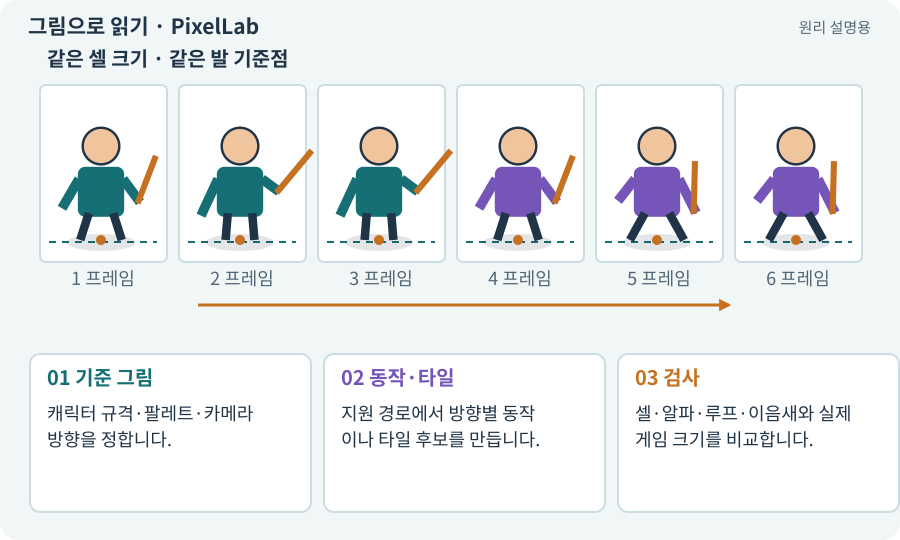

# PixelLab·픽셀 자산 제작

**분야:** 자산 제작·렌더링 보충

PixelLab은 픽셀 캐릭터·애니메이션·타일 제작 기능을 제공하는 게임 아트 도구입니다. 전용 기능이 있어도 방향·손·무기·발 위치의 결과 검사는 필요합니다.

**찾아오는 이름:** PixelLab·픽셀 자산 제작, PixelLab, 픽셀랩

## 익숙한 것에 비유하면

픽셀 아트 작업에 맞춘 도구함으로 볼 수 있습니다. 도구가 특정 작업에 맞아도 시안이 곧 최종 납품물은 아닙니다.



개념도입니다. 실제 Unity 화면이나 검사 결과가 아닙니다. 그림의 순서·색은 역할을 구분하며 실제 설정값은 프로젝트에서 확인합니다.

## 이렇게 작동합니다

### 1. 기준 그림

캐릭터 규격·팔레트·카메라 방향을 정합니다.

### 2. 동작·타일

지원 경로에서 방향별 동작이나 타일 후보를 만듭니다.

### 3. 검사

셀·알파·루프·이음새와 실제 게임 크기를 비교합니다.

## 우리 RPG에서는 이렇게 만나요

근접병의 걷기와 공격에 같은 얼굴·장비·발 기준을 유지하는지 확인합니다. 지원 웹·API·연동 방식은 AI에게 실제 계정과 공식 문서로 확인하게 하며 픽셀 수정도 AI 작업으로 요청합니다.

## 이것과 혼동하지 마세요

전문 서비스라는 이유만으로 8방향·모든 동작·일정 비용을 보장한다고 안내하지 않습니다.

## 이해했는지 한 번 생각해 보기

캐릭터가 매 프레임 다른 검을 들면 어떻게 하나요?

<details><summary>답과 이유</summary>

참조·동작 규격을 좁히고 프레임을 비교해 재생성·정리한 뒤 연결합니다.

</details>

## 내 프로젝트에서 확인하고 싶다면

아래 요청은 읽기 전용으로 실제 대상을 확인하는 선택 요청입니다. 코드나 설정을 직접 편집할 필요는 없습니다.

```text
현재 프로젝트에서 PixelLab·픽셀 자산 제작 관련 요소가 어떻게 사용되는지 읽기 전용으로 확인해 줘. 실제 대상과 설정을 찾아 쉬운 말과 작은 예로 설명해 줘. 특히 다음 혼동을 구분해 줘: 전문 서비스라는 이유만으로 8방향·모든 동작·일정 비용을 보장한다고 안내하지 않습니다. 아직 코드·설정·파일은 바꾸지 말고, 확인할 수 없는 내용은 따로 알려 줘.
```

## 이어지는 개념

[생성형 아트·참조 이미지·후처리](image-service.md) · [스프라이트 시트](sprite-sheet.md) · [Pivot과 발 기준점](pivot.md) · [아트 규격·레퍼런스·키 포즈](art-spec.md)

## 이 개념을 사용하는 실습

[58 · PixelLab로 방향별 픽셀 캐릭터 만들기](../index.html#lesson-058) · [67 · 내 게임의 아트 제작 경로 선택하기](../index.html#lesson-067)

## 참고와 설명의 범위

기본 도구 동작은 아래 공식 자료를 참고했습니다. 비유·그림·RPG의 예시 수치와 정책은 이해를 위한 자체 예제입니다. 실제 API·지원 기능은 설치 버전과 계정에서 확인합니다.

- [PixelLab · Pixelorama 통합과 제작](https://www.pixellab.ai/docs/introduction-pixelorama)

그림·계산 예제·조작 모형은 자체 제작한 설명입니다. 실제 Unity 화면, 서비스 생성 결과, 성능 실측 또는 게임 테스트 결과가 아닙니다. 자료 확인: 2026년 9월 26일.
