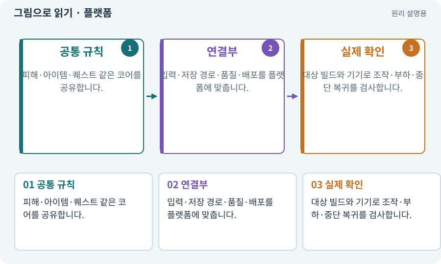

# 플랫폼·Editor·실기기

**분야:** 설명을 읽기 위한 기초 언어

플랫폼은 게임이 실행되는 운영체제·하드웨어 환경입니다. Editor, Windows 플레이어, Android 실제 기기는 입력·성능·권한·파일 경로가 다릅니다. 에뮬레이터는 일부 환경을 모사하는 도구입니다.

**찾아오는 이름:** 플랫폼·Editor·실기기, 플랫폼, Platform, platform, Windows, Android, PC, 실기기, 에뮬레이터, 시뮬레이터

## 익숙한 것에 비유하면

같은 레시피를 다른 주방과 장비에서 요리하는 상황입니다. 한 주방의 성공이 다른 주방의 성공을 자동 보장하지 않습니다.



개념도입니다. 실제 Unity 화면이나 검사 결과가 아닙니다. 그림의 순서·색은 역할을 구분하며 실제 설정값은 프로젝트에서 확인합니다.

## 이렇게 작동합니다

### 1. 공통 규칙

피해·아이템·퀘스트 같은 코어를 공유합니다.

### 2. 연결부

입력·저장 경로·품질·배포를 플랫폼에 맞춥니다.

### 3. 실제 확인

대상 빌드와 기기로 조작·부하·중단 복귀를 검사합니다.

## 우리 RPG에서는 이렇게 만나요

마우스로 조이스틱을 드래그한 것은 휴대폰에서 두 손가락으로 이동과 공격을 동시에 했다는 증거가 아닙니다. 기기가 없으면 해당 검사를 미실행으로 남깁니다.

## 이것과 혼동하지 마세요

PC가 빠르다고 휴대폰에서도 같은 FPS·메모리 여유가 나온다고 보지 않습니다.

## 이해했는지 한 번 생각해 보기

에뮬레이터가 정상이라면 실기기 검사는 필요 없나요?

<details><summary>답과 이유</summary>

실제 터치·GPU·발열·중단·권한을 확인할 기기 검사는 별도입니다.

</details>

## 내 프로젝트에서 확인하고 싶다면

아래 요청은 읽기 전용으로 실제 대상을 확인하는 선택 요청입니다. 코드나 설정을 직접 편집할 필요는 없습니다.

```text
현재 프로젝트에서 플랫폼·Editor·실기기 관련 요소가 어떻게 사용되는지 읽기 전용으로 확인해 줘. 실제 대상과 설정을 찾아 쉬운 말과 작은 예로 설명해 줘. 특히 다음 혼동을 구분해 줘: PC가 빠르다고 휴대폰에서도 같은 FPS·메모리 여유가 나온다고 보지 않습니다. 아직 코드·설정·파일은 바꾸지 말고, 확인할 수 없는 내용은 따로 알려 줘.
```

## 이어지는 개념

[ABI·ARM64·x86_64](abi.md) · [게임 빌드·개발 빌드·배포](build.md) · [멀티터치·가상 조이스틱](multitouch.md) · [Profiler·병목·실기기 측정](profiler.md)

## 이 개념을 사용하는 실습

[01 · 빈 2D 프로젝트 만들기](../index.html#lesson-001) · [02 · 내 게임을 알아듣는 개발 스킬 만들기](../index.html#lesson-002) · [03 · AI와 실행 중인 Unity 연결하기](../index.html#lesson-003) · [04 · 되돌릴 수 있는 작업 습관 만들기](../index.html#lesson-004) · [10 · 모바일 조이스틱과 버튼 배치하기](../index.html#lesson-010) · [11 · PC와 휴대폰에서 처음 실행하기](../index.html#lesson-011) · [13 · 적을 클릭해 접근하고 공격하기](../index.html#lesson-013) · [16 · 물약을 쓰고 죽은 뒤 다시 시작하기](../index.html#lesson-016) · [19 · 누가 때렸는지 보이는 전투 만들기](../index.html#lesson-019) · [22 · 장비를 주워 24칸 가방에 넣기](../index.html#lesson-022) · [24 · 보기 편한 인벤토리 화면 만들기](../index.html#lesson-024) · [25 · 게임을 껐다 켜도 장비 유지하기](../index.html#lesson-025) · [27 · 회복하고 물약을 사는 마을 만들기](../index.html#lesson-027) · [32 · 길 안내와 처음 하는 사람의 동선 만들기](../index.html#lesson-032) · [35 · 앞뒤 가림과 PC 조작 다듬기](../index.html#lesson-035) · [36 · 휴대폰에서 두 손가락으로 전투하기](../index.html#lesson-036) · [37 · 느려지는 원인을 측정해 고치기](../index.html#lesson-037) · [38 · 테스트 결과와 실제 플레이 구분하기](../index.html#lesson-038) · [39 · 다른 PC와 Android 에서 실행할 파일 만들기](../index.html#lesson-039) · [40 · 작은 RPG를 처음부터 끝까지 플레이하기](../index.html#lesson-040) · [42 · 트리에서 투자하고 저장하기](../index.html#lesson-042) · [44 · 시드로 같은 던전 다시 만들기](../index.html#lesson-044) · [47 · 실패하는 시드를 찾고 복구하기](../index.html#lesson-047) · [53 · 입력은 빠르게, 취소 규칙은 명확하게](../index.html#lesson-053) · [65 · 스프라이트를 정리해 실제 캐릭터에 넣기](../index.html#lesson-065) · [72 · 모바일 효과를 줄여도 위험은 남기기](../index.html#lesson-072) · [74 · 추가 외형을 서버에서 받게 준비하기](../index.html#lesson-074) · [77 · 앱을 바꾸지 않고 외형 업데이트하기](../index.html#lesson-077) · [78 · 선택: Google Play 에셋 전달 사용하기](../index.html#lesson-078) · [79 · 추가 기능을 하나의 게임으로 합치기](../index.html#lesson-079) · [80 · 나만의 2D RPG 완성하기](../index.html#lesson-080) · [81 · 2D 게임을 남기고 3D 작업 시작하기](../index.html#lesson-081) · [94 · 같은 랜덤 던전을 3D로 생성하기](../index.html#lesson-094) · [96 · 3D 카메라 가림과 터치 조작 다듬기](../index.html#lesson-096) · [98 · 3D 팩을 2D 팩과 따로 내려받기](../index.html#lesson-098) · [101 · 3D Android 성능 다시 측정하기](../index.html#lesson-101) · [102 · 네 배포물을 구분해 만들기](../index.html#lesson-102) · [104 · 2D와 3D를 두 플랫폼에서 완주하기](../index.html#lesson-104) · [107 · 원본을 보호하고 허용 경로 정하기](../index.html#lesson-107) · [114 · 테스트를 실행하고 결과 읽기](../index.html#lesson-114) · [115 · 지금 코드의 검사만 인정하기](../index.html#lesson-115) · [116 · “어디까지 됐어?”에 근거로 답하기](../index.html#lesson-116) · [124 · 현재 컴퓨터의 Unity 명령 등록하기](../index.html#lesson-124) · [126 · 한 요청으로 필터 기능 끝내기](../index.html#lesson-126) · [128 · 내 도구를 대화로 운영하기](../index.html#lesson-128) · [129 · 기존 2D 게임에서 확장팩 시작하기](../index.html#lesson-129) · [131 · 중요한 전리품만 표시하는 규칙 만들기](../index.html#lesson-131) · [132 · 필터를 실제 던전과 모바일에 연결하기](../index.html#lesson-132) · [135 · 벽을 통과하지 않는 회피 만들기](../index.html#lesson-135) · [137 · 기름·폭발통·밸브로 공간 활용하기](../index.html#lesson-137) · [140 · 개인 창고와 즐겨찾기 만들기](../index.html#lesson-140) · [147 · 용광로 감시자와 3단계 전투 만들기](../index.html#lesson-147) · [151 · 도감과 장비 비교로 새 기능 찾기](../index.html#lesson-151) · [152 · 이전 저장을 새 확장판으로 가져오기](../index.html#lesson-152) · [154 · 확장 기능을 켠 휴대폰 성능 고치기](../index.html#lesson-154) · [156 · 기능 조합에서 숨은 오류 찾기](../index.html#lesson-156) · [159 · 최종 확장판 배포 후보 만들기](../index.html#lesson-159) · [160 · 대장간 보스까지 완주하고 새 기능 맡기기](../index.html#lesson-160)

## 참고와 설명의 범위

기본 도구 동작은 아래 공식 자료를 참고했습니다. 비유·그림·RPG의 예시 수치와 정책은 이해를 위한 자체 예제입니다. 실제 API·지원 기능은 설치 버전과 계정에서 확인합니다.

- [Unity · Android 빌드](https://docs.unity3d.com/6000.3/Documentation/Manual/android-BuildProcess.html)
- [Unity · 타깃 기기 프로파일링](https://docs.unity3d.com/6000.3/Documentation/Manual/profiling-target-device.html)

그림·계산 예제·조작 모형은 자체 제작한 설명입니다. 실제 Unity 화면, 서비스 생성 결과, 성능 실측 또는 게임 테스트 결과가 아닙니다. 자료 확인: 2026년 9월 26일.
