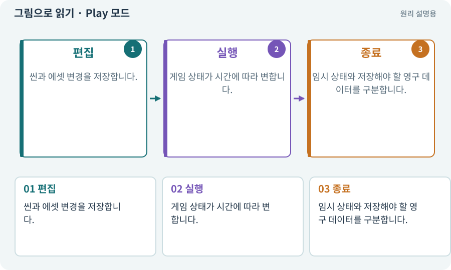

# Play 모드·편집 모드·런타임

**분야:** 시작·도구·작업 공간

편집 모드는 제작 상태이고 Play 모드는 게임 로직을 실행해 보는 상태입니다. 런타임은 게임이 실제로 실행되는 시간과 환경을 뜻합니다.

**찾아오는 이름:** Play 모드·편집 모드·런타임, Play, Play 모드, 런타임, Runtime, EditMode, PlayMode

## 익숙한 것에 비유하면

악보 편집과 실제 연주를 구분하는 것과 같습니다. 연주 중 임시로 바꾼 소리가 악보에 영구 기록된 것은 아닙니다.



개념도입니다. 실제 Unity 화면이나 검사 결과가 아닙니다. 그림의 순서·색은 역할을 구분하며 실제 설정값은 프로젝트에서 확인합니다.

## 이렇게 작동합니다

### 1. 편집

씬과 에셋 변경을 저장합니다.

### 2. 실행

게임 상태가 시간에 따라 변합니다.

### 3. 종료

임시 상태와 저장해야 할 영구 데이터를 구분합니다.

## 우리 RPG에서는 이렇게 만나요

Play 중 체력을 999로 바꿔 확인했더라도 정상 시작 체력이나 저장 데이터까지 그렇게 바뀐 것은 아닙니다. 에셋에 대한 쓰기는 별도 부작용이 생길 수 있어 주의합니다.

## 이것과 혼동하지 마세요

Play에서 보인 상태만 보고 저장·재개방까지 통과했다고 기록하지 않습니다.

## 이해했는지 한 번 생각해 보기

Play를 끝낸 뒤 위치가 돌아간 이유는?

<details><summary>답과 이유</summary>

실행 중 객체의 임시 변경이었을 수 있습니다. 편집 저장과 런타임 저장은 다릅니다.

</details>

## 내 프로젝트에서 확인하고 싶다면

아래 요청은 읽기 전용으로 실제 대상을 확인하는 선택 요청입니다. 코드나 설정을 직접 편집할 필요는 없습니다.

```text
현재 프로젝트에서 Play 모드·편집 모드·런타임 관련 요소가 어떻게 사용되는지 읽기 전용으로 확인해 줘. 실제 대상과 설정을 찾아 쉬운 말과 작은 예로 설명해 줘. 특히 다음 혼동을 구분해 줘: Play에서 보인 상태만 보고 저장·재개방까지 통과했다고 기록하지 않습니다. 아직 코드·설정·파일은 바꾸지 말고, 확인할 수 없는 내용은 따로 알려 줘.
```

## 이어지는 개념

[씬과 씬 전환](scene.md) · [파일 저장·게임 세이브·백업](save.md) · [컴파일·어셈블리·도메인 리로드](compile.md) · [수명주기·초기화·정리](lifecycle.md)

## 이 개념을 사용하는 실습

[03 · AI와 실행 중인 Unity 연결하기](../index.html#lesson-003) · [04 · 되돌릴 수 있는 작업 습관 만들기](../index.html#lesson-004) · [05 · 말로 스프라이트 하나 만들기](../index.html#lesson-005) · [06 · 시작 메뉴와 테스트 공간 연결하기](../index.html#lesson-006) · [12 · 체력과 피해를 눈으로 확인하기](../index.html#lesson-012) · [38 · 테스트 결과와 실제 플레이 구분하기](../index.html#lesson-038) · [39 · 다른 PC와 Android 에서 실행할 파일 만들기](../index.html#lesson-039) · [44 · 시드로 같은 던전 다시 만들기](../index.html#lesson-044) · [72 · 모바일 효과를 줄여도 위험은 남기기](../index.html#lesson-072) · [78 · 선택: Google Play 에셋 전달 사용하기](../index.html#lesson-078) · [86 · 3D에서도 클릭한 곳까지 돌아가기](../index.html#lesson-086) · [94 · 같은 랜덤 던전을 3D로 생성하기](../index.html#lesson-094) · [102 · 네 배포물을 구분해 만들기](../index.html#lesson-102) · [105 · 내 개발 도구를 빈 폴더에서 시작하기](../index.html#lesson-105) · [117 · Unity 작업을 한 창구로 모으기](../index.html#lesson-117) · [123 · 기존 게임의 실제 파일 찾아 연결하기](../index.html#lesson-123) · [125 · 하네스로 작은 전리품 화면 만들기](../index.html#lesson-125) · [130 · 첫 확장 작업을 하네스에 연결하기](../index.html#lesson-130)

## 참고와 설명의 범위

기본 도구 동작은 아래 공식 자료를 참고했습니다. 비유·그림·RPG의 예시 수치와 정책은 이해를 위한 자체 예제입니다. 실제 API·지원 기능은 설치 버전과 계정에서 확인합니다.

- [Unity · 2D 게임 제작 흐름](https://docs.unity3d.com/6000.3/Documentation/Manual/2d-game-creation-wokflow.html)

그림·계산 예제·조작 모형은 자체 제작한 설명입니다. 실제 Unity 화면, 서비스 생성 결과, 성능 실측 또는 게임 테스트 결과가 아닙니다. 자료 확인: 2026년 9월 26일.
