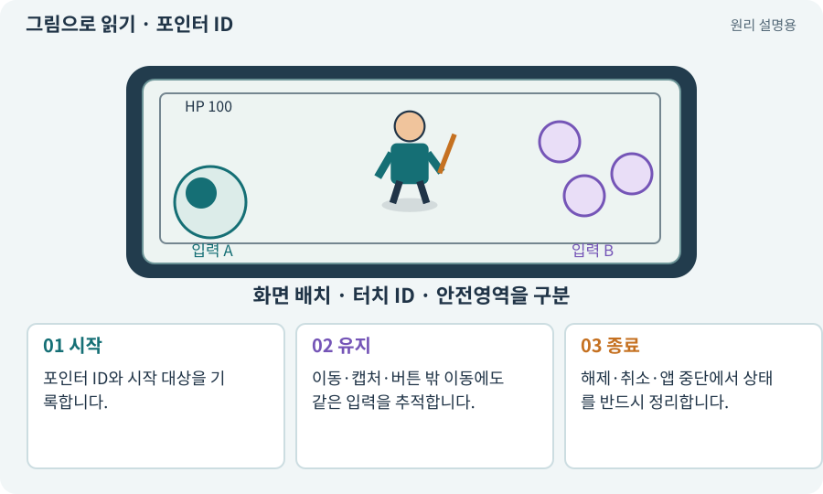

# 포인터 ID·누름·해제·캡처

**분야:** 입력·UI·소리·성능

포인터는 마우스나 터치 접점처럼 화면을 가리키는 입력입니다. ID는 동시에 들어오는 접점을 구분하고, 누름·이동·해제·취소는 한 입력의 단계입니다.

**찾아오는 이름:** 포인터 ID·누름·해제·캡처, pointerId, Pointer, 포인터 ID, pointerdown, pointerup, 포인터 캡처, 눌림, held

## 익숙한 것에 비유하면

각 손가락에 번호표를 붙여 어느 손가락이 어떤 버튼을 맡았는지 구분하는 것입니다.



개념도입니다. 실제 Unity 화면이나 검사 결과가 아닙니다. 그림의 순서·색은 역할을 구분하며 실제 설정값은 프로젝트에서 확인합니다.

## 이렇게 작동합니다

### 1. 시작

포인터 ID와 시작 대상을 기록합니다.

### 2. 유지

이동·캡처·버튼 밖 이동에도 같은 입력을 추적합니다.

### 3. 종료

해제·취소·앱 중단에서 상태를 반드시 정리합니다.

## 우리 RPG에서는 이렇게 만나요

왼손 포인터는 이동, 오른손 포인터는 공격을 맡게 합니다. 오른손을 떼었다고 왼손 이동 상태를 해제하지 않습니다.

## 이것과 혼동하지 마세요

마우스 한 번 누르기로 두 손가락 동시 입력을 검증했다고 말하지 않습니다.

## 이해했는지 한 번 생각해 보기

손을 뗐는데 계속 공격하면?

<details><summary>답과 이유</summary>

해제·취소·포커스 상실에서 해당 포인터 상태를 정리하는지 봅니다.

</details>

## 내 프로젝트에서 확인하고 싶다면

아래 요청은 읽기 전용으로 실제 대상을 확인하는 선택 요청입니다. 코드나 설정을 직접 편집할 필요는 없습니다.

```text
현재 프로젝트에서 포인터 ID·누름·해제·캡처 관련 요소가 어떻게 사용되는지 읽기 전용으로 확인해 줘. 실제 대상과 설정을 찾아 쉬운 말과 작은 예로 설명해 줘. 특히 다음 혼동을 구분해 줘: 마우스 한 번 누르기로 두 손가락 동시 입력을 검증했다고 말하지 않습니다. 아직 코드·설정·파일은 바꾸지 말고, 확인할 수 없는 내용은 따로 알려 줘.
```

## 이어지는 개념

[멀티터치·가상 조이스틱](multitouch.md) · [EventSystem·UI 입력·클릭 차단](event-system.md) · [수명주기·초기화·정리](lifecycle.md) · [입력 버퍼·취소·우선순위](input-buffer.md)

## 이 개념을 사용하는 실습

[10 · 모바일 조이스틱과 버튼 배치하기](../index.html#lesson-010) · [16 · 물약을 쓰고 죽은 뒤 다시 시작하기](../index.html#lesson-016) · [24 · 보기 편한 인벤토리 화면 만들기](../index.html#lesson-024) · [27 · 회복하고 물약을 사는 마을 만들기](../index.html#lesson-027) · [36 · 휴대폰에서 두 손가락으로 전투하기](../index.html#lesson-036)

## 참고와 설명의 범위

기본 도구 동작은 아래 공식 자료를 참고했습니다. 비유·그림·RPG의 예시 수치와 정책은 이해를 위한 자체 예제입니다. 실제 API·지원 기능은 설치 버전과 계정에서 확인합니다.

- [Unity Input System · UI 지원](https://docs.unity3d.com/Packages/com.unity.inputsystem@1.17/manual/UISupport.html)

그림·계산 예제·조작 모형은 자체 제작한 설명입니다. 실제 Unity 화면, 서비스 생성 결과, 성능 실측 또는 게임 테스트 결과가 아닙니다. 자료 확인: 2026년 9월 26일.
