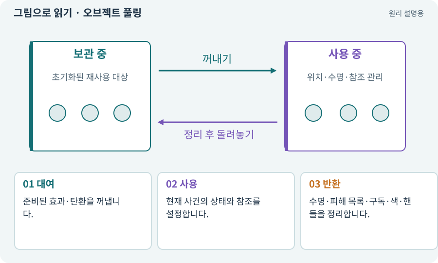

# 오브젝트 풀링

**분야:** 입력·UI·소리·성능

풀링은 자주 만들고 버리는 객체를 미리 준비하거나 재사용하는 방식입니다. 사용이 끝나면 파괴 대신 풀로 반환하고 다음 사용 전에 상태를 초기화합니다.

**찾아오는 이름:** 오브젝트 풀링, 오브젝트 풀, 풀링, Pooling, Pool

## 익숙한 것에 비유하면

식당 접시를 매번 새로 사지 않고 씻어 다시 쓰는 것과 같습니다. 씻지 않고 재사용하면 이전 음식이 남습니다.



개념도입니다. 실제 Unity 화면이나 검사 결과가 아닙니다. 그림의 순서·색은 역할을 구분하며 실제 설정값은 프로젝트에서 확인합니다.

## 이렇게 작동합니다

### 1. 대여

준비된 효과·탄환을 꺼냅니다.

### 2. 사용

현재 사건의 상태와 참조를 설정합니다.

### 3. 반환

수명·피해 목록·구독·색·핸들을 정리합니다.

## 우리 RPG에서는 이렇게 만나요

재사용한 마력탄에 이전 적의 피격 ID가 남으면 새 탄환이 그 적을 때리지 못할 수 있습니다. 흔적까지 초기화해야 합니다.

## 이것과 혼동하지 마세요

풀을 너무 크게 잡으면 메모리를 오래 점유합니다. 풀링은 무조건 많은 객체를 만드는 전략이 아닙니다.

## 이해했는지 한 번 생각해 보기

지난번 색깔의 피해 숫자가 남으면?

<details><summary>답과 이유</summary>

풀 반환·재대여 때 색·텍스트·애니메이션 초기화를 확인합니다.

</details>

## 내 프로젝트에서 확인하고 싶다면

아래 요청은 읽기 전용으로 실제 대상을 확인하는 선택 요청입니다. 코드나 설정을 직접 편집할 필요는 없습니다.

```text
현재 프로젝트에서 오브젝트 풀링 관련 요소가 어떻게 사용되는지 읽기 전용으로 확인해 줘. 실제 대상과 설정을 찾아 쉬운 말과 작은 예로 설명해 줘. 특히 다음 혼동을 구분해 줘: 풀을 너무 크게 잡으면 메모리를 오래 점유합니다. 풀링은 무조건 많은 객체를 만드는 전략이 아닙니다. 아직 코드·설정·파일은 바꾸지 말고, 확인할 수 없는 내용은 따로 알려 줘.
```

## 이어지는 개념

[수명주기·초기화·정리](lifecycle.md) · [GC·할당·메모리 누수](garbage.md) · [공격 ID·사건 ID·중복 피해 방지](event-id.md) · [VFX·Particle System·플립북](vfx.md)

## 이 개념을 사용하는 실습

[14 · 나를 발견하고 공격하는 적 만들기](../index.html#lesson-014) · [72 · 모바일 효과를 줄여도 위험은 남기기](../index.html#lesson-072) · [101 · 3D Android 성능 다시 측정하기](../index.html#lesson-101) · [149 · 상태와 보스 효과를 같은 데이터로 맞추기](../index.html#lesson-149)

## 참고와 설명의 범위

기본 도구 동작은 아래 공식 자료를 참고했습니다. 비유·그림·RPG의 예시 수치와 정책은 이해를 위한 자체 예제입니다. 실제 API·지원 기능은 설치 버전과 계정에서 확인합니다.

- [Unity Addressables · 메모리 관리](https://docs.unity3d.com/Packages/com.unity.addressables@2.7/manual/MemoryManagement.html)

그림·계산 예제·조작 모형은 자체 제작한 설명입니다. 실제 Unity 화면, 서비스 생성 결과, 성능 실측 또는 게임 테스트 결과가 아닙니다. 자료 확인: 2026년 9월 26일.
