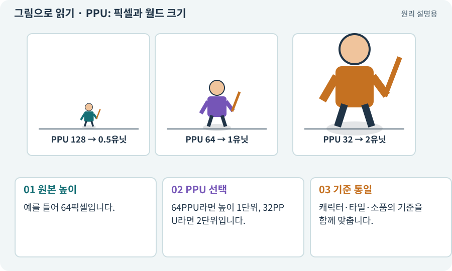

# PPU: 픽셀과 월드 크기

**분야:** 그림·애니메이션·화면 만들기

PPU는 월드 1단위를 몇 픽셀로 표현할지 정하는 값입니다. 같은 이미지에서 PPU가 커지면 월드에서 작아집니다. 기본 계산은 픽셀 수 ÷ PPU입니다.

**찾아오는 이름:** PPU: 픽셀과 월드 크기, PPU, Pixels Per Unit, PPU64, PPU32

## 익숙한 것에 비유하면

지도 축척처럼 사진 속 몇 칸을 실제 거리 1m로 볼지 정합니다. 실제 화면 픽셀과는 또 다릅니다.



개념도입니다. 실제 Unity 화면이나 검사 결과가 아닙니다. 그림의 순서·색은 역할을 구분하며 실제 설정값은 프로젝트에서 확인합니다.

## 이렇게 작동합니다

### 1. 원본 높이

예를 들어 64픽셀입니다.

### 2. PPU 선택

64PPU라면 높이 1단위, 32PPU라면 2단위입니다.

### 3. 기준 통일

캐릭터·타일·소품의 기준을 함께 맞춥니다.

## 숫자로 연결하면 크기를 예측할 수 있어요

그림의 가로 픽셀 수 ÷ Pixels Per Unit = Transform 배율을 적용하기 전의 월드 가로 길이입니다. 64픽셀 그림에 PPU 64면 1유닛, PPU 32면 2유닛입니다. PPU 숫자가 커질수록 같은 그림은 월드에서 작아집니다.

최종 크기에는 Transform과 부모의 배율도 영향을 줍니다. 화면에 보이는 픽셀 수는 카메라·뷰포트·출력 해상도가 다시 결정합니다. 그래서 원본 픽셀, 월드 유닛, 화면 픽셀을 세 가지로 나눠 생각해야 합니다.

아래 모형은 Transform 배율 1, 격자 한 칸 1유닛입니다. 값을 움직이면 그림의 크기만 변합니다. 실제 플레이어의 몸체를 별도로 유지할 때에는 Collider까지 자동으로 바뀌었다고 가정하지 않습니다.

| 원본 폭 | PPU | 월드 폭(배율 1) |
| --- | --- | --- |
| 64px | 64 | 1유닛 |
| 64px | 32 | 2유닛 |
| 64px | 128 | 0.5유닛 |

## 직접 값을 바꾸며 보기

[웹 해설의 조작 모형 열기](../index.html#tech-ppu). 조작은 설명용 모형만 바꿉니다. 실제 프로젝트·AI·진행 체크·게임 테스트는 실행하거나 변경하지 않습니다.

## 우리 RPG에서는 이렇게 만나요

Scale 1의 64픽셀 캐릭터를 PPU64로 쓰면 키 1단위입니다. 충돌 반경 0.3은 따로 정한 게임 몸체 값이며 PPU를 바꿨다고 자동 보정된 것으로 보지 않습니다.

## 이것과 혼동하지 마세요

PPU는 해상도를 높이는 기능이 아닙니다. 원본 픽셀 수는 바뀌지 않습니다.

## 이해했는지 한 번 생각해 보기

같은 그림을 PPU32에서 PPU64로 바꾸면?

<details><summary>답과 이유</summary>

월드 가로·세로 크기가 절반이 됩니다. 카메라가 같다면 더 작게 보입니다.

</details>

## 내 프로젝트에서 확인하고 싶다면

아래 요청은 읽기 전용으로 실제 대상을 확인하는 선택 요청입니다. 코드나 설정을 직접 편집할 필요는 없습니다.

```text
현재 프로젝트에서 PPU: 픽셀과 월드 크기 관련 요소가 어떻게 사용되는지 읽기 전용으로 확인해 줘. 실제 대상과 설정을 찾아 쉬운 말과 작은 예로 설명해 줘. 특히 다음 혼동을 구분해 줘: PPU는 해상도를 높이는 기능이 아닙니다. 원본 픽셀 수는 바뀌지 않습니다. 아직 코드·설정·파일은 바꾸지 말고, 확인할 수 없는 내용은 따로 알려 줘.
```

## 이어지는 개념

[텍스처·픽셀·해상도](texture.md) · [Pivot과 발 기준점](pivot.md) · [픽셀 퍼펙트와 화면 배율](scale-pixel.md) · [Collider와 몸체 경계](collider.md)

## 이 개념을 사용하는 실습

[05 · 말로 스프라이트 하나 만들기](../index.html#lesson-005) · [07 · 캐릭터와 벽이 있는 공간 만들기](../index.html#lesson-007) · [33 · 기본 캐릭터·몬스터·타일 아트 만들기](../index.html#lesson-033) · [55 · 어떤 그림도 맞춰 넣는 아트 규격 정하기](../index.html#lesson-055) · [56 · Unity AI로 캐릭터 움직임 만들기](../index.html#lesson-056) · [57 · Unity AI로 바닥과 벽 타일 만들기](../index.html#lesson-057) · [58 · PixelLab로 방향별 픽셀 캐릭터 만들기](../index.html#lesson-058) · [62 · OpenAI 이미지로 게임 자산 만들기](../index.html#lesson-062) · [63 · Grok 이미지로 같은 자산 시험하기](../index.html#lesson-063) · [65 · 스프라이트를 정리해 실제 캐릭터에 넣기](../index.html#lesson-065) · [97 · 선택: 3D 모델에서 2D 시트 만들기](../index.html#lesson-097) · [148 · 아트 역할로 새 지역 외형 완성하기](../index.html#lesson-148)

## 참고와 설명의 범위

기본 도구 동작은 아래 공식 자료를 참고했습니다. 비유·그림·RPG의 예시 수치와 정책은 이해를 위한 자체 예제입니다. 실제 API·지원 기능은 설치 버전과 계정에서 확인합니다.

- [Unity · Pixels Per Unit](https://docs.unity3d.com/6000.3/Documentation/ScriptReference/TextureImporter-spritePixelsPerUnit.html)

그림·계산 예제·조작 모형은 자체 제작한 설명입니다. 실제 Unity 화면, 서비스 생성 결과, 성능 실측 또는 게임 테스트 결과가 아닙니다. 자료 확인: 2026년 9월 26일.
