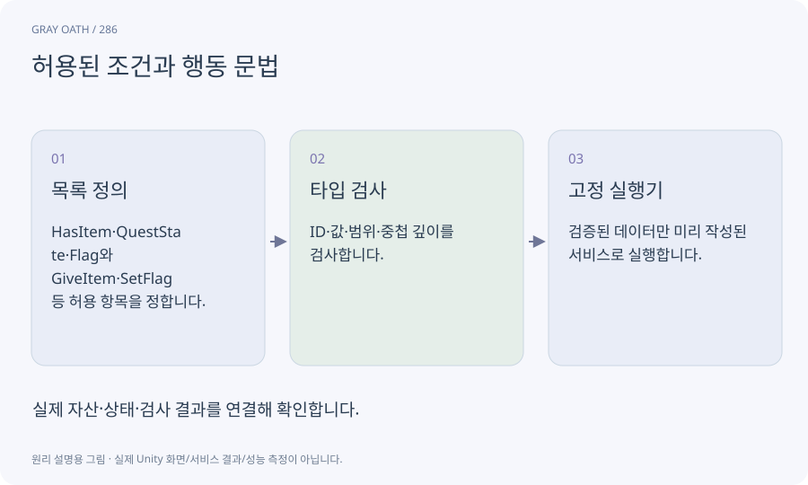

# 허용된 조건과 행동 문법

퀘스트가 사용할 수 있는 조건과 행동을 제한된 데이터 문법으로 표현하는 방식입니다. AI가 임의 C#이나 셸 코드를 반환해 실행하지 못하도록 합니다.

## 익숙한 비유

주방 주문표에서 허용된 메뉴와 옵션만 고르는 것과 같습니다.



## 작동 원리

### 1. 목록 정의

HasItem·QuestState·Flag와 GiveItem·SetFlag 등 허용 항목을 정합니다.

### 2. 타입 검사

ID·값·범위·중첩 깊이를 검사합니다.

### 3. 고정 실행기

검증된 데이터만 미리 작성된 서비스로 실행합니다.

## 게임 속 예

flag.fog_clue=true 조건은 허용하지만 “터미널로 파일 삭제” 같은 코드는 quest action으로 실행할 수 없습니다.

## 혼동하지 않기

JSON 형식이 맞다는 것만으로 안전한 내용이나 참조의 의미까지 검증된 것은 아닙니다.

## 확인 질문

조건 설명에 외부 지시문이 들어 있으면?

대사/설명은 데이터로만 취급하고 실행 권한과 문법 목록은 프로그램이 고정합니다.

## 내 프로젝트에서 확인하기

```text
현재 GrayOathRPG3D에서 허용된 조건과 행동 문법을 사용하는 실제 대상과 동작을 읽기 전용으로 확인해 줘. 쉬운 말과 작은 사례로 설명하고 JSON 형식이 맞다는 것만으로 안전한 내용이나 참조의 의미까지 검증된 것은 아닙니다. 이 문제를 어떻게 막는지 보여 줘. 코드·데이터·설정은 아직 수정하지 마.
```

## 관련 해설

[structured-output](structured-output.md) · [permission](permission.md) · [world-state](world-state.md)

## 공식 참고

- [Claude Code · Programmatic use](https://code.claude.com/docs/en/headless)
