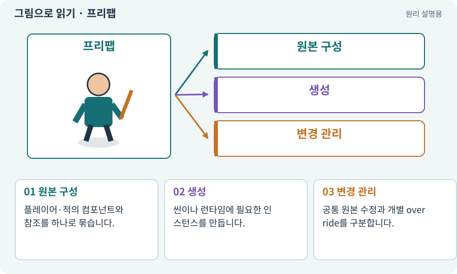

# 프리팹·인스턴스·Variant

**분야:** 자산 제작·렌더링 보충

프리팹은 GameObject와 컴포넌트·하위 구조·설정의 재사용 가능한 원본입니다. 씬에 배치하거나 실행 중 생성한 개체는 인스턴스입니다. 프리팹 Variant는 원본을 바탕으로 차이를 추가하는 파생 자산입니다.

**찾아오는 이름:** 프리팹·인스턴스·Variant, 프리팹, Prefab, prefab, Prefab Variant, 프리팹 인스턴스

## 익숙한 것에 비유하면

붕어빵 틀과 만들어진 붕어빵을 구분하는 것입니다. 다만 Unity에서는 원본과 인스턴스의 연결을 유지하고 일부 차이를 덮어쓸 수 있습니다.



개념도입니다. 실제 Unity 화면이나 검사 결과가 아닙니다. 그림의 순서·색은 역할을 구분하며 실제 설정값은 프로젝트에서 확인합니다.

## 이렇게 작동합니다

### 1. 원본 구성

플레이어·적의 컴포넌트와 참조를 하나로 묶습니다.

### 2. 생성

씬이나 런타임에 필요한 인스턴스를 만듭니다.

### 3. 변경 관리

공통 원본 수정과 개별 override를 구분합니다.

## 우리 RPG에서는 이렇게 만나요

석궁수 프리팹 원본의 감지 반경을 바꾸면 연결된 인스턴스에 반영될 수 있습니다. 특정 적의 개별 override가 남으면 원본 값과 다르게 동작하므로 AI가 실제 상태를 확인해야 합니다.

## 이것과 혼동하지 마세요

씬의 적 하나를 고친 것이 프리팹 원본까지 저장됐다는 뜻은 아닙니다. Apply·Revert 대상과 범위를 확인합니다.

## 이해했는지 한 번 생각해 보기

적 하나의 체력을 낮췄는데 새 적은 그대로라면?

<details><summary>답과 이유</summary>

인스턴스만 바꿨는지 원본·변형·데이터 참조를 확인해야 합니다.

</details>

## 내 프로젝트에서 확인하고 싶다면

아래 요청은 읽기 전용으로 실제 대상을 확인하는 선택 요청입니다. 코드나 설정을 직접 편집할 필요는 없습니다.

```text
현재 프로젝트에서 프리팹·인스턴스·Variant 관련 요소가 어떻게 사용되는지 읽기 전용으로 확인해 줘. 실제 대상과 설정을 찾아 쉬운 말과 작은 예로 설명해 줘. 특히 다음 혼동을 구분해 줘: 씬의 적 하나를 고친 것이 프리팹 원본까지 저장됐다는 뜻은 아닙니다. Apply·Revert 대상과 범위를 확인합니다. 아직 코드·설정·파일은 바꾸지 말고, 확인할 수 없는 내용은 따로 알려 줘.
```

## 이어지는 개념

[GameObject](gameobject.md) · [컴포넌트](component.md) · [에셋과 가져오기](asset.md) · [아이템 인스턴스와 소유권](item-instance.md)

## 이 개념을 사용하는 실습

[04 · 되돌릴 수 있는 작업 습관 만들기](../index.html#lesson-004) · [07 · 캐릭터와 벽이 있는 공간 만들기](../index.html#lesson-007) · [38 · 테스트 결과와 실제 플레이 구분하기](../index.html#lesson-038) · [65 · 스프라이트를 정리해 실제 캐릭터에 넣기](../index.html#lesson-065) · [68 · 피격 불꽃과 먼지 만들기](../index.html#lesson-068) · [73 · 주소로 에셋 불러오기](../index.html#lesson-073) · [75 · 다운로드 용량과 진행률 보여 주기](../index.html#lesson-075) · [76 · 연결이 끊겨도 게임 계속하기](../index.html#lesson-076) · [77 · 앱을 바꾸지 않고 외형 업데이트하기](../index.html#lesson-077) · [78 · 선택: Google Play 에셋 전달 사용하기](../index.html#lesson-078) · [79 · 추가 기능을 하나의 게임으로 합치기](../index.html#lesson-079) · [82 · 게임 규칙은 재사용하고 공간만 바꾸기](../index.html#lesson-082) · [92 · 무기를 손에 쥐고 전리품 표시하기](../index.html#lesson-092) · [97 · 선택: 3D 모델에서 2D 시트 만들기](../index.html#lesson-097) · [98 · 3D 팩을 2D 팩과 따로 내려받기](../index.html#lesson-098) · [107 · 원본을 보호하고 허용 경로 정하기](../index.html#lesson-107) · [117 · Unity 작업을 한 창구로 모으기](../index.html#lesson-117) · [153 · 대장간 고해상도팩 선택 다운로드하기](../index.html#lesson-153)

## 참고와 설명의 범위

기본 도구 동작은 아래 공식 자료를 참고했습니다. 비유·그림·RPG의 예시 수치와 정책은 이해를 위한 자체 예제입니다. 실제 API·지원 기능은 설치 버전과 계정에서 확인합니다.

- [Unity · Prefab](https://docs.unity3d.com/6000.3/Documentation/Manual/Prefabs.html)

그림·계산 예제·조작 모형은 자체 제작한 설명입니다. 실제 Unity 화면, 서비스 생성 결과, 성능 실측 또는 게임 테스트 결과가 아닙니다. 자료 확인: 2026년 9월 26일.
