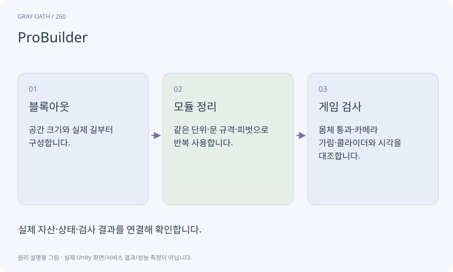

# ProBuilder

Unity 안에서 형태를 만들고 편집하는 모델링 도구입니다. 이 과정에서는 건물·길·문·계단의 블록아웃과 모듈을 AI가 구성하는 경로로 씁니다.

## 익숙한 비유

건축 모형용 블록을 현장에서 자르고 이어 붙이는 도구입니다.



## 작동 원리

### 1. 블록아웃

공간 크기와 실제 길부터 구성합니다.

### 2. 모듈 정리

같은 단위·문 규격·피벗으로 반복 사용합니다.

### 3. 게임 검사

몸체 통과·카메라 가림·콜라이더와 시각을 대조합니다.

## 게임 속 예

물안개 마을의 집은 벽·문틀·지붕 모듈로 만듭니다. 문 그림은 넓지만 충돌체가 막는 문제를 캐릭터로 검사합니다.

## 혼동하지 않기

도구 설치나 메시 완성이 길찾기·NPC 목적지까지 자동 연결해 주지 않습니다.

## 확인 질문

수강생이 정점을 직접 이동해야 하나요?

필요 없습니다. AI에 문 폭과 지붕 모양을 요청하고 완성한 게임 공간을 걸어 확인합니다.

## 내 프로젝트에서 확인하기

```text
현재 GrayOathRPG3D에서 ProBuilder을 사용하는 실제 대상과 동작을 읽기 전용으로 확인해 줘. 쉬운 말과 작은 사례로 설명하고 도구 설치나 메시 완성이 길찾기·NPC 목적지까지 자동 연결해 주지 않습니다. 이 문제를 어떻게 막는지 보여 줘. 코드·데이터·설정은 아직 수정하지 마.
```

## 관련 해설

[procedural-model](procedural-model.md) · [modular-kit](modular-kit.md) · [collider](collider.md)

## 공식 참고

- [Unity · ProBuilder 6](https://docs.unity3d.com/Packages/com.unity.probuilder@6.0/manual/index.html)
