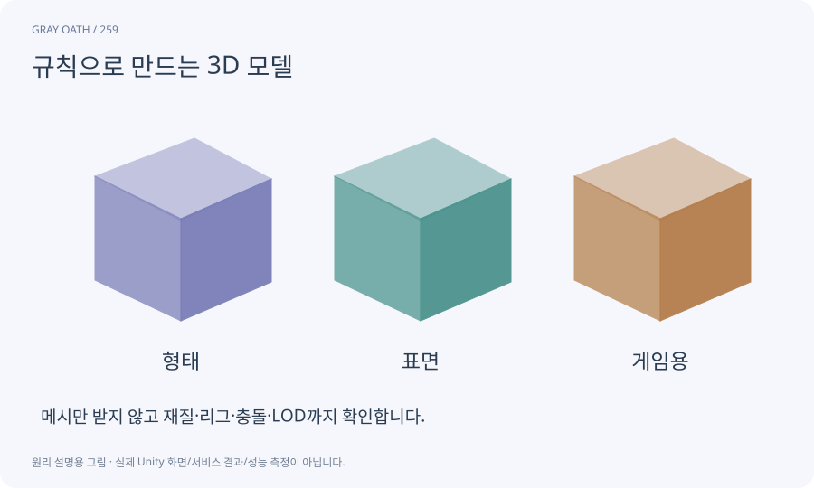

# 규칙으로 만드는 3D 모델

정점·면·크기를 규칙과 매개변수로 계산해 메시를 만드는 방식입니다. AI가 이 도구를 작성하면 생성 이미지 서비스 없이도 소품·건물·단순 캐릭터를 만들 수 있습니다.

## 익숙한 비유

설계 치수를 바꿔 여러 크기의 상자를 만드는 조립식 가구 공정입니다.



## 작동 원리

### 1. 형태 규칙

폭·높이·두께·구멍·모듈을 정합니다.

### 2. 메시 생성

정점·삼각형·노멀·UV·bounds를 구성합니다.

### 3. 게임 연결

재질·콜라이더·LOD·프리팹으로 묶습니다.

## 게임 속 예

나무 상자 폭을1m에서1.5m로 바꿔도 바닥 피벗과 뚜껑 힌지가 유지됩니다. 그림과 충돌 크기의 변경을 함께 확인합니다.

## 혼동하지 않기

기본 도형을 붙였다고 사실적인 인체나 고품질 리그가 자동 완성되는 것은 아닙니다.

## 확인 질문

AI 모델 서비스를 쓰지 않아도 완주용 자산을 만들 수 있나요?

가능합니다. 이 과정은 통일된 단순 화풍과 필요한 동작을 기준으로 내부 제작 경로를 제공합니다.

## 내 프로젝트에서 확인하기

```text
현재 GrayOathRPG3D에서 규칙으로 만드는 3D 모델을 사용하는 실제 대상과 동작을 읽기 전용으로 확인해 줘. 쉬운 말과 작은 사례로 설명하고 기본 도형을 붙였다고 사실적인 인체나 고품질 리그가 자동 완성되는 것은 아닙니다. 이 문제를 어떻게 막는지 보여 줘. 코드·데이터·설정은 아직 수정하지 마.
```

## 관련 해설

[mesh](mesh.md) · [uv](uv.md) · [modular-kit](modular-kit.md) · [pivot](pivot.md)

## 공식 참고

- [Unity · ProBuilder 6](https://docs.unity3d.com/Packages/com.unity.probuilder@6.0/manual/index.html)
