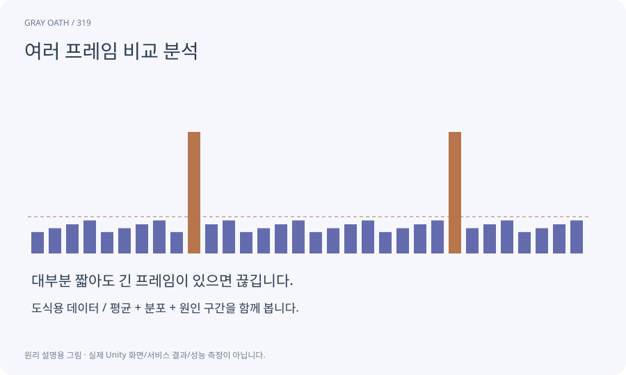

# 여러 프레임 비교 분석

하나의 프레임만 보지 않고 구간과 캡처를 비교해 반복 비용과 변화 추세를 살펴보는 Unity 도구입니다. 설치된 패키지와 버전의 기능을 확인합니다.

## 익숙한 비유

하루 한 장의 사진 대신 여러 날의 통계를 비교하는 분석표입니다.



## 작동 원리

### 1. 캡처 고정

동일 시나리오의 변경 전후 자료를 준비합니다.

### 2. 구간 비교

marker별 시간·호출·분포를 비교합니다.

### 3. 원인 확인

좋아진 이유와 게임 동작 손상을 별도로 확인합니다.

## 게임 속 예

적 감지를 여러 프레임에 나눈 뒤 CPU 피크가 줄었는지 같은90초 전투 구간에서 비교합니다.

## 혼동하지 않기

다른 기기·적 수·설정으로 찍은 두 캡처는 공정한 비교가 아닙니다.

## 확인 질문

평균이 좋아졌지만 최악 프레임이 나빠지면?

원인이 로딩·GC·특정 패턴인지 구분하고 품질 기준에 맞춰 판단합니다.

## 내 프로젝트에서 확인하기

```text
현재 GrayOathRPG3D에서 여러 프레임 비교 분석을 사용하는 실제 대상과 동작을 읽기 전용으로 확인해 줘. 쉬운 말과 작은 사례로 설명하고 다른 기기·적 수·설정으로 찍은 두 캡처는 공정한 비교가 아닙니다. 이 문제를 어떻게 막는지 보여 줘. 코드·데이터·설정은 아직 수정하지 마.
```

## 관련 해설

[percentile](percentile.md) · [profiler-marker](profiler-marker.md) · [telemetry](telemetry.md)

## 공식 참고

- [Unity · Profile Analyzer](https://docs.unity3d.com/Packages/com.unity.performance.profile-analyzer@1.2/manual/index.html)
