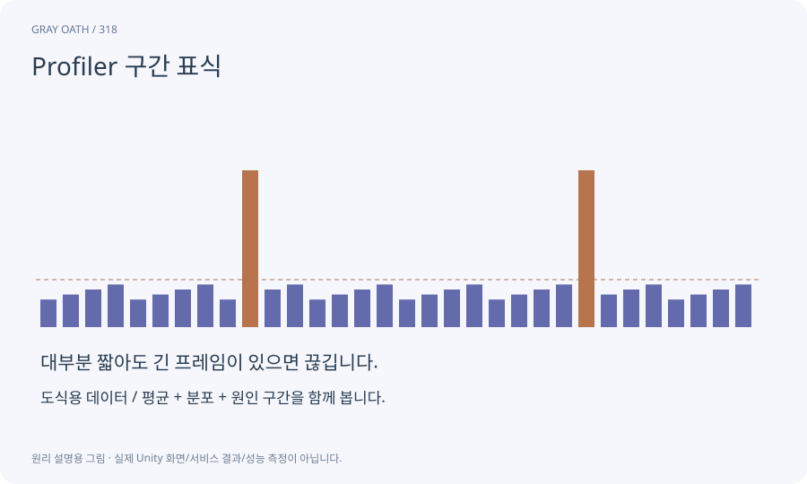

# Profiler 구간 표식

어떤 코드 구간이 수행되는지 성능 도구에 이름을 붙이는 표식입니다. AI 감지·경로 요청·세이브처럼 의미 있는 경계를 나눠 비용을 찾게 합니다.

## 익숙한 비유

작업 시간표에 준비·조립·포장이라는 칸을 만들어 어디서 오래 걸리는지 보는 것입니다.



## 작동 원리

### 1. 경계 선정

진단할 실제 함수/작업의 범위를 정합니다.

### 2. 계측 연결

지원 API로 시작·끝을 일관되게 표시합니다.

### 3. 자료 해석

부모·자식·자기 시간과 호출 수를 대조합니다.

## 게임 속 예

Quest.Dispatch와 Path.Request를 표시하면 전투 때 목표 갱신이 비싼지 경로 계산이 비싼지 분리할 수 있습니다.

## 혼동하지 않기

표식을 만들기 위한 매 프레임 문자열 할당이 측정 대상보다 커지지 않게 합니다.

## 확인 질문

마커가 가장 긴 부모 구간이면 전부 삭제하나요?

하위 작업과 기다림을 조사해 필요한 기능을 유지한 채 실제 병목만 줄입니다.

## 내 프로젝트에서 확인하기

```text
현재 GrayOathRPG3D에서 Profiler 구간 표식을 사용하는 실제 대상과 동작을 읽기 전용으로 확인해 줘. 쉬운 말과 작은 사례로 설명하고 표식을 만들기 위한 매 프레임 문자열 할당이 측정 대상보다 커지지 않게 합니다. 이 문제를 어떻게 막는지 보여 줘. 코드·데이터·설정은 아직 수정하지 마.
```

## 관련 해설

[cpu-gpu](cpu-gpu.md) · [profiler](profiler.md) · [profile-analyzer](profile-analyzer.md)

## 공식 참고

- [Unity · Profiler markers](https://docs.unity3d.com/6000.3/Documentation/Manual/profiler-markers.html)
