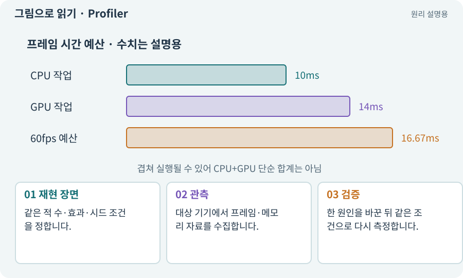

# Profiler·병목·실기기 측정

**분야:** 입력·UI·소리·성능

Profiler는 시간·메모리 사용 등의 원인을 관찰하는 도구입니다. 병목은 전체 속도를 가장 크게 제한하는 부분입니다. Editor 결과와 실제 기기 결과는 구분해야 합니다.

**찾아오는 이름:** Profiler·병목·실기기 측정, Profiler, 프로파일러, 프로파일링, 병목, 성능 측정, Development Build

## 익숙한 것에 비유하면

줄이 긴 계산대가 어디인지 확인하는 것입니다. 한가한 계산대만 더 빠르게 해도 전체 대기는 줄지 않을 수 있습니다.



개념도입니다. 실제 Unity 화면이나 검사 결과가 아닙니다. 그림의 순서·색은 역할을 구분하며 실제 설정값은 프로젝트에서 확인합니다.

## 이렇게 작동합니다

### 1. 재현 장면

같은 적 수·효과·시드 조건을 정합니다.

### 2. 관측

대상 기기에서 프레임·메모리 자료를 수집합니다.

### 3. 검증

한 원인을 바꾼 뒤 같은 조건으로 다시 측정합니다.

## 우리 RPG에서는 이렇게 만나요

투명 효과가 화면을 덮을 때만 느리다면 AI 경로보다 GPU 픽셀 비용을 의심할 수 있습니다. 추정은 측정 자료로 확인해야 합니다.

## 이것과 혼동하지 마세요

Development Build와 프로파일러 자체도 비용을 더할 수 있습니다. 배포용 빌드의 실제 경험도 확인합니다.

## 이해했는지 한 번 생각해 보기

PC Editor에서 120FPS면 휴대폰 60FPS도 보장되나요?

<details><summary>답과 이유</summary>

아닙니다. 하드웨어·해상도·발열·플랫폼이 다릅니다.

</details>

## 내 프로젝트에서 확인하고 싶다면

아래 요청은 읽기 전용으로 실제 대상을 확인하는 선택 요청입니다. 코드나 설정을 직접 편집할 필요는 없습니다.

```text
현재 프로젝트에서 Profiler·병목·실기기 측정 관련 요소가 어떻게 사용되는지 읽기 전용으로 확인해 줘. 실제 대상과 설정을 찾아 쉬운 말과 작은 예로 설명해 줘. 특히 다음 혼동을 구분해 줘: Development Build와 프로파일러 자체도 비용을 더할 수 있습니다. 배포용 빌드의 실제 경험도 확인합니다. 아직 코드·설정·파일은 바꾸지 말고, 확인할 수 없는 내용은 따로 알려 줘.
```

## 이어지는 개념

[FPS·프레임 시간·ms](frame-time.md) · [CPU·GPU·RAM·VRAM](cpu-gpu.md) · [오버드로·투명 효과 비용](overdraw.md) · [게임 빌드·개발 빌드·배포](build.md)

## 이 개념을 사용하는 실습

[37 · 느려지는 원인을 측정해 고치기](../index.html#lesson-037) · [72 · 모바일 효과를 줄여도 위험은 남기기](../index.html#lesson-072) · [101 · 3D Android 성능 다시 측정하기](../index.html#lesson-101) · [154 · 확장 기능을 켠 휴대폰 성능 고치기](../index.html#lesson-154)

## 참고와 설명의 범위

기본 도구 동작은 아래 공식 자료를 참고했습니다. 비유·그림·RPG의 예시 수치와 정책은 이해를 위한 자체 예제입니다. 실제 API·지원 기능은 설치 버전과 계정에서 확인합니다.

- [Unity Input System · UI 지원](https://docs.unity3d.com/Packages/com.unity.inputsystem@1.17/manual/UISupport.html)

그림·계산 예제·조작 모형은 자체 제작한 설명입니다. 실제 Unity 화면, 서비스 생성 결과, 성능 실측 또는 게임 테스트 결과가 아닙니다. 자료 확인: 2026년 9월 26일.
