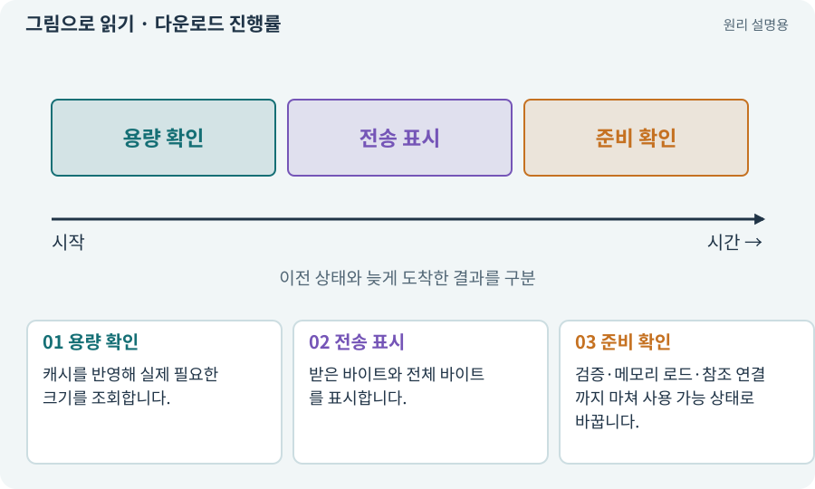

# 다운로드 진행률·바이트·준비 상태

**분야:** 비동기·다운로드·빌드·버전 관리

다운로드 진행률은 전송한 바이트와 필요한 바이트의 비율입니다. 여러 하위 작업을 균등하게 센 진행률과는 다를 수 있습니다. 전송 100%와 게임 사용 준비 완료도 구분합니다.

**찾아오는 이름:** 다운로드 진행률·바이트·준비 상태, 진행률, GetDownloadSizeAsync, GetDownloadStatus, PercentComplete, 전송량, 다운로드 용량

## 익숙한 것에 비유하면

이삿짐이 도착한 비율과 방에 가구 배치까지 마친 비율을 구분하는 것과 같습니다.



개념도입니다. 실제 Unity 화면이나 검사 결과가 아닙니다. 그림의 순서·색은 역할을 구분하며 실제 설정값은 프로젝트에서 확인합니다.

## 이렇게 작동합니다

### 1. 용량 확인

캐시를 반영해 실제 필요한 크기를 조회합니다.

### 2. 전송 표시

받은 바이트와 전체 바이트를 표시합니다.

### 3. 준비 확인

검증·메모리 로드·참조 연결까지 마쳐 사용 가능 상태로 바꿉니다.

## 우리 RPG에서는 이렇게 만나요

10MiB 중 4MiB를 받으면 전송률은 40%입니다. 남은 다운로드가 0이어도 로드 실패나 버전 불일치가 있을 수 있어 입장 버튼 조건은 따로 둡니다.

## 이것과 혼동하지 마세요

전체 바이트가 0이면 나누기 오류를 내지 않고 “다운로드 불필요·로드 중”처럼 실제 상태를 표시합니다.

## 이해했는지 한 번 생각해 보기

바이트 진행률이 100%인데 잠깐 더 기다리는 이유는?

<details><summary>답과 이유</summary>

파일 검증·로드·씬 준비가 남아 있을 수 있습니다.

</details>

## 내 프로젝트에서 확인하고 싶다면

아래 요청은 읽기 전용으로 실제 대상을 확인하는 선택 요청입니다. 코드나 설정을 직접 편집할 필요는 없습니다.

```text
현재 프로젝트에서 다운로드 진행률·바이트·준비 상태 관련 요소가 어떻게 사용되는지 읽기 전용으로 확인해 줘. 실제 대상과 설정을 찾아 쉬운 말과 작은 예로 설명해 줘. 특히 다음 혼동을 구분해 줘: 전체 바이트가 0이면 나누기 오류를 내지 않고 “다운로드 불필요·로드 중”처럼 실제 상태를 표시합니다. 아직 코드·설정·파일은 바꾸지 말고, 확인할 수 없는 내용은 따로 알려 줘.
```

## 이어지는 개념

[비동기·await·콜백](async.md) · [캐시·적중·무효화](cache.md) · [Addressables·주소로 에셋 불러오기](addressables.md) · [핸들·참조 계수·Release](handle.md)

## 이 개념을 사용하는 실습

[75 · 다운로드 용량과 진행률 보여 주기](../index.html#lesson-075) · [98 · 3D 팩을 2D 팩과 따로 내려받기](../index.html#lesson-098)

## 참고와 설명의 범위

기본 도구 동작은 아래 공식 자료를 참고했습니다. 비유·그림·RPG의 예시 수치와 정책은 이해를 위한 자체 예제입니다. 실제 API·지원 기능은 설치 버전과 계정에서 확인합니다.

- [Unity Addressables · 사전 다운로드](https://docs.unity3d.com/Packages/com.unity.addressables@2.7/manual/remote-content-predownload.html)

그림·계산 예제·조작 모형은 자체 제작한 설명입니다. 실제 Unity 화면, 서비스 생성 결과, 성능 실측 또는 게임 테스트 결과가 아닙니다. 자료 확인: 2026년 9월 26일.
