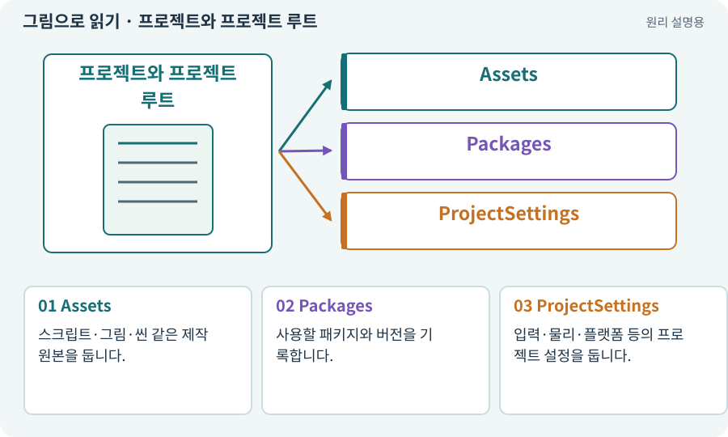

# 프로젝트와 프로젝트 루트

**분야:** 시작·도구·작업 공간

프로젝트는 게임 소스·에셋·설정을 모아 둔 폴더입니다. 루트는 Assets·Packages·ProjectSettings가 함께 놓인 최상위 작업 폴더를 말합니다.

**찾아오는 이름:** 프로젝트와 프로젝트 루트, 프로젝트 루트, Unity 프로젝트, ProjectSettings, Assets/Packages/ProjectSettings, Assets, Packages, Library

## 익숙한 것에 비유하면

가게의 창고 주소입니다. 물건 이름만 같다고 같은 가게는 아니듯, 프로젝트 이름이 같아도 경로가 다르면 다른 작업물입니다.



개념도입니다. 실제 Unity 화면이나 검사 결과가 아닙니다. 그림의 순서·색은 역할을 구분하며 실제 설정값은 프로젝트에서 확인합니다.

## 이렇게 작동합니다

### 1. Assets

스크립트·그림·씬 같은 제작 원본을 둡니다.

### 2. Packages

사용할 패키지와 버전을 기록합니다.

### 3. ProjectSettings

입력·물리·플랫폼 등의 프로젝트 설정을 둡니다.

## 우리 RPG에서는 이렇게 만나요

AshfallRPG2D 원본과 Candidate01 후보를 동시에 갖고 있다면 AI가 어느 경로의 Editor를 조작하는지 먼저 확인합니다. 창 제목만으로 결정하지 않습니다.

## 이것과 혼동하지 마세요

Library는 가져오기 결과 등의 캐시가 주로 들어갑니다. Assets와 같은 원본 취급으로 무작정 공유하거나 원본을 지우지 않습니다.

## 이해했는지 한 번 생각해 보기

두 폴더의 이름이 Ashfall이면 같은 프로젝트인가요?

<details><summary>답과 이유</summary>

아닙니다. 절대 경로와 소스 상태를 확인해야 합니다.

</details>

## 내 프로젝트에서 확인하고 싶다면

아래 요청은 읽기 전용으로 실제 대상을 확인하는 선택 요청입니다. 코드나 설정을 직접 편집할 필요는 없습니다.

```text
현재 프로젝트에서 프로젝트와 프로젝트 루트 관련 요소가 어떻게 사용되는지 읽기 전용으로 확인해 줘. 실제 대상과 설정을 찾아 쉬운 말과 작은 예로 설명해 줘. 특히 다음 혼동을 구분해 줘: Library는 가져오기 결과 등의 캐시가 주로 들어갑니다. Assets와 같은 원본 취급으로 무작정 공유하거나 원본을 지우지 않습니다. 아직 코드·설정·파일은 바꾸지 말고, 확인할 수 없는 내용은 따로 알려 줘.
```

## 이어지는 개념

[파일 경로·절대 경로·상대 경로](path.md) · [에셋과 가져오기](asset.md) · [패키지·패키지 관리자](package.md) · [후보·스테이징·변경 적용](candidate.md) · [캐시·적중·무효화](cache.md)

## 이 개념을 사용하는 실습

[01 · 빈 2D 프로젝트 만들기](../index.html#lesson-001) · [04 · 되돌릴 수 있는 작업 습관 만들기](../index.html#lesson-004) · [25 · 게임을 껐다 켜도 장비 유지하기](../index.html#lesson-025) · [62 · OpenAI 이미지로 게임 자산 만들기](../index.html#lesson-062) · [81 · 2D 게임을 남기고 3D 작업 시작하기](../index.html#lesson-081) · [107 · 원본을 보호하고 허용 경로 정하기](../index.html#lesson-107) · [117 · Unity 작업을 한 창구로 모으기](../index.html#lesson-117)

## 참고와 설명의 범위

기본 도구 동작은 아래 공식 자료를 참고했습니다. 비유·그림·RPG의 예시 수치와 정책은 이해를 위한 자체 예제입니다. 실제 API·지원 기능은 설치 버전과 계정에서 확인합니다.

- [Unity · 2D 게임 제작 흐름](https://docs.unity3d.com/6000.3/Documentation/Manual/2d-game-creation-wokflow.html)
- [Python · 파일 경로](https://docs.python.org/3/library/pathlib.html)

그림·계산 예제·조작 모형은 자체 제작한 설명입니다. 실제 Unity 화면, 서비스 생성 결과, 성능 실측 또는 게임 테스트 결과가 아닙니다. 자료 확인: 2026년 9월 26일.
