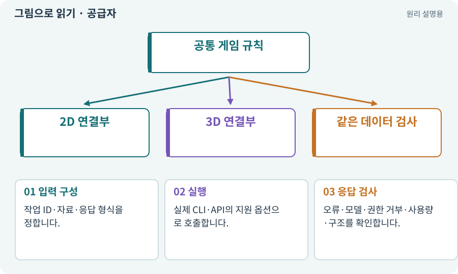

# 공급자·어댑터·실제 호출

**분야:** AI·스킬·훅·하네스 운영

공급자 어댑터는 하네스가 모델을 호출하고 응답을 읽는 연결부입니다. 고정 mock 응답과 실제 Claude 호출을 같은 결과 계약으로 연결할 수 있지만 검증 범위는 다릅니다.

**찾아오는 이름:** 공급자·어댑터·실제 호출, Provider, provider, 공급자, Claude Code, Claude CLI, 공급자 어댑터

## 익숙한 것에 비유하면

같은 주문서를 받아 처리하는 연습용 창구와 실제 가게를 바꿔 끼우는 구조입니다.



개념도입니다. 실제 Unity 화면이나 검사 결과가 아닙니다. 그림의 순서·색은 역할을 구분하며 실제 설정값은 프로젝트에서 확인합니다.

## 이렇게 작동합니다

### 1. 입력 구성

작업 ID·자료·응답 형식을 정합니다.

### 2. 실행

실제 CLI·API의 지원 옵션으로 호출합니다.

### 3. 응답 검사

오류·모델·권한 거부·사용량·구조를 확인합니다.

## 우리 RPG에서는 이렇게 만나요

mock 연결이 끝나면 실제 계정의 작은 작업으로 바꿉니다. 비용 정보가 없는데 0원으로 기록하거나 다른 모델로 조용히 대체하지 않습니다.

## 이것과 혼동하지 마세요

CLI 프로세스 종료 코드만으로 모델 요청 전체가 성공했다고 판단하지 않습니다. 응답 내부 오류도 봅니다.

## 이해했는지 한 번 생각해 보기

JSON 응답은 왔는데 is_error가 참이면?

<details><summary>답과 이유</summary>

실패로 다루고 원인을 확인합니다. 구조가 있다는 이유로 적용하지 않습니다.

</details>

## 내 프로젝트에서 확인하고 싶다면

아래 요청은 읽기 전용으로 실제 대상을 확인하는 선택 요청입니다. 코드나 설정을 직접 편집할 필요는 없습니다.

```text
현재 프로젝트에서 공급자·어댑터·실제 호출 관련 요소가 어떻게 사용되는지 읽기 전용으로 확인해 줘. 실제 대상과 설정을 찾아 쉬운 말과 작은 예로 설명해 줘. 특히 다음 혼동을 구분해 줘: CLI 프로세스 종료 코드만으로 모델 요청 전체가 성공했다고 판단하지 않습니다. 응답 내부 오류도 봅니다. 아직 코드·설정·파일은 바꾸지 말고, 확인할 수 없는 내용은 따로 알려 줘.
```

## 이어지는 개념

[AI 모델·LLM·모델 선택](llm.md) · [도구 호출·로컬·클라우드](tool.md) · [파서·XML·결과 판정](parser.md) · [비용 한도·예약·실사용량](budget.md) · [픽스처·Mock·Stub·테스트 더블](fixture.md)

## 이 개념을 사용하는 실습

[02 · 내 게임을 알아듣는 개발 스킬 만들기](../index.html#lesson-002) · [78 · 선택: Google Play 에셋 전달 사용하기](../index.html#lesson-078) · [82 · 게임 규칙은 재사용하고 공간만 바꾸기](../index.html#lesson-082) · [112 · 네 역할을 순서대로 실행하기](../index.html#lesson-112) · [118 · 모의 응답 대신 실제 Claude 연결하기](../index.html#lesson-118) · [119 · 막힌 작업을 안전하게 이어가기](../index.html#lesson-119) · [120 · 자연어 요청을 계획으로 바꾸기](../index.html#lesson-120) · [121 · 필요한 역할을 하나 추가하기](../index.html#lesson-121)

## 참고와 설명의 범위

기본 도구 동작은 아래 공식 자료를 참고했습니다. 비유·그림·RPG의 예시 수치와 정책은 이해를 위한 자체 예제입니다. 실제 API·지원 기능은 설치 버전과 계정에서 확인합니다.

- [Claude Code · 비대화형 실행](https://code.claude.com/docs/en/headless)

그림·계산 예제·조작 모형은 자체 제작한 설명입니다. 실제 Unity 화면, 서비스 생성 결과, 성능 실측 또는 게임 테스트 결과가 아닙니다. 자료 확인: 2026년 9월 26일.
