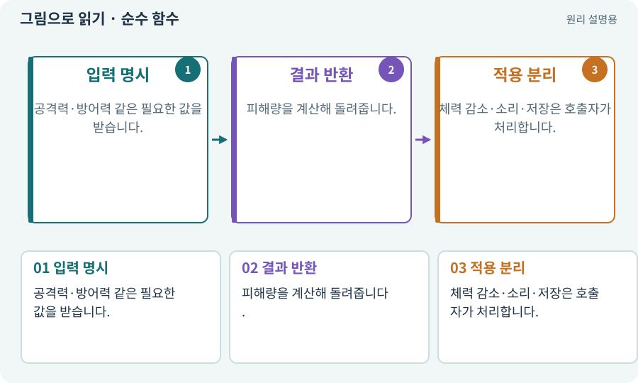

# 순수 함수·불변 조건·결정적 계산

**분야:** 코드·데이터·저장·검사

순수 함수는 같은 입력에서 같은 결과를 만들고 외부 상태를 몰래 바꾸지 않는 계산입니다. 게임 규칙을 이런 형태로 분리하면 씬·기기 없이도 검사하기 쉬워집니다.

**찾아오는 이름:** 순수 함수·불변 조건·결정적 계산, 순수 함수, pure function, Core, 순수 규칙, 결정적 계산

## 익숙한 것에 비유하면

재료 양을 넣으면 같은 계산서가 나오는 계산기입니다. 계산할 때 몰래 창고에서 재료를 빼지 않습니다.



개념도입니다. 실제 Unity 화면이나 검사 결과가 아닙니다. 그림의 순서·색은 역할을 구분하며 실제 설정값은 프로젝트에서 확인합니다.

## 이렇게 작동합니다

### 1. 입력 명시

공격력·방어력 같은 필요한 값을 받습니다.

### 2. 결과 반환

피해량을 계산해 돌려줍니다.

### 3. 적용 분리

체력 감소·소리·저장은 호출자가 처리합니다.

## 우리 RPG에서는 이렇게 만나요

2D와 3D가 같은 DamageCalculator를 쓰면 동일 입력의 피해를 비교할 수 있습니다. 물리 충돌 결과가 같다는 뜻까지 포함하지 않습니다.

## 이것과 혼동하지 마세요

함수 안에서 현재 시간·전역 난수·싱글톤을 몰래 읽으면 입력만으로 재현하기 어렵습니다.

## 이해했는지 한 번 생각해 보기

공격력 12·방어력 5인데 매번 다른 피해면?

<details><summary>답과 이유</summary>

공식 외에 난수·전역 상태·시간을 읽는지 확인합니다.

</details>

## 내 프로젝트에서 확인하고 싶다면

아래 요청은 읽기 전용으로 실제 대상을 확인하는 선택 요청입니다. 코드나 설정을 직접 편집할 필요는 없습니다.

```text
현재 프로젝트에서 순수 함수·불변 조건·결정적 계산 관련 요소가 어떻게 사용되는지 읽기 전용으로 확인해 줘. 실제 대상과 설정을 찾아 쉬운 말과 작은 예로 설명해 줘. 특히 다음 혼동을 구분해 줘: 함수 안에서 현재 시간·전역 난수·싱글톤을 몰래 읽으면 입력만으로 재현하기 어렵습니다. 아직 코드·설정·파일은 바꾸지 말고, 확인할 수 없는 내용은 따로 알려 줘.
```

## 이어지는 개념

[단위·통합·회귀 테스트](test.md) · [어댑터·인터페이스·의존성 분리](adapter.md) · [능력치·클램프·정수·부동소수점](stats.md) · [재현성·결정성·동등성](deterministic.md)

## 이 개념을 사용하는 실습

[06 · 시작 메뉴와 테스트 공간 연결하기](../index.html#lesson-006) · [12 · 체력과 피해를 눈으로 확인하기](../index.html#lesson-012) · [17 · 적을 잡아 레벨 올리기](../index.html#lesson-017) · [22 · 장비를 주워 24칸 가방에 넣기](../index.html#lesson-022) · [41 · 선택할 수 있는9노드 스킬트리 만들기](../index.html#lesson-041) · [78 · 선택: Google Play 에셋 전달 사용하기](../index.html#lesson-078) · [82 · 게임 규칙은 재사용하고 공간만 바꾸기](../index.html#lesson-082) · [89 · 같은 전투 규칙을 3D에 연결하기](../index.html#lesson-089) · [93 · 3D 마을과 퀘스트 연결하기](../index.html#lesson-093) · [99 · 2D와 3D 사이에 진행 가져오기](../index.html#lesson-099) · [100 · 두 버전이 같은 게임인지 비교하기](../index.html#lesson-100) · [103 · 같은 전투를 2D와 3D로 플레이하기](../index.html#lesson-103) · [131 · 중요한 전리품만 표시하는 규칙 만들기](../index.html#lesson-131)

## 참고와 설명의 범위

이 항목의 비유·그림·RPG 수치·운영 규칙은 개념을 이해하기 위한 자체 설계 예제입니다. 특정 도구가 이 규칙을 자동으로 구현한다는 뜻은 아닙니다.


그림·계산 예제·조작 모형은 자체 제작한 설명입니다. 실제 Unity 화면, 서비스 생성 결과, 성능 실측 또는 게임 테스트 결과가 아닙니다. 자료 확인: 2026년 9월 26일.
