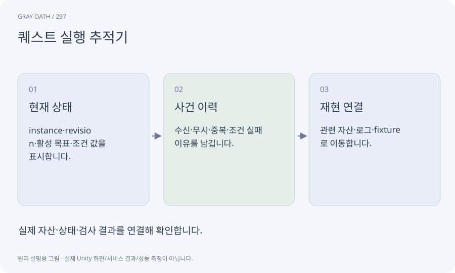

# 퀘스트 실행 추적기

현재 어떤 퀘스트 노드가 활성인지, 어떤 사건을 받았고 무엇 때문에 다음으로 가지 않았는지 읽는 개발 도구입니다. 강제로 성공시키는 치트와 목적이 다릅니다.

## 익숙한 비유

배송 추적에서 어느 허브에 있고 왜 보류됐는지 보는 화면입니다.



## 작동 원리

### 1. 현재 상태

instance·revision·활성 목표·조건 값을 표시합니다.

### 2. 사건 이력

수신·무시·중복·조건 실패 이유를 남깁니다.

### 3. 재현 연결

관련 자산·로그·fixture로 이동합니다.

## 게임 속 예

괴물을 처치했는데 목표가 그대로라면 actor/target/instance ID 불일치인지 이미 처리된 event인지 확인합니다.

## 혼동하지 않기

강제로 완료 플래그를 바꿔 진행된 것을 정상 사용자 경로의 성공으로 세지 않습니다.

## 확인 질문

화면에서 빨간 오류가 없으면 정상인가요?

조건 때문에 합법적으로 대기할 수도 있습니다. 기대 사건과 실제 상태를 대조해야 합니다.

## 내 프로젝트에서 확인하기

```text
현재 GrayOathRPG3D에서 퀘스트 실행 추적기을 사용하는 실제 대상과 동작을 읽기 전용으로 확인해 줘. 쉬운 말과 작은 사례로 설명하고 강제로 완료 플래그를 바꿔 진행된 것을 정상 사용자 경로의 성공으로 세지 않습니다. 이 문제를 어떻게 막는지 보여 줘. 코드·데이터·설정은 아직 수정하지 마.
```

## 관련 해설

[objective-event](objective-event.md) · [quest-simulation](quest-simulation.md) · [repro](repro.md)

## 공식 참고

- [Unity · UI Toolkit EditorWindow](https://docs.unity3d.com/6000.3/Documentation/Manual/UIE-HowTo-CreateEditorWindow.html)
