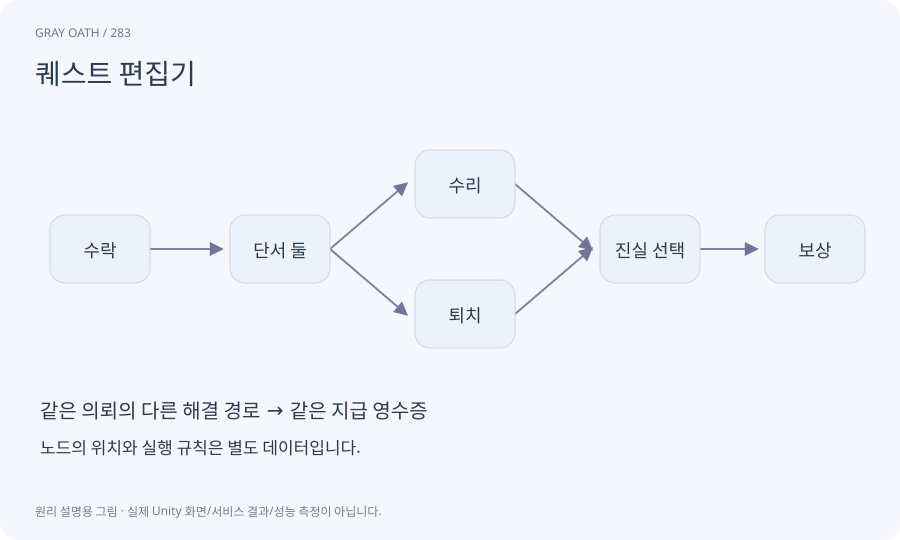

# 퀘스트 편집기

퀘스트의 조건·목표·분기·보상·지도 연결을 제작하고 검사하는 Unity Editor 도구입니다. 플레이어용 저널과 실제 진행 엔진은 따로 존재합니다.

## 익숙한 비유

여행 안내 프로그램의 코스를 설계하는 사무실입니다. 코스 편집 화면이 실제 여행을 실행하지는 않습니다.



## 작동 원리

### 1. 정의 편집

안정 ID·목표·분기·참조를 구성합니다.

### 2. 검사·시뮬레이션

잘못된 연결과 실행 경로를 시험합니다.

### 3. 승인 적용

변경을 검토하고 자산에 저장한 뒤 게임에서 확인합니다.

## 창에서 무엇이 실제로 연결되는가

만드는 순서는 작은 저장 가능한 상세 창→그래프→검증기→시뮬레이터→AI 초안→실제 플레이입니다. AI 생성 버튼부터 만든 뒤 데이터 검증을 나중으로 미루지 않습니다.

완성된 도구는 마우스로 쓸 수 있고 같은 작업을 자연어 스킬에서도 실행할 수 있습니다. 둘은 서로 다른 구현이 아니라 같은 command service의 두 진입점입니다.

| 화면 | 원본 데이터 | 필수 동작 |

|---|---|---|

| 목록/상세 | QuestDefinition | 찾기·필터·Undo·저장·재개방 |

| 그래프 | 노드/포트/간선 | 레이아웃과 실행 revision 분리 |

| AI 작업 | requestId/baseRevision/draft | 요청·취소·검증·diff·승인 |

| 시뮬레이터 | 격리 QuestInstance | 동일 runtime reducer·fake reward |

| 실행 추적 | 현재 플레이 instance | 사건·무시 이유·실제 노드로 이동 |

## 게임 속 예

H01 돌다리의 등불에서 NPC→단서 둘→저주 해제/처치→보상 두 경로를 만들고 각각 저장·복원을 시험합니다.

## 혼동하지 않기

노드 그림과 생성 버튼만 있는 창은 퀘스트 제작 도구의 완성이 아닙니다.

## 확인 질문

편집기 안에서 성공했으면 지도에도 표시되나요?

지도 anchor와 runtime quest 상태가 같은 데이터로 연결됐는지 따로 확인합니다.

## 내 프로젝트에서 확인하기

```text
현재 GrayOathRPG3D에서 퀘스트 편집기을 사용하는 실제 대상과 동작을 읽기 전용으로 확인해 줘. 쉬운 말과 작은 사례로 설명하고 노드 그림과 생성 버튼만 있는 창은 퀘스트 제작 도구의 완성이 아닙니다. 이 문제를 어떻게 막는지 보여 줘. 코드·데이터·설정은 아직 수정하지 마.
```

## 관련 해설

[quest-graph](quest-graph.md) · [quest-simulation](quest-simulation.md) · [quest-marker](quest-marker.md)

## 공식 참고

- [Unity · UI Toolkit EditorWindow](https://docs.unity3d.com/6000.3/Documentation/Manual/UIE-HowTo-CreateEditorWindow.html)
- [Unity · AssetDatabase](https://docs.unity3d.com/6000.3/Documentation/ScriptReference/AssetDatabase.html)
