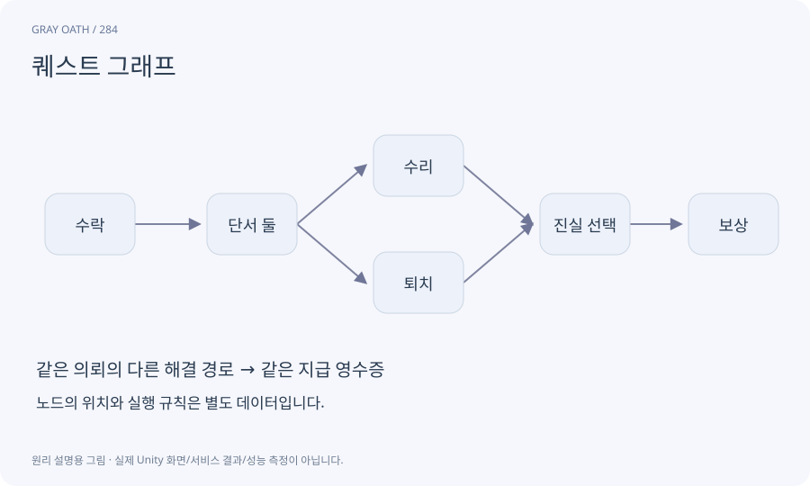

# 퀘스트 그래프

시작·목표·분기·보상·종료 같은 노드와 그 사이의 진행 연결을 나타낸 자료입니다. 화면에서 노드를 옮기는 위치와 게임에서 실행되는 의미를 구분합니다.

## 익숙한 비유

갈림길이 있는 길 안내도입니다. 종이 위의 점 위치를 옮겨도 실제 목적지가 달라지는 것은 아닙니다.



## 작동 원리

### 1. 노드 정의

각 노드의 타입과 데이터를 정합니다.

### 2. 연결 정의

어떤 결과에서 다음 노드로 가는지 명시합니다.

### 3. 실행 확인

실제 상태 엔진이 정의대로 사건을 처리하는지 검사합니다.

## 게임 속 예

이 제품의 퀘스트 그래프는 순환 없는 DAG로 제한합니다. 반복 의뢰는 같은 활성 그래프를 루프시키지 않고 새 실행 인스턴스로 만듭니다.

## 혼동하지 않기

선이 이어졌다는 것만으로 보상 중복·조건 모순·길막힘이 해결되지는 않습니다.

## 확인 질문

그래프에서 노드 위치를 바꾸면 진행 revision도 바뀌어야 하나요?

시각 배치와 실행 데이터 revision을 분리하면 불필요한 세이브 충돌을 줄일 수 있습니다.

## 내 프로젝트에서 확인하기

```text
현재 GrayOathRPG3D에서 퀘스트 그래프을 사용하는 실제 대상과 동작을 읽기 전용으로 확인해 줘. 쉬운 말과 작은 사례로 설명하고 선이 이어졌다는 것만으로 보상 중복·조건 모순·길막힘이 해결되지는 않습니다. 이 문제를 어떻게 막는지 보여 줘. 코드·데이터·설정은 아직 수정하지 마.
```

## 관련 해설

[dependency](dependency.md) · [typed-port](typed-port.md) · [graph-validation](graph-validation.md)

## 공식 참고

- [Unity · UI Toolkit EditorWindow](https://docs.unity3d.com/6000.3/Documentation/Manual/UIE-HowTo-CreateEditorWindow.html)
