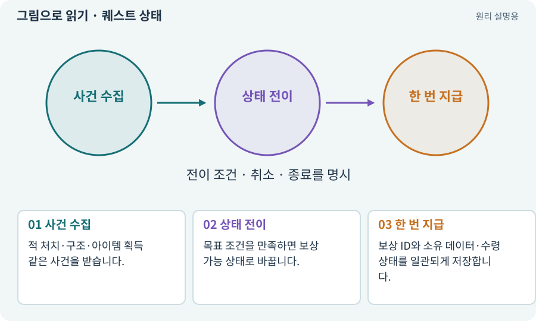

# 퀘스트 상태·대화 분기·보상 지급

**분야:** 설명을 읽기 위한 기초 언어

퀘스트는 수락·진행·목표 달성·보상 수령처럼 상태가 바뀌는 진행 규칙입니다. 대화문 표시와 실제 보상 지급은 분리하고, 한 번 보상하는 조건을 명확히 해야 합니다.

**찾아오는 이름:** 퀘스트 상태·대화 분기·보상 지급, 퀘스트 상태, Quest State, 대화 분기, 퀘스트 보상, 보상 지급, Claimed

## 익숙한 것에 비유하면

도장을 모은 쿠폰에서 조건을 채운 것과 실제 상품을 받아 사용 처리한 것은 다른 상태입니다.



개념도입니다. 실제 Unity 화면이나 검사 결과가 아닙니다. 그림의 순서·색은 역할을 구분하며 실제 설정값은 프로젝트에서 확인합니다.

## 이렇게 작동합니다

### 1. 사건 수집

적 처치·구조·아이템 획득 같은 사건을 받습니다.

### 2. 상태 전이

목표 조건을 만족하면 보상 가능 상태로 바꿉니다.

### 3. 한 번 지급

보상 ID와 소유 데이터·수령 상태를 일관되게 저장합니다.

## 우리 RPG에서는 이렇게 만나요

대장장이 구조 후 버튼을 연타하거나 저장 후 재접속해도 같은 보상을 두 번 받지 않게 합니다. 반복 던전 전리품과 한 번 주는 퀘스트 보상은 다른 정책입니다.

## 이것과 혼동하지 마세요

대화에서 “완료”라고 말한 것만으로 보상 데이터가 저장된 것은 아닙니다.

## 이해했는지 한 번 생각해 보기

목표를 달성한 상태와 보상을 받은 상태를 합쳐도 되나요?

<details><summary>답과 이유</summary>

미수령·가방 공간·저장 실패 같은 상황을 구분해야 하므로 별도 상태가 유용합니다.

</details>

## 내 프로젝트에서 확인하고 싶다면

아래 요청은 읽기 전용으로 실제 대상을 확인하는 선택 요청입니다. 코드나 설정을 직접 편집할 필요는 없습니다.

```text
현재 프로젝트에서 퀘스트 상태·대화 분기·보상 지급 관련 요소가 어떻게 사용되는지 읽기 전용으로 확인해 줘. 실제 대상과 설정을 찾아 쉬운 말과 작은 예로 설명해 줘. 특히 다음 혼동을 구분해 줘: 대화에서 “완료”라고 말한 것만으로 보상 데이터가 저장된 것은 아닙니다. 아직 코드·설정·파일은 바꾸지 말고, 확인할 수 없는 내용은 따로 알려 줘.
```

## 이어지는 개념

[상태 기계·FSM](state-machine.md) · [트랜잭션·거래의 한 번 적용](transaction.md) · [공격 ID·사건 ID·중복 피해 방지](event-id.md) · [파일 저장·게임 세이브·백업](save.md)

## 이 개념을 사용하는 실습

[25 · 게임을 껐다 켜도 장비 유지하기](../index.html#lesson-025) · [30 · 예고를 보고 피하는 보스 만들기](../index.html#lesson-030) · [31 · 퀘스트를 받아 엔딩까지 이어가기](../index.html#lesson-031) · [32 · 길 안내와 처음 하는 사람의 동선 만들기](../index.html#lesson-032) · [40 · 작은 RPG를 처음부터 끝까지 플레이하기](../index.html#lesson-040) · [47 · 실패하는 시드를 찾고 복구하기](../index.html#lesson-047) · [93 · 3D 마을과 퀘스트 연결하기](../index.html#lesson-093) · [100 · 두 버전이 같은 게임인지 비교하기](../index.html#lesson-100) · [104 · 2D와 3D를 두 플랫폼에서 완주하기](../index.html#lesson-104) · [134 · 화상·냉기·표식으로 전투 확장하기](../index.html#lesson-134) · [146 · 대장장이 구조 퀘스트 만들기](../index.html#lesson-146) · [149 · 상태와 보스 효과를 같은 데이터로 맞추기](../index.html#lesson-149) · [151 · 도감과 장비 비교로 새 기능 찾기](../index.html#lesson-151) · [160 · 대장간 보스까지 완주하고 새 기능 맡기기](../index.html#lesson-160)

## 참고와 설명의 범위

이 항목의 비유·그림·RPG 수치·운영 규칙은 개념을 이해하기 위한 자체 설계 예제입니다. 특정 도구가 이 규칙을 자동으로 구현한다는 뜻은 아닙니다.


그림·계산 예제·조작 모형은 자체 제작한 설명입니다. 실제 Unity 화면, 서비스 생성 결과, 성능 실측 또는 게임 테스트 결과가 아닙니다. 자료 확인: 2026년 9월 26일.
