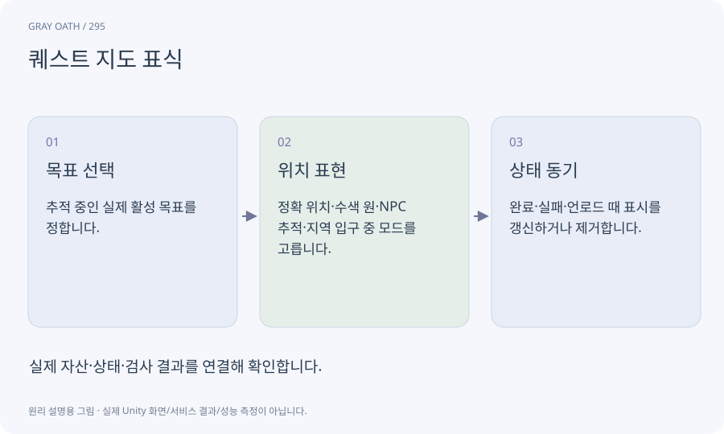

# 퀘스트 지도 표식

현재 목표를 월드·미니맵·전체 지도에 표현하는 표시입니다. 정답 위치를 숨겨야 할 때는 정확한 점 대신 수색 영역이나 다른 지역 안내를 사용합니다.

## 익숙한 비유

주소를 바로 보여 주는 지도와 “이 동네에서 찾아보세요”라고 표시한 안내도의 차이입니다.



## 작동 원리

### 1. 목표 선택

추적 중인 실제 활성 목표를 정합니다.

### 2. 위치 표현

정확 위치·수색 원·NPC 추적·지역 입구 중 모드를 고릅니다.

### 3. 상태 동기

완료·실패·언로드 때 표시를 갱신하거나 제거합니다.

## 게임 속 예

H01에서 첫 단서 전에는 돌다리 주변 수색 원만 표시하고, 충분히 조사한 뒤 실제 저주 장소를 보여 줍니다.

## 혼동하지 않기

NPC Transform을 찾지 못했다고 저장된 퀘스트 위치를 0,0으로 표시하면 잘못된 안내가 생깁니다.

## 확인 질문

다른 지역의 목표는 어떻게 표시하나요?

현재 목표 지역과 알려진 출입 지점을 안내하고 미로드 Transform 대신 등록된 anchor를 사용합니다.

## 내 프로젝트에서 확인하기

```text
현재 GrayOathRPG3D에서 퀘스트 지도 표식을 사용하는 실제 대상과 동작을 읽기 전용으로 확인해 줘. 쉬운 말과 작은 사례로 설명하고 NPC Transform을 찾지 못했다고 저장된 퀘스트 위치를 0,0으로 표시하면 잘못된 안내가 생깁니다. 이 문제를 어떻게 막는지 보여 줘. 코드·데이터·설정은 아직 수정하지 마.
```

## 관련 해설

[map-projection](map-projection.md) · [world-state](world-state.md) · [identifier](identifier.md)

## 공식 참고

- [Unity · UI Toolkit EditorWindow](https://docs.unity3d.com/6000.3/Documentation/Manual/UIE-HowTo-CreateEditorWindow.html)
