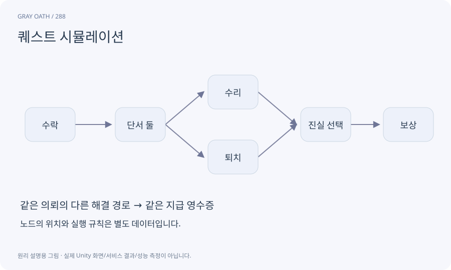

# 퀘스트 시뮬레이션

테스트용 세계 상태와 사건을 넣어 퀘스트 진행이 어떻게 변하는지 보는 도구입니다. 실제 게임과 다른 가짜 진행 로직을 만들지 않는 것이 중요합니다.

## 익숙한 비유

항공기 조종 원리를 같은 규칙으로 연습하되 실제 비행과는 구분하는 모의 조종입니다.



## 작동 원리

### 1. 격리 시작

테스트 인벤토리·사실·퀘스트 상태를 만듭니다.

### 2. 동일 엔진 실행

게임이 쓰는 reducer에 사건을 넣습니다.

### 3. 결과 검사

활성 목표·분기·보상·복원을 확인합니다.

## 게임 속 예

단서 A/B 순서를 바꾸거나 처치를 먼저 넣어 H01의 두 해결 경로를 반복합니다. 테스트 보상은 실제 플레이어에게 지급하지 않습니다.

## 혼동하지 않기

시뮬레이터 성공은 실제 NPC 위치나 NavMesh 길·지도 투영까지 검증하지 않습니다.

## 확인 질문

도구와 게임이 서로 다른 결과를 보이면?

별도 진행 로직이 생겼는지 확인하고 같은 runtime 서비스를 호출하도록 맞춥니다.

## 내 프로젝트에서 확인하기

```text
현재 GrayOathRPG3D에서 퀘스트 시뮬레이션을 사용하는 실제 대상과 동작을 읽기 전용으로 확인해 줘. 쉬운 말과 작은 사례로 설명하고 시뮬레이터 성공은 실제 NPC 위치나 NavMesh 길·지도 투영까지 검증하지 않습니다. 이 문제를 어떻게 막는지 보여 줘. 코드·데이터·설정은 아직 수정하지 마.
```

## 관련 해설

[quest-graph](quest-graph.md) · [replay](replay.md) · [fixture](fixture.md)

## 공식 참고

- [Unity · UI Toolkit EditorWindow](https://docs.unity3d.com/6000.3/Documentation/Manual/UIE-HowTo-CreateEditorWindow.html)
