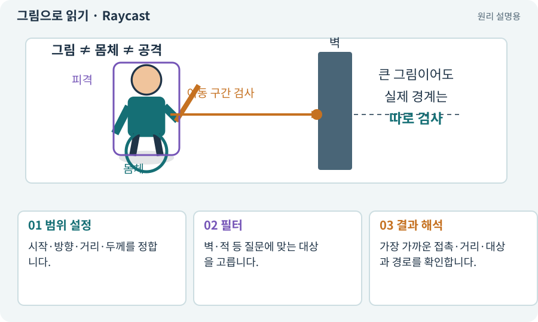

# Raycast·Linecast·Cast

**분야:** 오브젝트·좌표·움직임

Raycast는 시작점에서 방향으로 가는 선의 충돌을 묻고, Linecast는 두 점 사이를 검사합니다. CircleCast·SphereCast 등은 두께가 있는 모양을 쓸어 이동 가능한 공간을 검사합니다.

**찾아오는 이름:** Raycast·Linecast·Cast, Raycast, Linecast, CircleCast, SphereCast, CapsuleCast, 캐스트, Cast

## 익숙한 것에 비유하면

실 한 가닥이 문틈을 지나가는지와 몸통이 문을 통과하는지를 구분합니다. 선이 통과해도 사람이 통과할 수 있는 것은 아닙니다.



개념도입니다. 실제 Unity 화면이나 검사 결과가 아닙니다. 그림의 순서·색은 역할을 구분하며 실제 설정값은 프로젝트에서 확인합니다.

## 이렇게 작동합니다

### 1. 범위 설정

시작·방향·거리·두께를 정합니다.

### 2. 필터

벽·적 등 질문에 맞는 대상을 고릅니다.

### 3. 결과 해석

가장 가까운 접촉·거리·대상과 경로를 확인합니다.

## 우리 RPG에서는 이렇게 만나요

클릭 이동의 중앙선은 열려 있어도 캐릭터 반경이 크면 모서리에 걸립니다. 몸체 두께를 고려한 캐스트와 격자 여유 공간을 함께 확인합니다.

## 이것과 혼동하지 마세요

Cast는 질문입니다. 결과를 받았다고 객체가 자동으로 이동하거나 피해를 주지는 않습니다.

## 이해했는지 한 번 생각해 보기

광선은 통과하는데 캐릭터가 못 지나가는 이유는?

<details><summary>답과 이유</summary>

광선은 두께가 없기 때문입니다. 몸체 반경과 충돌 여유를 반영해야 합니다.

</details>

## 내 프로젝트에서 확인하고 싶다면

아래 요청은 읽기 전용으로 실제 대상을 확인하는 선택 요청입니다. 코드나 설정을 직접 편집할 필요는 없습니다.

```text
현재 프로젝트에서 Raycast·Linecast·Cast 관련 요소가 어떻게 사용되는지 읽기 전용으로 확인해 줘. 실제 대상과 설정을 찾아 쉬운 말과 작은 예로 설명해 줘. 특히 다음 혼동을 구분해 줘: Cast는 질문입니다. 결과를 받았다고 객체가 자동으로 이동하거나 피해를 주지는 않습니다. 아직 코드·설정·파일은 바꾸지 말고, 확인할 수 없는 내용은 따로 알려 줘.
```

## 이어지는 개념

[Collider와 몸체 경계](collider.md) · [몸체 여유·모서리 통과](clearance.md) · [시야·LOS·마지막 목격 위치](los.md) · [화면 좌표에서 월드 좌표로](screen-world.md)

## 이 개념을 사용하는 실습

[08 · WASD로 벽에 부딪히며 이동하기](../index.html#lesson-008) · [09 · 클릭한 곳까지 벽을 돌아가기](../index.html#lesson-009) · [13 · 적을 클릭해 접근하고 공격하기](../index.html#lesson-013) · [14 · 나를 발견하고 공격하는 적 만들기](../index.html#lesson-014) · [15 · 다른 방식으로 싸우는 적 추가하기](../index.html#lesson-015) · [35 · 앞뒤 가림과 PC 조작 다듬기](../index.html#lesson-035) · [37 · 느려지는 원인을 측정해 고치기](../index.html#lesson-037) · [51 · 전투 전체의 압박 조절하기](../index.html#lesson-051) · [86 · 3D에서도 클릭한 곳까지 돌아가기](../index.html#lesson-086) · [89 · 같은 전투 규칙을 3D에 연결하기](../index.html#lesson-089) · [135 · 벽을 통과하지 않는 회피 만들기](../index.html#lesson-135)

## 참고와 설명의 범위

기본 도구 동작은 아래 공식 자료를 참고했습니다. 비유·그림·RPG의 예시 수치와 정책은 이해를 위한 자체 예제입니다. 실제 API·지원 기능은 설치 버전과 계정에서 확인합니다.

- [Unity · Physics2D.CircleCast](https://docs.unity3d.com/6000.3/Documentation/ScriptReference/Physics2D.CircleCast.html)

그림·계산 예제·조작 모형은 자체 제작한 설명입니다. 실제 Unity 화면, 서비스 생성 결과, 성능 실측 또는 게임 테스트 결과가 아닙니다. 자료 확인: 2026년 9월 26일.
