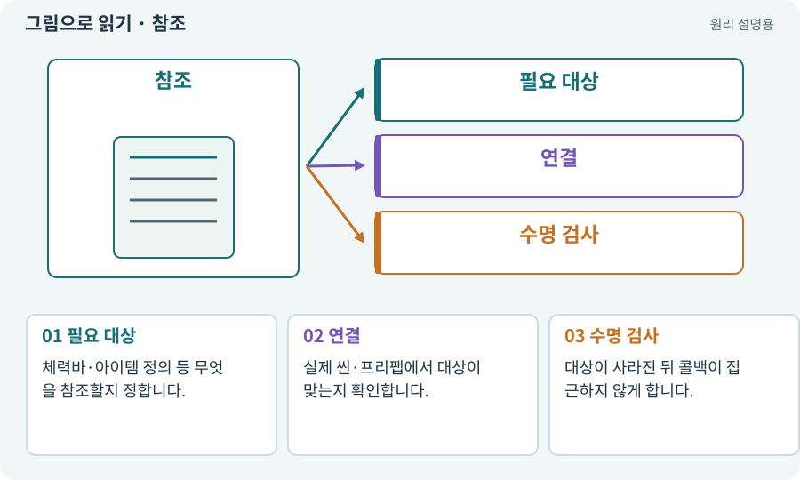

# 참조·null·Missing Reference

**분야:** 코드·데이터·저장·검사

참조는 다른 객체나 에셋을 가리키는 연결입니다. null은 필요한 대상이 없음을 나타내는 값이며, Missing Reference는 이전에 가리키던 Unity 대상이 없어졌을 때 나타날 수 있습니다.

**찾아오는 이름:** 참조·null·Missing Reference, Reference, NullReferenceException, Missing Reference

## 익숙한 것에 비유하면

전화번호부의 연락처가 실제 사람을 가리키는 것과 같습니다. 번호가 비었거나 상대가 더 이상 존재하지 않으면 연결되지 않습니다.



개념도입니다. 실제 Unity 화면이나 검사 결과가 아닙니다. 그림의 순서·색은 역할을 구분하며 실제 설정값은 프로젝트에서 확인합니다.

## 이렇게 작동합니다

### 1. 필요 대상

체력바·아이템 정의 등 무엇을 참조할지 정합니다.

### 2. 연결

실제 씬·프리팹에서 대상이 맞는지 확인합니다.

### 3. 수명 검사

대상이 사라진 뒤 콜백이 접근하지 않게 합니다.

## 우리 RPG에서는 이렇게 만나요

던전 UI가 이전 씬의 플레이어를 계속 참조하면 마을 복귀 후 오류가 날 수 있습니다. 씬 전환에 맞춰 참조와 구독을 정리합니다.

## 이것과 혼동하지 마세요

null 오류를 전부 무시하게 만들면 필요한 연결이 없는 기능이 조용히 실패할 수 있습니다.

## 이해했는지 한 번 생각해 보기

검사만 넣어 오류가 사라지면 기능도 고쳐진 건가요?

<details><summary>답과 이유</summary>

아닙니다. 필요한 대상이 왜 없었는지와 실제 기능이 실행되는지 확인합니다.

</details>

## 내 프로젝트에서 확인하고 싶다면

아래 요청은 읽기 전용으로 실제 대상을 확인하는 선택 요청입니다. 코드나 설정을 직접 편집할 필요는 없습니다.

```text
현재 프로젝트에서 참조·null·Missing Reference 관련 요소가 어떻게 사용되는지 읽기 전용으로 확인해 줘. 실제 대상과 설정을 찾아 쉬운 말과 작은 예로 설명해 줘. 특히 다음 혼동을 구분해 줘: null 오류를 전부 무시하게 만들면 필요한 연결이 없는 기능이 조용히 실패할 수 있습니다. 아직 코드·설정·파일은 바꾸지 말고, 확인할 수 없는 내용은 따로 알려 줘.
```

## 이어지는 개념

[Inspector와 참조 연결](inspector.md) · [수명주기·초기화·정리](lifecycle.md) · [메타 파일과 GUID](meta.md) · [이벤트·콜백·구독·이벤트 버스](event.md)

## 이 개념을 사용하는 실습

[36 · 휴대폰에서 두 손가락으로 전투하기](../index.html#lesson-036)

## 참고와 설명의 범위

기본 도구 동작은 아래 공식 자료를 참고했습니다. 비유·그림·RPG의 예시 수치와 정책은 이해를 위한 자체 예제입니다. 실제 API·지원 기능은 설치 버전과 계정에서 확인합니다.

- [Microsoft · C# 클래스](https://learn.microsoft.com/en-us/dotnet/csharp/fundamentals/types/classes)

그림·계산 예제·조작 모형은 자체 제작한 설명입니다. 실제 Unity 화면, 서비스 생성 결과, 성능 실측 또는 게임 테스트 결과가 아닙니다. 자료 확인: 2026년 9월 26일.
