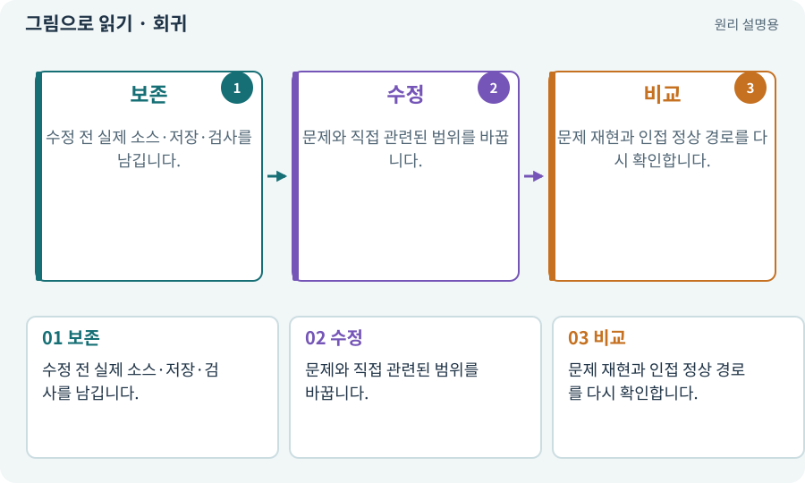

# 회귀·기준선·수정 전후 비교

**분야:** 코드·데이터·저장·검사

회귀는 변경으로 이전에 정상인 기능이 다시 깨지는 현상입니다. 기준선은 비교할 정상 소스·설정·자료·검사 조건을 기록한 상태입니다.

**찾아오는 이름:** 회귀·기준선·수정 전후 비교, 회귀, 회귀 검사, Regression, 기준선, Baseline, baseline

## 익숙한 것에 비유하면

옷을 수선한 뒤 길이는 맞지만 지퍼가 안 잠기게 됐는지 확인하는 것입니다.



개념도입니다. 실제 Unity 화면이나 검사 결과가 아닙니다. 그림의 순서·색은 역할을 구분하며 실제 설정값은 프로젝트에서 확인합니다.

## 이렇게 작동합니다

### 1. 보존

수정 전 실제 소스·저장·검사를 남깁니다.

### 2. 수정

문제와 직접 관련된 범위를 바꿉니다.

### 3. 비교

문제 재현과 인접 정상 경로를 다시 확인합니다.

## 우리 RPG에서는 이렇게 만나요

룬 버그를 고친 뒤 장비 해제·창고 이동·저장 재실행도 확인합니다. 이전 run의 PASS를 현재 소스 PASS로 복사하지 않습니다.

## 이것과 혼동하지 마세요

기준선은 Git 커밋 하나만으로 기기·저장·다운로드 팩까지 고정되지 않습니다.

## 이해했는지 한 번 생각해 보기

새 기능 테스트만 통과하면 충분한가요?

<details><summary>답과 이유</summary>

기존 기능과의 접점도 재검사해야 합니다.

</details>

## 내 프로젝트에서 확인하고 싶다면

아래 요청은 읽기 전용으로 실제 대상을 확인하는 선택 요청입니다. 코드나 설정을 직접 편집할 필요는 없습니다.

```text
현재 프로젝트에서 회귀·기준선·수정 전후 비교 관련 요소가 어떻게 사용되는지 읽기 전용으로 확인해 줘. 실제 대상과 설정을 찾아 쉬운 말과 작은 예로 설명해 줘. 특히 다음 혼동을 구분해 줘: 기준선은 Git 커밋 하나만으로 기기·저장·다운로드 팩까지 고정되지 않습니다. 아직 코드·설정·파일은 바꾸지 말고, 확인할 수 없는 내용은 따로 알려 줘.
```

## 이어지는 개념

[Git·저장소·커밋](git.md) · [증거·검사 상태·미실행](evidence.md) · [스냅샷·기준선·baseline](snapshot.md) · [단위·통합·회귀 테스트](test.md)

## 이 개념을 사용하는 실습

[38 · 테스트 결과와 실제 플레이 구분하기](../index.html#lesson-038) · [40 · 작은 RPG를 처음부터 끝까지 플레이하기](../index.html#lesson-040) · [54 · 느낌을 근거로 밸런스 고치기](../index.html#lesson-054) · [103 · 같은 전투를 2D와 3D로 플레이하기](../index.html#lesson-103) · [104 · 2D와 3D를 두 플랫폼에서 완주하기](../index.html#lesson-104) · [133 · 첫 기능의 실패를 고쳐 다음 기준 만들기](../index.html#lesson-133) · [156 · 기능 조합에서 숨은 오류 찾기](../index.html#lesson-156) · [158 · 룬 교체 버그를 역할로 수정하기](../index.html#lesson-158) · [159 · 최종 확장판 배포 후보 만들기](../index.html#lesson-159)

## 참고와 설명의 범위

기본 도구 동작은 아래 공식 자료를 참고했습니다. 비유·그림·RPG의 예시 수치와 정책은 이해를 위한 자체 예제입니다. 실제 API·지원 기능은 설치 버전과 계정에서 확인합니다.

- [Python · unittest](https://docs.python.org/3/library/unittest.html)

그림·계산 예제·조작 모형은 자체 제작한 설명입니다. 실제 Unity 화면, 서비스 생성 결과, 성능 실측 또는 게임 테스트 결과가 아닙니다. 자료 확인: 2026년 9월 26일.
