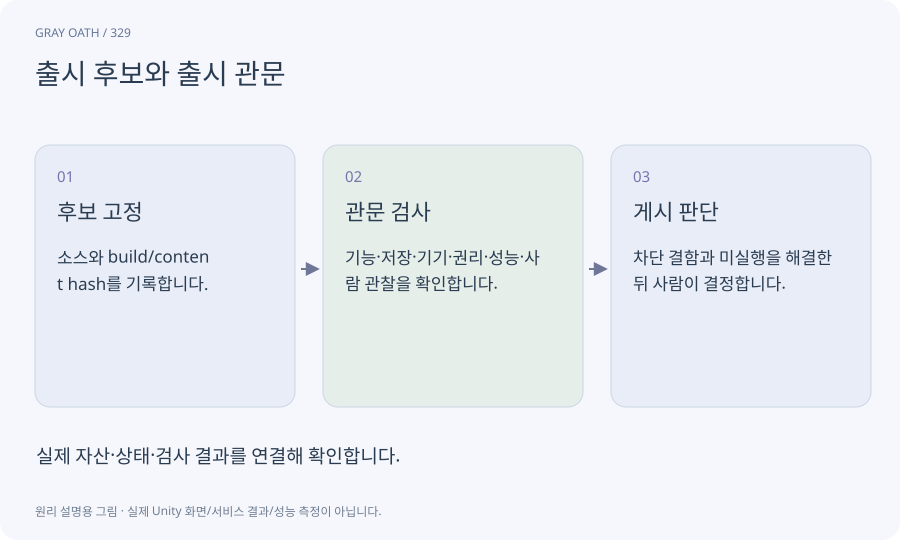

# 출시 후보와 출시 관문

검증할 소스·콘텐츠·빌드·설정이 고정된 제품 후보입니다. 필요한 검사가 모두 그 후보에 연결돼야 하며 공개 게시 승인은 별도입니다.

## 익숙한 비유

포장·성분표·품질 검사가 같은 생산분을 가리키는 출고 대기 상품입니다.



## 작동 원리

### 1. 후보 고정

소스와 build/content hash를 기록합니다.

### 2. 관문 검사

기능·저장·기기·권리·성능·사람 관찰을 확인합니다.

### 3. 게시 판단

차단 결함과 미실행을 해결한 뒤 사람이 결정합니다.

## 게임 속 예

다른 빌드의 보스 검사와 이전 데이터의 엔딩 검사를 모아 현재 후보가 모두 통과했다고 하지 않습니다.

## 혼동하지 않기

기능 수가 많거나 평균FPS가 목표를 넘었다고 출시 품질이 자동 보장되지 않습니다.

## 확인 질문

미실행된 Android 검사를 PC 성공으로 대신할 수 있나요?

안 됩니다. 플랫폼별 BLOCKED/NOT RUN을 남기고 해당 검사를 실제 수행해야 합니다.

## 내 프로젝트에서 확인하기

```text
현재 GrayOathRPG3D에서 출시 후보와 출시 관문을 사용하는 실제 대상과 동작을 읽기 전용으로 확인해 줘. 쉬운 말과 작은 사례로 설명하고 기능 수가 많거나 평균FPS가 목표를 넘었다고 출시 품질이 자동 보장되지 않습니다. 이 문제를 어떻게 막는지 보여 줘. 코드·데이터·설정은 아직 수정하지 마.
```

## 관련 해설

[evidence](evidence.md) · [gate](gate.md) · [manifest](manifest.md)

## 공식 참고

- [Unity · CLI reference](https://docs.unity.com/en-us/unity-cli/unity-cli-reference)
