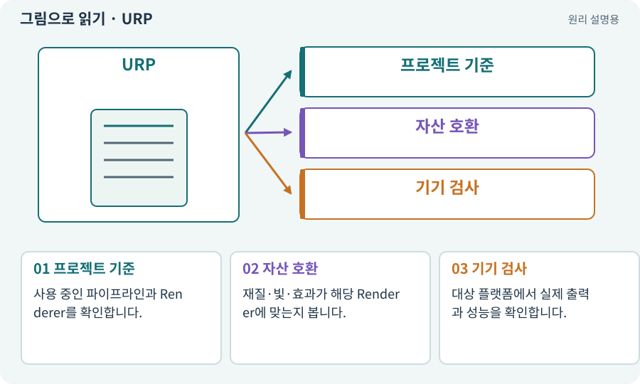

# URP·2D Renderer·Universal Renderer

**분야:** 그림·애니메이션·화면 만들기

렌더 파이프라인은 장면을 화면으로 그리는 작업 순서와 방법입니다. URP는 Unity의 렌더 파이프라인 하나이며, 그 안에서 2D 또는 3D에 맞는 Renderer 설정을 사용할 수 있습니다.

**찾아오는 이름:** URP·2D Renderer·Universal Renderer, URP, Universal Render Pipeline, 2D Renderer, Universal Renderer, 렌더 파이프라인, Universal 2D, URP2D, Universal 3D

## 익숙한 것에 비유하면

같은 방송국에서 만화 촬영 장비와 입체 세트 촬영 장비를 다르게 쓰는 것입니다.



개념도입니다. 실제 Unity 화면이나 검사 결과가 아닙니다. 그림의 순서·색은 역할을 구분하며 실제 설정값은 프로젝트에서 확인합니다.

## 이렇게 작동합니다

### 1. 프로젝트 기준

사용 중인 파이프라인과 Renderer를 확인합니다.

### 2. 자산 호환

재질·빛·효과가 해당 Renderer에 맞는지 봅니다.

### 3. 기기 검사

대상 플랫폼에서 실제 출력과 성능을 확인합니다.

## 우리 RPG에서는 이렇게 만나요

본편은 URP 2D Renderer의 스프라이트·2D Light를 사용하고, 3D 과정은 별도 프로젝트에서 Universal Renderer 구성을 확인합니다.

## 이것과 혼동하지 마세요

Unity Pipeline이라는 CLI 연결 패키지와 혼동하지 않습니다.

## 이해했는지 한 번 생각해 보기

2D Light를 만들었는데 3D 모델이 기대대로 안 밝아지는 이유는?

<details><summary>답과 이유</summary>

사용 중인 Renderer와 Shader가 그 조명 경로를 지원하는지 확인해야 합니다.

</details>

## 내 프로젝트에서 확인하고 싶다면

아래 요청은 읽기 전용으로 실제 대상을 확인하는 선택 요청입니다. 코드나 설정을 직접 편집할 필요는 없습니다.

```text
현재 프로젝트에서 URP·2D Renderer·Universal Renderer 관련 요소가 어떻게 사용되는지 읽기 전용으로 확인해 줘. 실제 대상과 설정을 찾아 쉬운 말과 작은 예로 설명해 줘. 특히 다음 혼동을 구분해 줘: Unity Pipeline이라는 CLI 연결 패키지와 혼동하지 않습니다. 아직 코드·설정·파일은 바꾸지 말고, 확인할 수 없는 내용은 따로 알려 줘.
```

## 이어지는 개념

[Unity Pipeline과 제작 파이프라인](pipeline.md) · [Material과 Shader](material.md) · [조명·Lit·Unlit·그림자](lighting.md) · [렌더링·Renderer](render.md)

## 이 개념을 사용하는 실습

[01 · 빈 2D 프로젝트 만들기](../index.html#lesson-001) · [03 · AI와 실행 중인 Unity 연결하기](../index.html#lesson-003) · [05 · 말로 스프라이트 하나 만들기](../index.html#lesson-005) · [70 · 피격 강조와 보스 예고 셰이더 만들기](../index.html#lesson-070) · [83 · 3D 카메라와 재질로 공간 보기](../index.html#lesson-083) · [91 · 보스 예고를 3D 바닥에 맞추기](../index.html#lesson-091) · [102 · 네 배포물을 구분해 만들기](../index.html#lesson-102)

## 참고와 설명의 범위

기본 도구 동작은 아래 공식 자료를 참고했습니다. 비유·그림·RPG의 예시 수치와 정책은 이해를 위한 자체 예제입니다. 실제 API·지원 기능은 설치 버전과 계정에서 확인합니다.

- [Unity · 2D Renderer](https://docs.unity3d.com/6000.3/Documentation/Manual/urp/2DRendererData-overview.html)

그림·계산 예제·조작 모형은 자체 제작한 설명입니다. 실제 Unity 화면, 서비스 생성 결과, 성능 실측 또는 게임 테스트 결과가 아닙니다. 자료 확인: 2026년 9월 26일.
