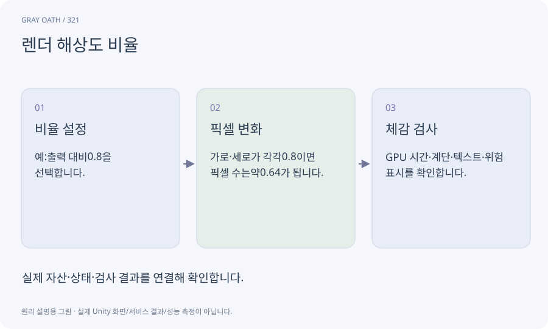

# 렌더 해상도 비율

화면 출력 크기에 비해 내부 렌더링을 어느 비율로 할지 정하는 값입니다. 해상도 비율을 낮추면 픽셀 수는 두 축에 걸쳐 감소하지만 화질도 달라집니다.

## 익숙한 비유

큰 액자에 작은 그림을 확대해 넣는 방식입니다.



## 작동 원리

### 1. 비율 설정

예:출력 대비0.8을 선택합니다.

### 2. 픽셀 변화

가로·세로가 각각0.8이면 픽셀 수는약0.64가 됩니다.

### 3. 체감 검사

GPU 시간·계단·텍스트·위험 표시를 확인합니다.

## 게임 속 예

Android에서0.8을 시험하더라도 UI와 공격 예고가 읽히는지 확인합니다. 픽셀 수 감소와 성능 향상을 같은 비율로 단정하지 않습니다.

## 혼동하지 않기

CPU 병목이면 해상도를 낮춰도 충분한 속도 개선이 없을 수 있습니다.

## 확인 질문

0.5로 줄이면 픽셀 수는 절반인가요?

가로·세로 모두 줄이면 약4분의1입니다. 업스케일 비용과 다른 렌더 작업은 별개입니다.

## 내 프로젝트에서 확인하기

```text
현재 GrayOathRPG3D에서 렌더 해상도 비율을 사용하는 실제 대상과 동작을 읽기 전용으로 확인해 줘. 쉬운 말과 작은 사례로 설명하고 CPU 병목이면 해상도를 낮춰도 충분한 속도 개선이 없을 수 있습니다. 이 문제를 어떻게 막는지 보여 줘. 코드·데이터·설정은 아직 수정하지 마.
```

## 관련 해설

[cpu-gpu](cpu-gpu.md) · [viewport](viewport.md) · [frame-time](frame-time.md)

## 공식 참고

- [Unity · URP performance](https://docs.unity3d.com/6000.3/Documentation/Manual/urp/understand-performance.html)
