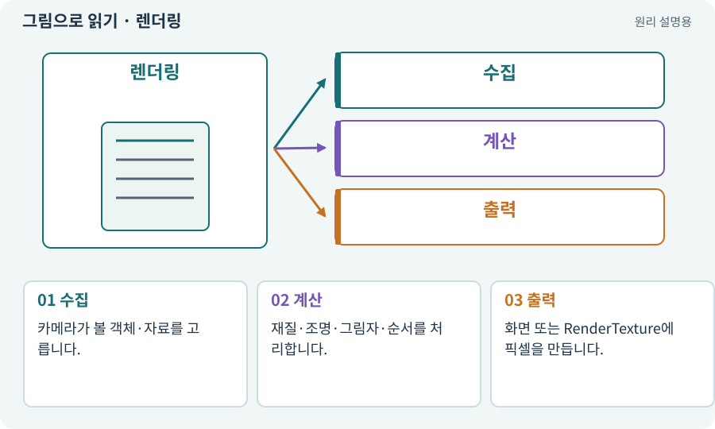

# 렌더링·Renderer

**분야:** 그림·애니메이션·화면 만들기

렌더링은 장면의 자료와 카메라를 바탕으로 최종 화면을 그리는 과정입니다. Renderer 컴포넌트는 어떤 객체를 어떤 자료로 그릴지 렌더 시스템에 제공합니다.

**찾아오는 이름:** 렌더링·Renderer, 렌더링, Rendering, Renderer, 렌더러, MeshRenderer

## 익숙한 것에 비유하면

무대의 실제 소품·배우를 카메라가 한 장의 화면으로 만드는 작업입니다. 소품의 위치와 최종 화면은 같은 데이터가 아닙니다.



개념도입니다. 실제 Unity 화면이나 검사 결과가 아닙니다. 그림의 순서·색은 역할을 구분하며 실제 설정값은 프로젝트에서 확인합니다.

## 이렇게 작동합니다

### 1. 수집

카메라가 볼 객체·자료를 고릅니다.

### 2. 계산

재질·조명·그림자·순서를 처리합니다.

### 3. 출력

화면 또는 RenderTexture에 픽셀을 만듭니다.

## 우리 RPG에서는 이렇게 만나요

스프라이트가 안 보일 때 AI는 비활성·카메라 범위·정렬·알파·재질 등을 조사합니다. 물리 객체가 사라졌다고 바로 판단하지 않습니다.

## 이것과 혼동하지 마세요

Renderer를 끄면 그림만 숨길 수 있습니다. 게임 규칙과 충돌이 자동으로 멈추는 것은 아닙니다.

## 이해했는지 한 번 생각해 보기

투명하게 만든 적이 계속 공격할 수 있나요?

<details><summary>답과 이유</summary>

로직과 Collider가 살아 있다면 가능합니다. 표시와 활성 상태를 구분합니다.

</details>

## 내 프로젝트에서 확인하고 싶다면

아래 요청은 읽기 전용으로 실제 대상을 확인하는 선택 요청입니다. 코드나 설정을 직접 편집할 필요는 없습니다.

```text
현재 프로젝트에서 렌더링·Renderer 관련 요소가 어떻게 사용되는지 읽기 전용으로 확인해 줘. 실제 대상과 설정을 찾아 쉬운 말과 작은 예로 설명해 줘. 특히 다음 혼동을 구분해 줘: Renderer를 끄면 그림만 숨길 수 있습니다. 게임 규칙과 충돌이 자동으로 멈추는 것은 아닙니다. 아직 코드·설정·파일은 바꾸지 말고, 확인할 수 없는 내용은 따로 알려 줘.
```

## 이어지는 개념

[카메라·직교·원근](camera.md) · [Material과 Shader](material.md) · [Sorting Layer·Order·발 정렬](sorting.md) · [컬링·카메라 가림·LOD](culling.md)

## 이 개념을 사용하는 실습

[01 · 빈 2D 프로젝트 만들기](../index.html#lesson-001) · [28 · 여덟 구역의 첫 던전 만들기](../index.html#lesson-028) · [32 · 길 안내와 처음 하는 사람의 동선 만들기](../index.html#lesson-032) · [37 · 느려지는 원인을 측정해 고치기](../index.html#lesson-037) · [44 · 시드로 같은 던전 다시 만들기](../index.html#lesson-044) · [70 · 피격 강조와 보스 예고 셰이더 만들기](../index.html#lesson-070) · [81 · 2D 게임을 남기고 3D 작업 시작하기](../index.html#lesson-081) · [83 · 3D 카메라와 재질로 공간 보기](../index.html#lesson-083) · [84 · 같은 지도를 3D 바닥과 벽으로 만들기](../index.html#lesson-084) · [91 · 보스 예고를 3D 바닥에 맞추기](../index.html#lesson-091) · [94 · 같은 랜덤 던전을 3D로 생성하기](../index.html#lesson-094) · [96 · 3D 카메라 가림과 터치 조작 다듬기](../index.html#lesson-096) · [97 · 선택: 3D 모델에서 2D 시트 만들기](../index.html#lesson-097) · [100 · 두 버전이 같은 게임인지 비교하기](../index.html#lesson-100) · [102 · 네 배포물을 구분해 만들기](../index.html#lesson-102) · [143 · 새 랜덤 지역 봉인된 대장간 만들기](../index.html#lesson-143)

## 참고와 설명의 범위

기본 도구 동작은 아래 공식 자료를 참고했습니다. 비유·그림·RPG의 예시 수치와 정책은 이해를 위한 자체 예제입니다. 실제 API·지원 기능은 설치 버전과 계정에서 확인합니다.

- [Unity · Sprite](https://docs.unity3d.com/6000.3/Documentation/Manual/sprite/sprite-landing.html)

그림·계산 예제·조작 모형은 자체 제작한 설명입니다. 실제 Unity 화면, 서비스 생성 결과, 성능 실측 또는 게임 테스트 결과가 아닙니다. 자료 확인: 2026년 9월 26일.
